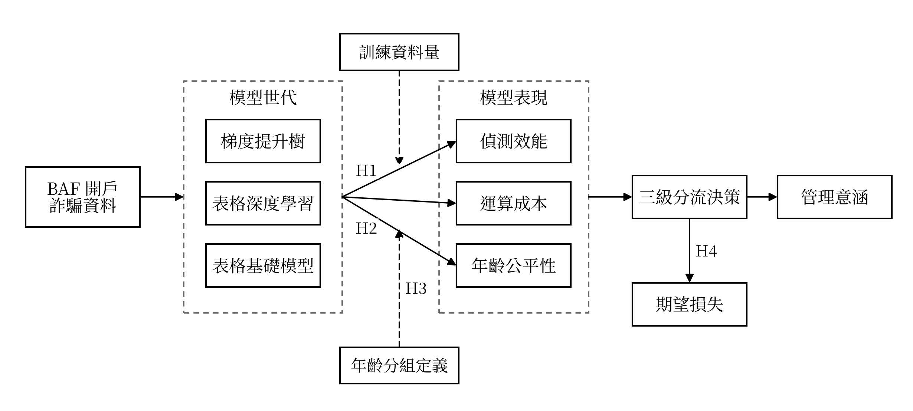
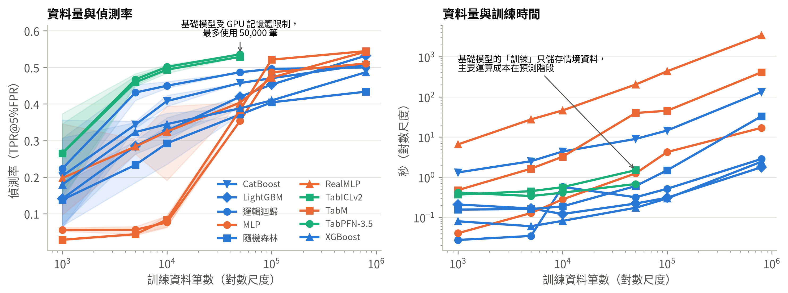
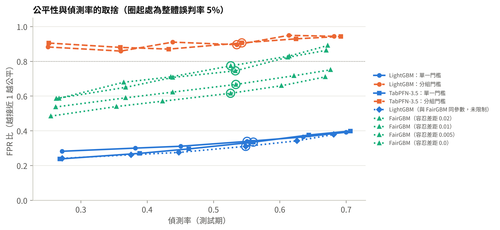
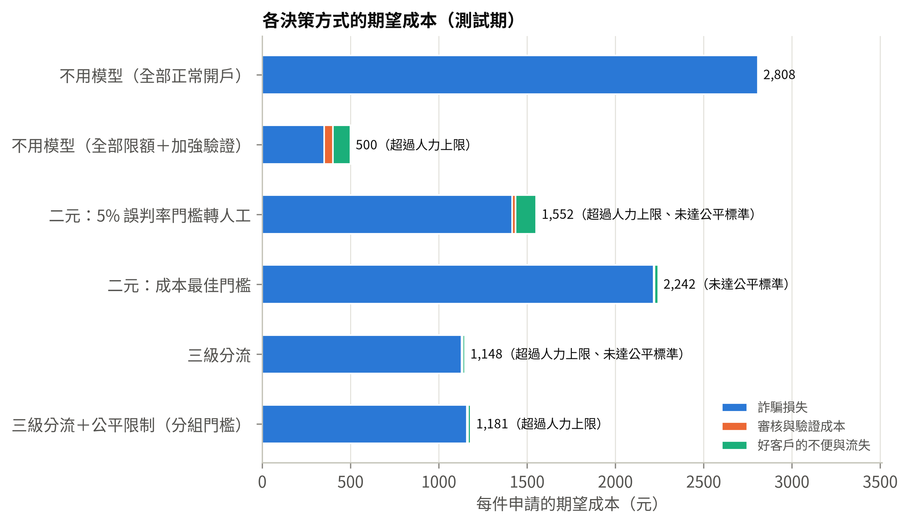
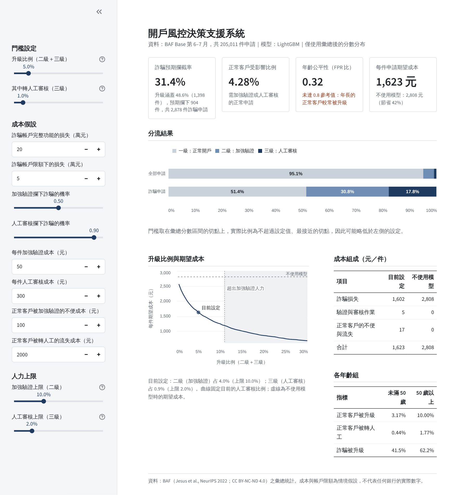

# fair-fraud-detection

**兼顧公平與成本的開戶詐騙三級分流決策：從表格模型比較到決策支援系統**
*Fair and Cost-Aware Three-Tier Decisions for Account-Opening Fraud: From Tabular Model Comparison to Decision Support System*

📄 **報告全文（PDF）：[期中報告.pdf](期中報告.pdf)**

> **Catch Fraud, Not Customers** — 抓詐騙，不誤傷好客戶。

[](https://github.com/rtudvb/fair-fraud-detection/actions/workflows/ci.yml)

商業智慧課程期中報告。以 NeurIPS 2022 的銀行開戶詐騙基準資料集（BAF）為基礎，
先**重現原論文**，再比較三代共十個 AI 模型的**偵測效能、年齡公平性與運算成本**，
最後提出對應台灣數位存款帳戶分類的**三級分流決策模型**，實作為**開戶風控決策支援系統**，並轉化為銀行可執行的管理建議。

報告中的每一張圖、每一張表，都由本專案的程式自動產生；資料自 Kaggle 下載後，主要結果可依指令重現（完整執行需 GPU，約 1–2 個晚上）。

## 研究問題

詐騙集團以人頭帳戶收受詐騙所得，開戶審查是銀行防堵詐騙的第一道關卡（2025 年台灣詐騙財損約 893 億元）。
但審查時，銀行要同時兼顧四件事：**攔截詐騙、不誤傷正常客戶、控制審核成本、公平對待各客群**。



| 假說 | 內容 |
|---|---|
| H1 | 三代模型（梯度提升樹、表格深度學習、表格基礎模型）的偵測效能有差異，且差異隨訓練資料量改變 |
| H2 | 模型對年長申請者的誤判率高於年輕申請者 |
| H3 | 公平性結論會隨年齡分組的切點改變 |
| H4 | 三級分流決策的期望損失低於二元（核准／拒絕）決策 |

## 主要發現

**1. 資料充足時，便宜的梯度提升樹就夠了；資料少時，表格基礎模型明顯領先。**
在約 80 萬筆訓練資料下，三代模型的偵測率差距只有 1–2 個百分點，經調參的梯度提升樹運算成本最低；
但訓練資料只有 1,000–10,000 筆時，TabPFN 與 TabICL 的偵測率明顯高於其他模型——這對資料少的小型銀行特別重要。



**2. 所有模型都對 50 歲以上的正常申請者不公平，但修正的代價很小。**
年長者被誤判為詐騙的機率約為年輕者的 3 倍；以分組門檻處理後，誤判率比可由 0.34 提升至 0.90，偵測率僅降低約 1.6 個百分點。



**3. 「加強驗證＋限額開戶」比「直接拒絕」更划算。**
在相同的人力上限下（加強驗證 10%、人工審核 2%），三級分流的期望損失比最佳的二元決策低 44.8%，
也比原論文的二元決策（需把 6.59% 的申請轉人工審核）低 23.8%；加入公平性限制只多出 3.6% 的成本。
效益主要來自限額帳戶降低了詐騙損失，關鍵在於加強驗證（視訊、電信驗證）的處理能量；
固定門檻上線後的審核量會隨分數分布漂移，需以近期的分數分布換算門檻，才能守住人力上限。



**4. 重現時發現：原論文的年齡分組定義前後不一。**
論文正文以「大於 50 歲」定義年長組，官方的公平性評估程式卻用「50 歲以上」。偵測率在六個資料集都重現成功，
原論文圖中變體資料的誤判率比也只和正文的定義對得上；但變體資料的群體占比與詐騙率比，卻只在「50 歲以上」的分組下符合生成程式的設定。
以這個分組計算，誤判率比低 2 至 3 倍；原論文對變體資料公平性的解讀，仍待以原作者的完整程式確認。
公平性稽核必須先明確定義受保護群體，否則結論可能完全不同。

據此，報告提出分級審核流程、依銀行規模的模型導入策略、公平性稽核與上線漂移監控等管理建議，
並對照金管會《金融業運用人工智慧（AI）指引》與《人工智慧基本法》。

## 方法

| 類別 | 模型 |
|---|---|
| 梯度提升樹與傳統機器學習 | 邏輯迴歸、隨機森林、XGBoost、LightGBM、CatBoost |
| 表格深度學習 | MLP、TabM（ICLR 2025）、RealMLP（NeurIPS 2024） |
| 表格基礎模型 | TabPFN、TabICL |

| 實驗 | 內容 |
|---|---|
| E0 | 探索式資料分析 |
| E1 | 重現 BAF 論文的基準結果 |
| E2–E4 | 三代模型比較（預設參數、同預算調參、學習曲線） |
| E5–E6 | 年齡公平性、切點敏感度、公平性處理（分組門檻、FairGBM） |
| E7 | 三級分流決策：門檻搜尋、成本與參數敏感度分析 |
| E8 | 知識發現：SHAP 與代理決策樹規則萃取 |
| E9 | 上線監控：PSI 資料漂移、模型卡 |
| E10 | 小銀行困境：單獨訓練 vs. 表格基礎模型 vs. 聯合學習（FedAvg） |
| E11 | 開戶風控決策支援系統（Streamlit） |

評估以銀行業常用的「誤判率 5% 下的偵測率」（TPR@5%FPR）為主，依時間切分訓練／驗證／測試資料，
並以拔靴法估計信賴區間。

## 開戶風控決策支援系統

把三級分流決策模型做成給風控主管用的互動網頁（`make app`）：拉動門檻、改成本假設與人力上限，
即時看到預期攔下多少詐騙、誤傷多少好客戶、年齡是否公平，以及每件申請的期望成本；
曲線圖標出升級比例與期望成本的關係，以及加強驗證人力不足的範圍。
只使用模型分數的彙總分布，不含任何個別申請者的資料。



## 工程實作

- **統一的模型介面**：十個模型包成同一個 scikit-learn 介面（`frauddetect.models.build_model`），評估程式只寫一次。
- **可重現**：所有設定集中在 `configs/*.yaml`；每次執行自動記錄硬體、套件版本與 git commit；長時間實驗可中斷續跑。
- **測試與 CI**：88 個單元測試，含假資料的端對端流程測試；GitHub Actions 於每次推送時執行 ruff 與 pytest。
- **報告即程式**：報告以 Quarto 撰寫，`make report` 直接產生 Word 與 PDF，
  並以自寫的後處理腳本套用論文格式（章節編號、三線表、目錄、圖表目錄）。

## 專案結構

```
fair-fraud-detection/
├── src/frauddetect/          核心程式（可匯入、可測試）
│   ├── data/                 資料下載、欄位驗證、時間切分
│   ├── models/               十個模型的統一介面、前處理、超參數搜尋
│   ├── evaluation/           效能指標、公平性指標、拔靴法檢定
│   ├── decision/             三級分流決策模型
│   ├── explain/              SHAP 與代理模型規則萃取
│   ├── monitoring/           PSI 資料漂移監控
│   ├── federated/            小銀行模擬與聯合學習（FedAvg）
│   ├── experiments/          實驗 E0–E11 的執行程式
│   ├── viz/                  統一的圖表風格
│   └── cli.py                命令列介面
├── configs/                  實驗設定（模型參數、成本假設、資料切分）
├── tests/                    單元測試
├── reports/paper/            報告原始檔（Quarto）、圖表與參考文獻
├── app/                      開戶風控決策支援系統（Streamlit）
├── docs/                     研究計畫書、實驗手冊、環境建置說明
├── data/                     資料（不進版控，見 data/README.md）
└── Makefile                  一鍵執行的指令
```

## 快速開始

```bash
python -m venv .venv && source .venv/bin/activate
make install-all      # 全部套件（GPU 環境）；只要核心功能用 make install
make test             # 單元測試（不需要真實資料）
make pipeline-check   # 所有實驗用假資料跑一次（數分鐘）

make data             # 從 Kaggle 下載 BAF（需 Kaggle API token，見 data/README.md）
make experiments      # 跑 E0–E11（約 1–2 個晚上；建議在 tmux 裡）
make report           # 產生報告（Word 與 PDF）
make app              # 開啟開戶風控決策支援系統
```

每個實驗的指令、產出與建議順序見 [`docs/experiments.md`](docs/experiments.md)；
從零開始的環境建置見 [`docs/compute.md`](docs/compute.md)。
實驗在 Windows + WSL2 的桌機上執行（Intel Core i7-12700、64 GB 記憶體、NVIDIA GeForce RTX 2080 Ti 11 GB）。

## 資料與授權

- **BAF 資料集**：Jesus et al. (2022)，授權 CC BY-NC-ND 4.0。本 repo 不包含任何原始資料或逐筆預測結果，只有彙總後的圖表。
- **TabPFN 權重**：非商業授權，僅用於學術研究。
- **三級分流模型中的成本與限額**為情境模擬的假設值，不代表任何銀行的真實數字。
- 本專案使用生成式 AI 工具（Claude）輔助程式撰寫與測試、文獻檢索、圖表統整，以及報告初稿的撰寫；研究方向、實驗執行、結果判讀，以及報告的審閱（含文獻驗證）與定稿由作者負責。
