<!--
撰寫說明（不會出現在輸出中）
- 結構依 docs/proposal.md §8；每章標「待撰寫」處由作者以自己的話完成。
- 圖表一律由程式產生到 figures/ 與 tables/，在這裡引用，不手動貼數字：
    {#fig-名稱 width=90%}
    文中引用：如 @fig-名稱 所示
- 引用文獻：[@jesus2022turning]；多篇：[@chen2016xgboost; @ke2017lightgbm]
- 計畫書的表 A／B／C 依序對應 @tbl-contributions、@tbl-gap、@tbl-vs-paper，加上結論總表，各放一處不重複。
  @tbl-gap 只列真正讀過的文獻。
-->

::: {custom-style="RepoLink"}
程式碼與完整實驗紀錄：<https://github.com/rtudvb/fair-fraud-detection>

本報告所有圖表皆由上述專案的程式自動產生，可完整重現（見附錄 A）
:::

# 摘要 {.unnumbered}

詐騙集團以人頭帳戶收受與移轉詐騙所得，使開戶審查成為銀行防堵詐騙的第一道關卡；然而審查時，銀行必須同時兼顧攔截詐騙、不誤傷正常客戶、控制審核成本與公平對待各客群。本研究以 NeurIPS 2022 發表的銀行開戶詐騙資料集（BAF）為基礎，在重現原論文的發現後，比較梯度提升樹、表格深度學習與表格基礎模型三代共十個模型的偵測效能、年齡公平性與運算成本，並以三支決策為理論基礎，提出對應台灣數位存款帳戶分類的三級分流決策模型。研究結果顯示：第一，在資料充足時，三代模型的偵測率差距僅 1 至 2 個百分點，經調參的梯度提升樹成本最低；資料較少時，表格基礎模型則明顯領先。第二，所有模型對 50 歲以上的正常申請者皆不公平，其誤判率約為較年輕者的 3 倍；以分組門檻處理後，誤判率比可由 0.34 提升至 0.90，偵測率僅降低約 1.6 個百分點。第三，以「限額開戶並加強驗證」取代直接拒絕的三級分流，在相同的人力限制下，期望損失較原論文的二元決策低 26%，加入公平性限制僅增加約 3% 的成本，而其效益主要取決於加強驗證的處理能量。本研究據此提出分級審核流程、模型導入策略、公平性稽核與上線監控等管理建議，並對照金管會的 AI 指引與《人工智慧基本法》。

**關鍵字**：開戶詐騙偵測、表格基礎模型、演算法公平性、成本敏感決策、三支決策

# Abstract {.unnumbered}

Fraud rings move their proceeds through money-mule accounts, which makes account opening a bank's first line of defence. At this stage, banks must catch fraudulent applications while avoiding harm to legitimate customers, keeping review costs under control and treating customer groups fairly. Building on the Bank Account Fraud (BAF) dataset published at NeurIPS 2022, this study first reproduces the original findings and then compares ten models from three generations, namely gradient-boosted trees, tabular deep learning and tabular foundation models, in terms of detection performance, age fairness and computational cost. Grounded in three-way decision theory, it further proposes a three-tier decision model mapped to Taiwan's classes of digital deposit accounts. The results show, first, that with ample data the three generations differ by only one to two percentage points in detection rate and tuned gradient-boosted trees are the cheapest, whereas tabular foundation models lead clearly when data are scarce. Second, every model is unfair to legitimate applicants aged 50 and above, who are wrongly flagged about three times as often as younger applicants; group-specific thresholds raise the false-positive-rate ratio from 0.34 to 0.90 at a cost of about 1.6 percentage points in detection. Third, replacing outright rejection with a limited account plus enhanced verification lowers the expected loss by 26% relative to the original paper's binary policy under the same staffing limits; adding a fairness constraint raises the cost by only about 3%, and the benefit depends mainly on the capacity for enhanced verification. Based on these findings, the study offers managerial recommendations on tiered review, model adoption, fairness auditing and post-deployment monitoring, and relates them to Taiwan's FSC guidelines on AI and the AI Basic Act.

**Keywords**: account-opening fraud detection, tabular foundation models, algorithmic fairness,
cost-sensitive decision making, three-way decisions

```{=typst}
#heading(level: 1, numbering: none, outlined: false)[目錄]
#outline(title: none, depth: 2, indent: auto)
#heading(level: 1, numbering: none, outlined: false)[圖目錄]
#outline(title: none, target: figure.where(kind: "quarto-float-fig"))
#heading(level: 1, numbering: none, outlined: false)[表目錄]
#outline(title: none, target: figure.where(kind: "quarto-float-tbl"))
```

```{=openxml}
<w:p><w:pPr><w:pStyle w:val="FrontMatterHeading"/></w:pPr><w:r><w:t>目錄</w:t></w:r></w:p>
<w:p><w:r><w:fldChar w:fldCharType="begin" w:dirty="true"/></w:r><w:r><w:instrText xml:space="preserve"> TOC \o "1-2" \h \z \u </w:instrText></w:r><w:r><w:fldChar w:fldCharType="separate"/></w:r><w:r><w:t>（請在 Word 中按 F9 更新）</w:t></w:r><w:r><w:fldChar w:fldCharType="end"/></w:r></w:p>
<w:p><w:pPr><w:pStyle w:val="FrontMatterHeading"/></w:pPr><w:r><w:t>圖目錄</w:t></w:r></w:p>
<w:p><w:r><w:fldChar w:fldCharType="begin" w:dirty="true"/></w:r><w:r><w:instrText xml:space="preserve"> TOC \h \z \t "Image Caption,1" </w:instrText></w:r><w:r><w:fldChar w:fldCharType="separate"/></w:r><w:r><w:t>（請在 Word 中按 F9 更新）</w:t></w:r><w:r><w:fldChar w:fldCharType="end"/></w:r></w:p>
<w:p><w:pPr><w:pStyle w:val="FrontMatterHeading"/></w:pPr><w:r><w:t>表目錄</w:t></w:r></w:p>
<w:p><w:r><w:fldChar w:fldCharType="begin" w:dirty="true"/></w:r><w:r><w:instrText xml:space="preserve"> TOC \h \z \t "Table Caption,1" </w:instrText></w:r><w:r><w:fldChar w:fldCharType="separate"/></w:r><w:r><w:t>（請在 Word 中按 F9 更新）</w:t></w:r><w:r><w:fldChar w:fldCharType="end"/></w:r></w:p>
```

# 緒論

## 研究背景與動機

### 開戶審查：銀行防堵人頭帳戶的第一道關卡

詐騙已是台灣社會最受關注的治安與金融問題之一。依警政署 165 打詐儀表板的統計，2025 年全年詐騙案件受理約 16.2 萬件，財損金額達 893.26 億元[（今周刊，2026）]{.cite}。詐騙所得必須經由銀行帳戶移轉，人頭帳戶因此成為詐騙金流的關鍵環節；而隨著數位存款帳戶普及，民眾不必臨櫃即可開戶，「開戶審查」便成為銀行攔阻人頭帳戶的第一道關卡。

2025 年的自然人憑證事件，凸顯了開戶審查在管理上的難題。部分民眾受騙交出自然人憑證，遭詐騙集團用於線上開立數位存款帳戶，一度有 17 家銀行暫停受理以自然人憑證線上開戶；金融監督管理委員會（以下簡稱金管會）要求銀行依風險基礎強化身分驗證後恢復受理，銀行多改為搭配他行存款帳戶驗證、視訊或電信認證，至同年 9 月底已有 16 家恢復[（ETtoday財經雲，2025）]{.cite}。全面暫停雖能止血，卻也讓正常客戶無法開戶；恢復受理則必須回答「哪些申請需要加強驗證」。換言之，開戶審查需要依申請者的風險高低採取不同強度的處置，而不只是「通過」與「拒絕」兩種選擇。

### 銀行面對的三方取捨

銀行導入人工智慧（artificial intelligence, AI）偵測可疑帳戶，雖提升了攔阻效率，也帶來誤判的代價。立法委員於立法院財政委員會質詢 AI 打詐造成正常民眾帳戶遭誤鎖、影響薪資轉帳與日常扣款等問題，金管會隨後要求銀行提升模型精準度，並提供 24 小時解除管控的服務[（優分析，2025）]{.cite}。由此可見，銀行在開戶審查上同時面對三個彼此牽制的目標（@tbl-tradeoffs）：審查越嚴，越能攔下詐騙，但也越容易誤擋正常客戶、增加人工審核的負擔；審查越鬆，客戶體驗與成本較佳，卻可能放行人頭帳戶。此外，若誤判集中於特定客群，還會衍生公平性與法規風險。

| 管理目標 | 未達成時的後果 | 主要承擔者 |
|:------------|:------------------------------|:----------------|
| 攔截詐騙開戶 | 人頭帳戶被用於收受詐騙款項，造成民眾財損，銀行面臨聲譽與監理壓力 | 被害民眾、銀行 |
| 不誤傷正常客戶 | 正常客戶開戶受阻或帳戶遭誤鎖，造成不便、客訴與客戶流失 | 正常客戶、銀行 |
| 控制審核成本 | 轉人工審核的案件過多，人力負擔與開戶等待時間增加 | 銀行 |
| 公平對待各客群 | 特定年齡客群被誤判的比例偏高，違反公平原則並引發法規風險 | 特定客群、銀行 |

: 開戶審查的管理目標與取捨 {#tbl-tradeoffs}

### 法規要求公平與可解釋

在法規面，公平性與可解釋性已從倫理原則走向制度要求。金管會於 2024 年發布《金融業運用人工智慧（AI）指引》，要求金融機構運用 AI 時應盡可能避免演算法偏見所造成的不公平[（金融監督管理委員會，2024）]{.cite}；立法院於 2025 年 12 月 23 日三讀通過《人工智慧基本法》，並於 2026 年 1 月 14 日公布施行，明定政府推動 AI 研發與應用應遵循「公平與不歧視」「透明與可解釋」等七項原則[（人工智慧基本法，2026）]{.cite}。然而，詐騙偵測模型是否公平，過去較少受到檢驗。@jesus2022turning 於 NeurIPS 2022 發表銀行開戶詐騙基準資料集（Bank Account Fraud，以下簡稱 BAF），其實驗發現：在誤判率固定為 5% 的操作點下，表現最佳的 LightGBM 模型在年齡組間的誤判率比（FPR 比）僅約 0.3，亦即年長的正常申請者（論文以 50 歲為分界）被誤判為詐騙的機率，是較年輕申請者的三倍以上。對銀行而言，這代表一個「最準」的模型，可能正是一個需要被稽核的模型。

### 新一代 AI 模型帶來的導入決策

在技術面，銀行可選擇的工具也在快速變化。表格資料的預測長期由梯度提升樹（gradient boosted decision trees, GBDT）主導 [@grinsztajn2022tree]；近年則出現新一代的表格深度學習模型，如 TabM [@gorishniy2025tabm] 與 RealMLP [@holzmuller2024better]，以及在大量合成資料上預訓練、可直接對新資料集進行預測的表格基礎模型（tabular foundation models），如發表於 *Nature* 的 TabPFN [@hollmann2025accurate]，以及 2026 年發表的 TabPFN-3.5 [@jaeger2026tabpfn35] 與 TabICLv2 [@qu2026tabiclv2]。大型評比 TabArena 指出，GBDT 在實務表格資料上仍具競爭力，而基礎模型在較小的資料集上表現特別突出 [@erickson2025tabarena]；但這些新模型在高風險決策中是否同樣公平仍無定論，@liu2026causal 對 TabPFN 的實證研究即發現，其公平性改善有限且不穩定。對銀行而言，問題不在於哪個模型分數最高，而在於「是否值得導入」：新模型帶來的偵測效益，是否足以抵銷其運算成本與潛在的公平性風險？資料較少的中小型銀行，又該如何取得足夠的偵測能力？產業界已開始探索跨行合作，2026 年 8 月，由台北富邦銀行領銜的 8 家銀行公布以聯合學習（federated learning）共同訓練防詐模型的驗證結果，在不交換原始資料的前提下，整體警示帳戶辨識精確率提升約兩倍[（中央通訊社，2026）]{.cite}。

### 研究缺口與動機

綜合上述，現有研究與實務之間存在落差。BAF 的原作者僅以未考慮公平性的 LightGBM 建立基準，並明確鼓勵後續研究嘗試具公平性考量的方法 [@jesus2022turning]；而新一代模型在極度不平衡（詐騙約占 1%）、資料分布隨時間變化的詐騙情境中，其效能、公平與成本之間的取捨，以及如何將模型分數轉化為符合台灣制度、兼顧審核人力與公平性的開戶決策，據我們所知尚少研究探討。本研究即以此為動機，站在銀行管理者的角度，以 BAF 為基礎評估三代 AI 模型的導入價值，並提出對應台灣數位存款帳戶分類的三級分流審查機制。

## 研究目的

本研究的核心目的，是協助銀行在開戶審查中，於「攔截詐騙」「不誤傷正常客戶」「控制審核成本」與「公平對待各客群」之間做出有依據的決策。具體而言，本研究期望回答以下管理問題，並提供對應的決策工具：

1. 導入決策：評估傳統機器學習、從頭訓練的深度學習與預訓練表格基礎模型三類共十個模型的偵測效益、公平性與運算成本，作為銀行選擇與導入 AI 模型的依據；
2. 公平性稽核：檢驗模型是否對特定年齡客群較不公平，並量化改善公平性所需付出的偵測率代價，作為法規遵循與內部稽核的參考；
3. 審查流程設計：提出三級分流決策模型，將模型的風險分數轉化為「正常開戶、限額開戶並加強驗證、人工審核」三種處置，並在審核人力與公平性的限制下使預期損失最小；
4. 風控知識萃取：從模型中萃取最能預警詐騙開戶的特徵，轉換為風控人員可直接使用的規則；
5. 管理建議：綜合上述結果，提出分級審核流程、公平性稽核、上線監控與法規對照等可落地的建議。

為確保上述分析建立在可信的基礎上，本研究亦獨立重現 BAF 論文的基準實驗，確認實驗結果與原論文一致後，再進行延伸分析。

## 研究問題

依據上述研究目的，本研究提出六個研究問題（@tbl-rq），並說明各問題所對應的管理意涵。其中 RQ1 至 RQ5 為核心問題，RQ6 為延伸問題；各問題對應的研究假說於第三章說明。

| 研究問題 | 內容 | 管理意涵 |
|:----------------|:-----------------------------|:--------------------|
| RQ1 重現 | 能否重現 BAF 論文的基準發現？ | 確認分析基礎可信 |
| RQ2 三代模型 | 傳統機器學習、深度學習、基礎模型，何者最適合詐騙偵測？代價為何？ | 是否值得導入新一代 AI 模型 |
| RQ3 年齡公平性 | 模型是否對年長者不公平？公平性處理的代價為何？結論是否隨年齡切點改變？ | 公平性稽核與法規遵循 |
| RQ4 三級分流決策 | 在公平與審核人力限制下，如何設定三級分流門檻使期望損失最小？ | 開戶審查流程與門檻設計 |
| RQ5 知識發現 | 哪些特徵最能預警詐騙開戶？能轉成哪些風控規則？ | 風控規則與人員訓練 |
| RQ6 小銀行困境（延伸） | 資料較少的銀行該採用基礎模型，還是加入跨行聯合學習？ | 中小型銀行的策略選擇 |

: 研究問題與管理意涵 {#tbl-rq}

## 研究貢獻

本研究的貢獻有三，分別對應管理實務與學術研究（@tbl-contributions）。

| 貢獻 | 內容 | 對管理實務 | 對學術研究 | 對應 |
|:----|:--------------|:-------------------|:-------------------|:----------|
| 一 | 三級分流決策模型 | 提供兼顧損失、人力與公平的開戶審查機制，以「限額開戶並加強驗證」取代直接拒絕 | 將三支決策結合台灣數位帳戶制度，並納入公平與人力限制 | RQ4 |
| 二 | 三代 AI 模型的導入評估 | 提供選擇與導入模型時，偵測效益、公平性與成本的比較依據 | 在極度不平衡、隨時間變化的詐騙情境中，同時評估三代模型的效能、公平與成本 | RQ2、RQ3 |
| 三 | 公平性結論的穩健性 | 提醒銀行稽核公平性時須明確定義分組方式 | 發現原論文年齡分組定義不一致，並進行切點敏感度分析 | RQ1、RQ3 |

: 研究貢獻 {#tbl-contributions}

第一，本研究的主要貢獻在於開戶審查的決策設計。本研究以三支決策（three-way decisions）[@yao2010threeway] 為理論基礎，將模型分數對應到台灣數位存款帳戶的分類，於中間一級以「限額開戶並加強驗證」取代直接拒絕，並在審核人力與年齡公平的限制下最小化預期損失，使模型的預測結果能直接轉化為銀行的審查流程。第二，本研究將 2024 至 2026 年間發表的表格深度學習與基礎模型，置於詐騙偵測這一極度不平衡且資料隨時間變化的高風險情境中，同時檢驗其效能、公平與成本，為銀行的導入決策提供依據；據我們所知，目前尚少研究在此情境下進行三者並重的比較。第三，本研究在重現過程中發現，BAF 論文正文以「年齡大於 50 歲」劃分年長組，而官方程式碼則以「50 歲以上」劃分；由於 BAF 的年齡以 10 歲為一級，兩者會使 50 歲這一級被歸入不同組別。本研究據此分析公平性結論對年齡切點的敏感度，提醒銀行在進行公平性稽核時，分組定義本身即可能影響結論。

## 研究範圍與限制

本研究的範圍如下。第一，研究對象為銀行線上開戶申請階段的詐騙偵測與審查決策，不包含開戶之後的交易監控，因此無法涵蓋既有帳戶轉為人頭帳戶的情形。第二，資料以 BAF 的基礎資料集（Base）為主，重現實驗另涵蓋其五個變體。第三，BAF 提供年齡、收入與就業狀態三個可作為受保護屬性的欄位，本研究與原論文一致，聚焦於年齡。

本研究的限制如下。第一，BAF 是以真實、匿名化的銀行開戶資料經生成模型合成的資料，且並非台灣的資料；因此本研究與台灣數位存款帳戶制度的對應屬於情境模擬，研究發現不宜直接套用於特定銀行。第二，三級分流決策模型中的損失與成本參數為假設值，本研究以敏感度分析檢驗結論是否依賴特定數值，實際導入時應以銀行自身的數據校正。第三，受限於 GPU 記憶體，表格基礎模型在部分實驗中以分層抽樣的訓練子集進行。第四，BAF 僅涵蓋 8 個月的申請資料，難以觀察更長期的分布變化。

## 研究流程

本研究的流程如下（@fig-research-flow）：第一章說明研究背景、目的、問題與貢獻；第二章回顧詐騙偵測、不平衡學習、表格資料模型、演算法公平性、可解釋 AI、三支決策與聯合學習的相關文獻，並歸納研究缺口；第三章說明研究架構、資料、模型、評估指標、三級分流決策模型與實驗設計；第四章依六個研究問題報告實驗結果；第五章將結果轉化為管理意涵與建議；第六章總結研究結論、限制與未來研究方向。

{#fig-research-flow width=85%}

# 文獻探討

本章回顧與本研究相關的文獻：2.1 節說明金融詐騙與人頭帳戶偵測的研究脈絡與資料集；2.2 節討論不平衡資料與成本敏感學習；2.3 節整理表格資料模型從梯度提升樹、表格深度學習到表格基礎模型的發展；2.4 節回顧演算法公平性的定義與處理方法；2.5 節介紹可解釋人工智慧與三支決策；2.6 節說明聯合學習在跨機構防詐的應用；2.7 節歸納研究缺口。

## 金融詐騙與人頭帳戶偵測

詐騙偵測是資料探勘最早的應用領域之一。@bolton2002statistical 回顧統計方法在信用卡、電信與洗錢等詐騙偵測上的應用，將方法區分為以已標記樣本訓練的監督式方法，以及偵測異常行為的非監督式方法，並討論詐騙者會隨偵測手段調整行為等挑戰。@dalpozzolo2018credit 從實務運作的角度指出，信用卡詐騙偵測系統須面對資料分布隨時間改變的概念漂移（concept drift）、交易須經查核才能取得標籤的驗證延遲，以及調查人員每日僅能查核有限警示等限制，因此評估模型時應重視最前段警示的精確度，而非整體正確率。這些特性同樣存在於開戶詐騙偵測：詐騙申請占比低、手法隨時間改變，而審核人力有限。

近年的系統性文獻回顧顯示，此領域已由傳統統計與機器學習方法擴展至深度學習。@chen2025fraudslr 以 Kitchenham 的系統性文獻回顧方法，分析 2019 至 2024 年間 57 篇以深度學習進行金融詐騙偵測的研究；@jerialvarado2025banking 回顧 2019 至 2025 年間 61 篇銀行業以機器學習偵測詐騙的期刊論文，並指出模型之間的比較，以及尚未涵蓋的銀行業務情境，仍有待後續研究。

在人頭帳戶方面，@zhang2026mule 提出新加坡華僑銀行（OCBC）的人頭帳戶偵測流程：先以 LightGBM 對 280 個特徵建模，再以 TreeSHAP 拆解每筆預測的特徵貢獻，最後由大型語言模型生成供調查人員閱讀的說明。該系統上線後，警示的有效率（yield rate）由原本規則式系統的 61% 提升至 89%。此研究顯示，梯度提升樹搭配特徵歸因，已是銀行防制人頭帳戶的實務做法。

開戶詐騙的公開研究長期受限於資料取得，因為銀行資料涉及個人隱私而難以公開。@jesus2022turning 因此發表 BAF 資料集：以真實、匿名化的銀行開戶資料訓練生成模型，合成六個各含一百萬筆申請紀錄、涵蓋八個月的資料集；除基準資料集外，其餘五個變體刻意注入不同型態的偏差，可用於檢驗模型在偏差、極度不平衡（詐騙約占 1%）與資料隨時間變化下的表現。同一研究團隊後續以 BAF 為基礎發表 FiFAR 資料集，加入 50 位模擬詐騙分析師的判斷與人工審查容量的限制，用於研究模型何時應將案件轉交人工審查（learning to defer）[@alves2023fifar]。BAF 的設計貼近本研究關注的問題，因此本研究以其作為實驗資料（詳見第三章）。

## 不平衡資料與成本敏感學習

當某一類別的樣本遠少於另一類別時，以整體正確率為目標的分類器會傾向預測多數類別。@he2009learning 回顧此類不平衡學習問題，將對策歸納為抽樣方法、成本敏感方法、核方法與主動學習等類型，並指出正確率在此情境下具有誤導性，應改以 ROC 曲線、精確率—召回率曲線等方式評估。抽樣方法中最具代表性者為 SMOTE [@chawla2002smote]，以在少數類別樣本之間內插的方式合成新樣本。

成本敏感學習則直接將不同錯誤的代價納入決策。@elkan2001foundations 指出，當模型輸出的機率經過校準時，最小化期望成本的決策只需調整分類門檻：若將正常申請誤判為詐騙的成本為 $c_{FP}$、漏判詐騙的成本為 $c_{FN}$，且正確判斷的成本為零，則應在詐騙機率 $p \geq c_{FP}/(c_{FP}+c_{FN})$ 時判定為詐騙。換言之，成本的差異可以透過門檻反映，不一定需要改變訓練資料的分布。

在詐騙偵測實務中，誤判成本往往不易精確量化，因此常改以限制誤判率的方式設定操作點。BAF 論文即以「誤判率（false positive rate, FPR）為 5% 時的偵測率（true positive rate, TPR）」作為主要指標，對應銀行限制正常客戶遭誤擋比例的考量 [@jesus2022turning]。本研究沿用此指標以便與原論文比較，並在三級分流決策中進一步納入成本與審核人力的限制（第三章）。

## 表格資料模型：從梯度提升樹到基礎模型

### 梯度提升樹

梯度提升樹（gradient boosted decision trees, GBDT）以逐步加入決策樹的方式修正前一階段的誤差，是表格資料最常用的模型。XGBoost 以正規化的目標函數與可處理稀疏資料的分裂演算法，使梯度提升可擴展至大規模資料 [@chen2016xgboost]；LightGBM 提出以梯度為基礎的單邊抽樣（GOSS）與互斥特徵綁定（EFB），大幅縮短訓練時間 [@ke2017lightgbm]；CatBoost 則以有序提升（ordered boosting）與類別特徵的有序目標統計，緩解預測偏移（prediction shift）的問題 [@prokhorenkova2018catboost]。BAF 論文的基準模型即為 LightGBM [@jesus2022turning]。

@grinsztajn2022tree 以 45 個中型資料集（約一萬筆樣本）比較樹模型與深度學習，發現樹模型仍明顯較佳，並將原因歸納為三項：神經網路傾向學習過度平滑的函數、容易受無資訊特徵影響，以及其旋轉不變性與表格資料的特性不符。

### 表格深度學習

為縮小與樹模型的差距，近年的表格深度學習研究轉向改良多層感知器（multilayer perceptron, MLP）。@holzmuller2024better 提出 RealMLP，並以 118 個資料集調校 GBDT 與 RealMLP 的預設超參數、再以另外 90 個資料集驗證，發現在中大型資料集上，RealMLP 的時間與準確度取捨優於其他神經網路，且與 GBDT 相當；經調校的預設參數也使模型不需逐一調參即有良好表現。@gorishniy2025tabm 提出 TabM，以參數高效的集成方式（基於 BatchEnsemble）讓單一 MLP 同時輸出多組預測；這些隱含的子模型共享大部分參數，在效能與效率上優於傳統的深度集成，且研究顯示注意力或檢索式架構所增加的複雜度並未帶來相應的效益。

### 表格基礎模型

@vanbreugel2024position 主張，相較於文字與影像，表格資料的基礎模型研究明顯不足，應列為研究優先方向。表格基礎模型的代表為 TabPFN：@hollmann2025accurate 以大量由結構因果模型生成的合成資料集預訓練 Transformer，使其能以情境學習（in-context learning）的方式，在一次前向傳遞中對新資料集進行預測，不需針對資料集訓練；在一萬筆樣本以內的資料集上，其表現優於經四小時調參的強基準模型集成。

早期的表格基礎模型受限於可處理的資料量。2026 年發表的新一代模型大幅提升了規模：TabPFN-3.5 的技術報告指出其可處理多達一百萬筆訓練資料，且在 TabArena 評比上明顯優於前一代 TabPFN-3 [@jaeger2026tabpfn35]；TabICLv2 以新的合成資料生成引擎、可擴展的 softmax 注意力與 Muon 最佳化器進行預訓練，在不調參的情況下即超越經調參、集成並以真實資料微調的 RealTabPFN-2.5，並能在 50 GB 以內的 GPU 記憶體處理百萬筆規模的資料 [@qu2026tabiclv2]。由於 BAF 單一資料集即有一百萬筆，新一代基礎模型的規模擴展，使其得以在完整規模的詐騙資料上與梯度提升樹比較。

### 大型評比

為公平比較上述模型，@erickson2025tabarena 建立持續更新的表格資料評比 TabArena，在預設參數、調參與集成三種情境下評估模型。結果顯示 GBDT 在實務表格資料上仍具競爭力，而基礎模型在較小的資料集上表現特別突出；由於部分基礎模型無法處理所有資料集，其僅在適用的資料集子集上評估。@tbl-model-generations 整理三代表格模型的特性。

| 世代 | 代表模型 | 學習方式 | 主要優勢 | 主要限制 |
|:-----------|:----------------|:----------------|:-------------------|:-------------------|
| 梯度提升樹 | XGBoost、LightGBM、CatBoost | 針對每個資料集從頭訓練決策樹集成 | 訓練快、不受特徵尺度影響、可用 TreeSHAP 精確解釋 | 需調參；不具跨資料集的先驗知識 |
| 深度學習 | TabM、RealMLP | 針對每個資料集從頭訓練神經網路 | 可用 GPU 加速、易與其他神經網路模組結合 | 需前處理與調參；訓練成本較高 |
| 基礎模型 | TabPFN-3.5、TabICLv2 | 以合成資料預訓練，對新資料集進行情境學習 | 不需調參即有強表現；小資料集優勢明顯 | 推論成本高；大型資料常需抽樣；部分模型權重限非商業使用 |

: 三代表格模型比較 {#tbl-model-generations}

然而，上述評比多以整體預測指標衡量模型，較少在極度不平衡且資料隨時間變化的詐騙情境中，以固定誤判率下的偵測率進行比較，也未同時檢驗模型的公平性與決策成本。

## 演算法公平性

### 公平性的定義

群體公平性多以模型在不同群體間的錯誤率或預測結果是否一致來衡量。@hardt2016equality 提出「均等勝算」（equalized odds），要求各群體的真陽性率與偽陽性率皆相等，以及僅要求真陽性率相等的「機會均等」（equal opportunity），並說明可透過對各群體設定不同門檻的後處理方式達成。在詐騙偵測中，偽陽性代表正常客戶被誤認為詐騙而遭拒絕或加強審查，因此 BAF 以年齡組間偽陽性率的比值衡量公平性，比值越接近 1 越公平 [@jesus2022turning]。以各群體偽陽性率相等為目標的定義，又稱為預測均等（predictive equality）[@corbettdavies2017algorithmic]。

不同的公平性定義往往無法同時成立。@chouldechova2017fair 證明，當各群體的基本率（base rate）不同時，各群體陽性預測值相等的預測工具，無法同時使各群體的偽陽性率與偽陰性率相等；@kleinberg2017inherent 也證明，除了完美預測或各群體基本率相同等特殊情況外，群體內校準與錯誤率平衡等條件無法同時滿足。因此，實務上須依應用情境選擇公平性定義，並揭露其與效能之間的取捨。

### 公平性的處理方法

公平性處理方法依介入的時點，可分為調整訓練資料的前處理、在訓練中加入限制的訓練中處理，以及調整模型輸出的後處理三類。後處理方法如前述的群體門檻調整 [@hardt2016equality]，不需改變模型本身。訓練中處理方面，@cruz2023fairgbm 提出 FairGBM，以可微分的錯誤率代理函數與代理拉格朗日（proxy-Lagrangian）方法，在梯度提升樹的訓練中加入公平性限制，其訓練時間較相關方法快約一個數量級，且對預測效能的影響很小。值得注意的是，FairGBM 的實證案例即為銀行開戶詐騙資料：在逾 50 萬筆、詐騙約占 1% 的開戶申請中，以年齡組間的偽陽性率相等為公平性目標，與本研究的設定一致。

在金融領域，@hurlin2026fairness 針對信用評分模型提出正式的公平性檢定方法，找出造成不公平的變數，並據以改善公平與效能之間的取捨。對於新興的表格基礎模型，@liu2026causal 檢驗 TabPFN 的效能、公平性與穩健性，發現其預測準確度較高且對虛假相關較穩健，但公平性的改善幅度有限且不一致，在資料非隨機缺失（missing not at random, MNAR）的共變量偏移下尤其明顯；作者因此認為因果預訓練本身不足以確保公平，部署時仍需額外的公平性處理。

## 可解釋人工智慧與三支決策

### 可解釋人工智慧

金融業運用 AI 須能說明決策的理由。SHAP [@lundberg2017unified] 以合作賽局中的 Shapley 值，將單筆預測分解為各特徵的貢獻，並證明其為同時滿足局部準確性、缺失性與一致性的唯一加法式特徵歸因方法。@lundberg2020local 進一步提出 TreeExplainer，可在多項式時間內精確計算樹模型的 Shapley 值，並將大量的局部解釋彙整為對模型整體行為的理解；前述 @zhang2026mule 的人頭帳戶偵測系統即採用此方法。另一方面，@rudin2019stop 主張在高風險決策中，應優先採用本身即可解釋的模型，而非事後解釋黑箱模型。本研究兼採兩種觀點：以 SHAP 解釋模型，並以決策樹將模型行為萃取為可直接檢視的風控規則（RQ5）。

### 三支決策

傳統的二元分類只有「接受」與「拒絕」兩種結果。@yao2010threeway 以機率粗糙集（probabilistic rough sets）為基礎提出三支決策，依樣本屬於某一概念的條件機率，將其分為正域、負域與邊界域，分別對應接受、拒絕與延遲決策；兩個門檻 $(\alpha, \beta)$ 可依貝氏決策理論，由各種決策的損失函數推導而得，使期望損失最小。邊界域代表資訊不足、需要進一步查核的案件，恰好對應開戶審查中的「加強驗證」。FiFAR 的研究也強調，將案件轉交人工審查時須考慮審查人力的容量限制 [@alves2023fifar]。本研究據此將三支決策應用於開戶審查，並加入審核人力與年齡公平的限制（第三章）。

## 聯合學習與跨機構防詐

資料量較少的銀行難以單獨訓練有效的模型，而個人資料保護又限制了銀行之間直接共享資料。聯合學習讓多個機構在不交換原始資料的前提下共同訓練模型，其中最基本的演算法為 FedAvg：各參與者以本地資料訓練模型後，由伺服器依資料量加權平均各方的模型參數 [@mcmahan2017communication]。

在詐騙偵測上，@roth2026flare 以 NVIDIA FLARE 模擬多家金融機構的聯合訓練，聯合模型的平均 F1 分數為 0.903，明顯高於各機構單獨訓練的 0.643，並接近集中訓練的 0.925；加入差分隱私後，在隱私預算 $\varepsilon$ 低於 10 時效能僅中度下降。@alhasawi2025fedfraud 提出 FedFraud 架構，依各參與者更新的可靠程度加權聚合，以因應各機構資料分布不一致（non-IID）的問題。台灣亦已有 8 家銀行以聯合學習共同訓練防詐模型[（中央通訊社，2026）]{.cite}。然而，上述研究多以信用卡或支付交易為對象；對資料較少的銀行而言，加入聯合學習與直接採用不需大量資料的表格基礎模型何者較佳，仍待比較（RQ6）。

## 研究缺口

@tbl-gap 整理本章主要文獻涵蓋的研究面向。綜合上述文獻，可歸納出三項研究缺口。第一，表格模型的大型評比多以整體預測指標衡量，較少在極度不平衡且資料隨時間變化的詐騙情境中，同時比較三代模型的偵測率、公平性與運算成本。第二，詐騙偵測的公平性研究多以梯度提升樹為對象，表格基礎模型的公平性證據仍然有限 [@liu2026causal]，而公平性結論對年齡分組方式的敏感度也較少受到檢驗。第三，既有研究多停留在模型層次的評估，較少將模型分數轉化為兼顧成本、審核人力與公平性的分級決策，並對應到特定國家的開戶制度。本研究即針對上述缺口設計研究方法（第三章）。

| 研究 | 詐騙資料 | 新一代模型 | 公平性 | 分級決策 | 台灣情境 |
|:----------------------|:-----------:|:-----------:|:-----------:|:-----------:|:-----------:|
| @jesus2022turning | ✓ |  | 量測 |  |  |
| @cruz2023fairgbm | ✓ |  | 處理 |  |  |
| @alves2023fifar | ✓ |  |  | 人力容量 |  |
| @zhang2026mule | ✓ |  |  |  |  |
| @roth2026flare | ✓ |  |  |  |  |
| @erickson2025tabarena |  | ✓ |  |  |  |
| @liu2026causal |  | ✓ | 量測 |  |  |
| @yao2010threeway |  |  |  | ✓ |  |
| 本研究 | ✓ | ✓ | 量測、處理 | ✓ | ✓ |

: 相關研究比較 {#tbl-gap}

# 研究方法

本章說明本研究的方法：3.1 節提出研究架構；3.2 節介紹資料集；3.3 節說明前處理與資料切分；3.4 節介紹模型與比較設計；3.5 節定義評估指標與統計檢定；3.6 節說明公平性分析方法；3.7 節提出三級分流決策模型；3.8 節說明知識發現、上線監控與小銀行模擬的方法；3.9 節彙整實驗設計與研究假說。

## 研究架構

本研究的研究架構如 @fig-research-framework 所示。研究以 BAF 開戶詐騙資料為基礎，比較梯度提升樹、表格深度學習與表格基礎模型三代模型在偵測效能、運算成本與年齡公平性三方面的表現。其中，模型世代對偵測效能的影響（H1）預期會受到訓練資料量的調節；模型對年齡公平性的影響（H2）以年齡組間的偽陽性率比衡量，而公平性的結論可能因年齡分組定義而改變（H3）。在模型表現的基礎上，本研究建立三級分流決策，檢驗其期望損失是否低於二元決策（H4），最後將結果歸納為管理意涵（第五章）。各假說的內容與檢驗方式詳見 3.9 節。

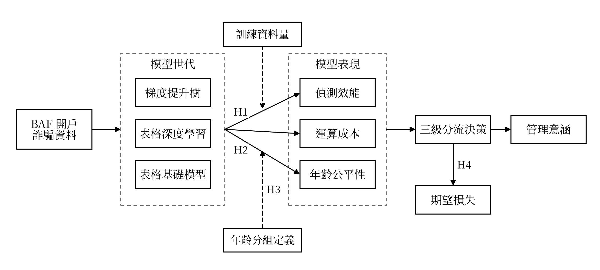{#fig-research-framework width=100%}

註：實線箭頭為研究假說的檢驗路徑；虛線箭頭表示影響該關係的調節因素；運算成本僅作比較，不另設假說。知識發現（RQ5）與小銀行困境（RQ6）屬探索性分析，未列於圖中。

## 資料

### BAF 資料集

本研究採用 @jesus2022turning 發表的 BAF（Bank Account Fraud）資料集。該資料集以真實、匿名化的銀行線上開戶申請資料訓練生成模型而合成，共包含六個資料集，每個資料集各有一百萬筆申請紀錄、30 個特徵、表示申請月份的 `month`（0 至 7，共八個月）與詐騙標籤 `fraud_bool`，詐騙約占 1%。其中 Base 資料集最接近原始資料，其餘五個變體則刻意注入不同型態的偏差（@tbl-baf-variants），可用於檢驗模型在偏差與資料分布變化下的表現。BAF 以 CC BY-NC-ND 4.0 授權釋出；依授權條款，本研究不重新散布原始資料，程式碼儲存庫僅提供下載腳本。

| 資料集 | 偏差設計 |
|:----------------|:----------------------------------------------------------------|
| Base | 依原始資料取樣；少數群體約占 20%，其詐騙率約為多數群體的兩倍 |
| Variant I | 群體規模的差異加大，兩群體的詐騙率相同 |
| Variant II | 兩群體規模相同，詐騙率的差異加大 |
| Variant III | 兩群體規模與詐騙率相同，但多數群體較容易區分詐騙（另含兩個合成特徵） |
| Variant IV | 與 Variant II 類似的詐騙率差異，但差異隨時間改變 |
| Variant V | 多數群體較容易區分詐騙的優勢僅存在於前六個月，之後減弱 |

: BAF 的六個資料集（整理自 Jesus et al., 2022） {#tbl-baf-variants}

除特別說明外，本研究的實驗皆使用 Base 資料集；五個變體用於重現原論文的實驗（RQ1）。

### 特徵

BAF 的 30 個特徵包含 25 個數值特徵與 5 個類別特徵，依其意義可分為六組（@tbl-baf-features）。部分特徵以負值表示缺失（例如 `prev_address_months_count`、 `bank_months_count`），本研究將於探索式資料分析中報告其比例。

| 類別 | 特徵 |
|:---------------|:-----------------------------------------------------------------|
| 申請人基本資料 | `customer_age`、 `income`、 `employment_status`、 `housing_status` |
| 居住與地址 | `prev_address_months_count`、 `current_address_months_count`、 `zip_count_4w` |
| 聯絡方式 | `name_email_similarity`、 `email_is_free`、 `phone_home_valid`、 `phone_mobile_valid`、 `date_of_birth_distinct_emails_4w` |
| 申請行為與頻率 | `days_since_request`、 `intended_balcon_amount`、 `payment_type`、 `velocity_6h`、 `velocity_24h`、 `velocity_4w`、 `bank_branch_count_8w` |
| 信用與往來 | `credit_risk_score`、 `bank_months_count`、 `has_other_cards`、 `proposed_credit_limit` |
| 申請管道與裝置 | `source`、 `foreign_request`、 `session_length_in_minutes`、 `keep_alive_session`、 `device_os`、 `device_distinct_emails_8w`、 `device_fraud_count` |

: BAF 的特徵分組 {#tbl-baf-features}

### 保護屬性與年齡分組

本研究以年齡作為公平性分析的保護屬性。BAF 的 `customer_age` 以 10 歲為一級，原論文正文以「年齡大於 50 歲」劃分年長組，官方程式碼則以「50 歲以上」劃分 [@jesus2022turning]。本研究的主要分析依官方程式碼採用「50 歲以上」與「未滿 50 歲」兩組，並另以正文的定義及其他切點進行敏感度分析（3.6 節）。

### 探索式資料分析

@fig-eda-monthly 為 Base 資料集各月份的申請量與詐騙率。申請量由第 3 個月的約 15.1 萬件，逐月降至第 7 個月的約 9.7 萬件；詐騙率則先降後升，由第 2 個月的 0.87% 上升至第 7 個月的 1.47%，作為測試期的第 6、7 個月詐騙率（1.34%、1.47%）明顯高於訓練期。此外，50 歲以上申請者的占比在第 0 至 6 個月介於 17% 至 20%，第 7 個月卻降至 13%。這些變化顯示資料分布確實隨時間改變，支持本研究以時間切分資料，並於上線監控（第五章）追蹤分布變化。

{#fig-eda-monthly width=95%}

@fig-eda-age 為各年齡層的人數與詐騙率。申請者以 20 至 40 多歲為主，50 歲以上約占 18%；詐騙率則隨年齡明顯上升，由 10 多歲的 0.35% 增加至 60 多歲的 3.30%。整體而言，50 歲以上申請者的詐騙率為 2.34%，約為未滿 50 歲者（0.83%）的 2.8 倍。兩組基本率的差異，是後續公平性分析的重要背景：依 @chouldechova2017fair 的推論，當基本率不同時，模型難以同時滿足各種公平性定義。

{#fig-eda-age width=95%}

@fig-eda-missing 為以負值表示缺失的特徵及其缺失比例。`intended_balcon_amount` 與 `prev_address_months_count` 的缺失比例超過七成，`bank_months_count` 約四分之一。值得注意的是，缺失本身與詐騙相關：`prev_address_months_count` 缺失者的詐騙率為 1.42%，有填寫者僅 0.31%；`bank_months_count` 缺失者為 1.63%，有填寫者為 0.92%。因此，本研究保留缺失的原值而不補值（3.3 節），使模型能利用缺失所隱含的風險訊號。

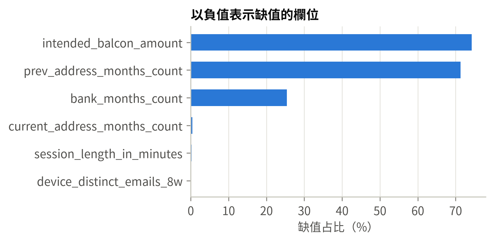{#fig-eda-missing width=70%}

## 資料前處理與切分

### 前處理

為使比較公平，所有模型接收相同的輸入：30 個特徵中的數值特徵維持原值，類別特徵以類別型態傳入，並以訓練資料出現過的類別為準，測試時出現的新類別視為缺失。以負值表示缺失的特徵保留原值，不另行補值，由模型自行學習缺失所隱含的訊號。各模型依其需求進行最少的轉換：梯度提升樹與表格基礎模型直接處理類別特徵；邏輯迴歸與 MLP 對類別特徵做獨熱編碼（one-hot encoding）並將數值特徵標準化；隨機森林則將類別特徵轉為整數編碼。與原論文相同，`customer_age` 也是模型的輸入特徵之一。

### 時間切分

詐騙偵測的模型必須以過去的資料預測未來的申請，因此本研究依申請月份切分資料，而非隨機切分。如 @fig-data-split 所示，本研究採用兩種切分方式：

1. 最終評估（final）：以第 0 至 5 個月訓練、第 6 至 7 個月測試，與原論文相同 [@jesus2022turning]，用於重現實驗、模型比較與公平性量測。
2. 開發（dev）：以第 0 至 4 個月訓練、第 5 個月驗證、第 6 至 7 個月測試。所有需要「選擇」的步驟，包括超參數調整、公平性處理的門檻，以及三級分流決策的門檻，都只在驗證月進行，再於測試月評估，以避免以測試資料做選擇而高估成效。

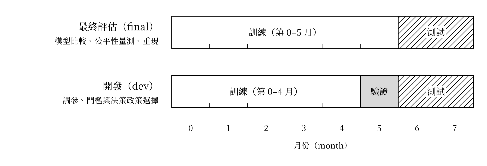{#fig-data-split width=90%}

## 模型

### 模型陣容

本研究比較三類共十個模型（@tbl-models）。傳統機器學習包含作為基準的邏輯迴歸與隨機森林 [@breiman2001random]，以及 XGBoost [@chen2016xgboost]、LightGBM [@ke2017lightgbm] 與 CatBoost [@prokhorenkova2018catboost] 三種梯度提升樹；從頭訓練的深度學習包含以 scikit-learn [@pedregosa2011scikit] 實作的多層感知器（MLP）、TabM [@gorishniy2025tabm] 與 RealMLP [@holzmuller2024better]；預訓練表格基礎模型包含 TabPFN-3.5 [@jaeger2026tabpfn35] 與 TabICLv2 [@qu2026tabiclv2]。所有模型皆包裝為相同的 scikit-learn 介面，使用同一套評估程式，以確保比較條件一致。

| 類別 | 模型 | 實作套件 | 輸入轉換 | 調參組 |
|:-------------|:-------------|:-------------|:---------------------|:--------|
| 傳統機器學習 | 邏輯迴歸 | scikit-learn | 獨熱編碼、標準化 | ✓ |
| | 隨機森林 | scikit-learn | 整數編碼 | ✓ |
| | XGBoost | xgboost | 原生類別處理 | ✓ |
| | LightGBM | lightgbm | 原生類別處理 | ✓ |
| | CatBoost | catboost | 原生類別處理 | ✓ |
| 深度學習 | MLP | scikit-learn | 獨熱編碼、標準化 | ✓ |
| | TabM | pytabkit | 套件內建前處理 | ✓ |
| | RealMLP | pytabkit | 套件內建前處理 | ✓ |
| 基礎模型 | TabPFN-3.5 | tabpfn | 模型內建前處理 | — |
| | TabICLv2 | tabicl | 模型內建前處理 | — |

: 模型陣容 {#tbl-models}

### 比較設計

參考 TabArena 的評比方式 [@erickson2025tabarena]，本研究的模型比較分為三部分：

1. 預設參數組（E2）：十個模型皆使用套件的預設參數，只設定執行所需的技術參數（例如執行緒數），反映模型「開箱即用」的表現。
2. 調參組（E3）：傳統機器學習與深度學習模型以相同預算調參，使用 Optuna [@akiba2019optuna] 的 TPE 演算法 [@bergstra2011algorithms] 各進行 30 次試驗，以驗證月的 TPR@5%FPR 為目標選出最佳超參數，再以第 0 至 5 個月重新訓練並於測試月評估。深度學習模型若以全量資料調參過於耗時，則在 10 萬筆分層抽樣的子樣本上調參。表格基礎模型依其設計不進行調參。
3. 學習曲線（E4）：以分層抽樣取 1 千、5 千、1 萬、5 萬、10 萬筆與全量的訓練資料，比較各模型的表現如何隨資料量變化；1 萬筆以下的資料量重複抽樣三次，以降低抽樣的隨機性。

### 實驗環境

實驗在一部配備 NVIDIA GeForce RTX 2080（8 GB 記憶體）的桌上型電腦上，以 Windows 的 WSL2（Ubuntu）環境執行；每次實驗皆自動記錄硬體、套件版本、程式版本與執行時間，作為運算成本比較的依據。受限於 GPU 記憶體，表格基礎模型在全量實驗中以 5 萬筆分層抽樣的訓練資料作為情境資料，此限制於結果中一併說明。

## 評估指標

### 效能指標

本研究的主要效能指標沿用原論文的 TPR@5%FPR [@jesus2022turning]：在偽陽性率（FPR）低於 5% 的條件下，選擇使偵測率最高的門檻，並以該門檻下的真陽性率（TPR）衡量模型。令 $s$ 為模型分數、$\tau$ 為門檻，則

$$
\tau^{*} = \min\{\tau : \text{FPR}(\tau) < 0.05\}, \qquad \text{TPR@5\%FPR} = \text{TPR}(\tau^{*})
$$

其中分數大於或等於 $\tau$ 的申請判定為疑似詐騙。與原論文相同，模型比較時的門檻於測試資料上決定，用以比較各模型在相同誤判率下的區辨能力；決策相關的實驗則改在驗證月決定門檻（3.3 節）。此外，本研究以 ROC-AUC 與 PR-AUC 衡量模型整體的排序能力，後者在類別極度不平衡時更能反映模型對少數類別的辨識；以 Brier 分數衡量預測機率的校準程度；並記錄訓練與預測時間，作為運算成本的指標。

### 公平性指標

主要的公平性指標為兩個年齡組偽陽性率的比值（FPR 比）：

$$
\text{FPR 比} = \frac{\min(\text{FPR}_{\text{年輕}},\ \text{FPR}_{\text{年長}})}{\max(\text{FPR}_{\text{年輕}},\ \text{FPR}_{\text{年長}})}
$$

FPR 比介於 0 與 1 之間，越接近 1 表示兩組正常申請者被誤判的機率越接近，對應預測均等的公平性定義 [@corbettdavies2017algorithmic]。本研究以 0.8 作為可接受的參考值，並另以 TPR 比衡量兩組詐騙者被偵測率的差異，對應機會均等 [@hardt2016equality]。

### 統計檢定

為量化結果的不確定性，本研究在測試資料上以拔靴法（bootstrap）[@efron1993introduction] 重抽 1,000 次，計算各指標的 95% 百分位信賴區間；重抽時依詐騙標籤分層，使每次重抽皆維持原有的詐騙比例。比較兩個模型時，以相同的重抽樣本計算兩模型指標的差異（配對拔靴法），並以差異落在 0 另一側的比例乘以 2 作為雙尾 p 值。

## 公平性分析方法

公平性分析分為量測與處理兩部分（E5、E6）：

1. 量測：在 TPR@5%FPR 的操作點計算各模型兩個年齡組的 FPR、TPR 與 FPR 比。
2. 切點敏感度：分別以 40、50、60 歲為切點，並比較「大於」與「大於或等於」兩種定義，檢驗公平性的結論是否隨年齡分組方式改變。
3. 後處理：在驗證月為兩個年齡組各自決定門檻，使兩組的 FPR 皆接近目標值，再於測試月評估 [@hardt2016equality]。此方法不需重新訓練模型，但決策時需使用申請者的年齡組別。
4. 訓練中處理：以 FairGBM [@cruz2023fairgbm] 在訓練時加入「兩組 FPR 差距不超過容許值」的限制，容許值設為 0.02、0.01 與 0，並與相同參數、不加限制的 LightGBM 比較。

為公平比較，上述方法皆在 1% 至 10% 的多個整體誤判率下評估，繪製偵測率與 FPR 比的取捨曲線。

## 三級分流決策模型

### 分級規則

本研究以三支決策 [@yao2010threeway] 為理論基礎，提出三級分流決策模型。給定模型分數 $s$ 與兩個門檻 $t_1 \le t_2$，申請依 @tbl-tiers 的規則分為三級。

台灣的數位存款帳戶依開戶時的身分驗證方式分為三類，驗證方式較弱的第三類帳戶，其非約定轉帳限額也較低：以臺灣中小企業銀行的約定條款為例，第一、二類帳戶經網路銀行的非約定轉帳上限為每月 20 萬元，第三類帳戶則為每月 5 萬元[（臺灣中小企業銀行，無日期）]{.cite}；第三類帳戶完成視訊驗證後，可將限額提高至每月 20 萬元[（中央通訊社，2021）]{.cite}。本研究借用此一「驗證強度越低、功能越受限」的設計，將中間一級對應為限額帳戶並搭配加強驗證，以取代直接拒絕。需要說明的是，實務上帳戶類別取決於驗證方式而非風險分數，此處的對應屬情境模擬。

| 等級 | 條件 | 處置 | 參照的帳戶限制 |
|:-----|:---------------|:-------------------------|:-------------------------|
| 一級 | $s < t_1$ | 正常開戶 | 第一、二類帳戶（每月 20 萬元） |
| 二級 | $t_1 \le s < t_2$ | 限額開戶並加強驗證（如視訊） | 第三類帳戶（每月 5 萬元） |
| 三級 | $s \ge t_2$ | 轉人工審核 | 審核通過後開戶 |

: 三級分流的規則 {#tbl-tiers}

### 期望損失

令 $N^{F}_{k}$ 與 $N^{L}_{k}$ 分別為被分到第 $k$ 級的詐騙與正常申請數，$N_k = N^{F}_{k} + N^{L}_{k}$。依 @elkan2001foundations 的成本敏感決策觀點，本研究將一個分級政策的期望損失定義為

$$
\text{Cost}(t_1, t_2) = \text{Loss}_{\text{fraud}} + \text{Cost}_{\text{customer}} + \text{Cost}_{\text{ops}}
$$

$$
\text{Loss}_{\text{fraud}} = N^{F}_{1} L_{\text{full}} + N^{F}_{2} (1 - v) L_{\text{limited}} + N^{F}_{3} (1 - r) L_{\text{full}}
$$

$$
\text{Cost}_{\text{customer}} = N^{L}_{2} C_{\text{friction}} + N^{L}_{3} C_{\text{attrition}}, \qquad \text{Cost}_{\text{ops}} = N_{2} C_{\text{verify}} + N_{3} C_{\text{review}}
$$

其中 $\text{Loss}_{\text{fraud}}$ 為詐騙造成的損失：進入第一級的詐騙帳戶可完整使用，進入第二級者若未被加強驗證攔下（機率 $1 - v$）只能在限額內使用，進入第三級者若未被人工審核攔下（機率 $1 - r$）則可完整使用；$\text{Cost}_{\text{customer}}$ 為對正常客戶造成的不便與流失成本；$\text{Cost}_{\text{ops}}$ 為加強驗證與人工審核的作業成本。各參數的設定如 @tbl-cost-params 所示；由於實際數值因銀行而異，本研究將其視為情境假設，並以敏感度分析檢驗結論的穩健性。

| 參數 | 意義 | 設定值 | 敏感度分析 |
|:---------|:-------------------------|:---------------------|:---------------|
| $L_{\text{full}}$ | 詐騙帳戶完整功能下的損失 | 200,000 元（第一、二類每月上限） | ×0.25、×1、×4 |
| $L_{\text{limited}}$ | 詐騙帳戶限額下的損失 | 50,000 元（第三類每月上限） | 隨 $L_{\text{full}}$ 等比調整 |
| $v$ | 加強驗證攔下詐騙的機率 | 0.5 | 0.3、0.5、0.8 |
| $r$ | 人工審核攔下詐騙的機率 | 0.9 | — |
| $C_{\text{verify}}$ | 每件加強驗證的作業成本 | 50 元 | — |
| $C_{\text{review}}$ | 每件人工審核的作業成本 | 300 元 | — |
| $C_{\text{friction}}$ | 正常客戶被加強驗證的不便成本 | 100 元 | — |
| $C_{\text{attrition}}$ | 正常客戶被轉人工審核的流失成本 | 2,000 元 | — |
| $\kappa$ | 人工審核占申請量的上限 | 2% | 1%、2%、5% |

: 三級分流決策模型的參數（情境假設） {#tbl-cost-params}

### 限制條件與求解

最佳政策須滿足兩項限制。第一為審核人力限制：轉人工審核的比例不得超過上限 $\kappa$，即 $N_3 / N \le \kappa$。第二為公平性限制：令 $E_g$ 為年齡組 $g$ 的正常申請者被分到第二級以上的比例，要求 $\min_g E_g / \max_g E_g \ge 0.8$，使正常客戶被加強審查的負擔在兩個年齡組間相近。

求解時，本研究以驗證月的分數分布設定候選門檻：令警示比例（分數高於門檻的申請占比）取 0.1% 至 30% 的 12 個值，$t_1$ 與 $t_2$ 分別取其中一個值所對應的門檻（$t_2$ 的警示比例不大於 $t_1$），以網格搜尋找出滿足限制且期望損失最小的組合；當 $t_1 = t_2$ 時即退化為一般的二元決策。選定的門檻再於測試月評估。本研究比較以下六種政策：

1. 不使用模型：所有申請皆正常開戶。
2. BAF 二元決策：以原論文 5% 誤判率的門檻將高風險申請轉人工審核。
3. 最佳二元決策：在人力限制下期望損失最小的二元政策。
4. 三級分流：在人力限制下期望損失最小的三級政策。
5. 三級分流加公平限制：另加入公平性限制，兩個年齡組使用同一組門檻。
6. 分組三級分流加公平限制：將分數轉換為各年齡組內的百分位（以驗證月正常申請者為基準）後再設定門檻，相當於兩組各自使用一組門檻。

比較政策 4 至 6 的期望損失，可估計滿足公平性要求的代價。

## 其他分析方法

### 知識發現

為回答 RQ5，本研究以 TreeSHAP [@lundberg2020local] 計算 LightGBM 對測試月 5,000 筆抽樣申請的 SHAP 值，分析各特徵的全域重要性、特徵值與貢獻的關係（相依圖）及個別案例的解釋。此外，以深度 3 與 4 的決策樹模仿 LightGBM 在 5% 誤判率門檻下的判定結果（代理模型，surrogate model）[@craven1996extracting]，將模型行為轉換為可直接檢視的規則，並以代理模型與原模型判定一致的比例（忠實度，fidelity）衡量規則的可信程度。

### 上線監控

模型上線後，申請者的特徵分布可能隨時間改變。本研究以母體穩定指標（population stability index, PSI）[@siddiqi2006credit]比較訓練期與各測試月的特徵分布：

$$
\text{PSI} = \sum_{i} (a_i - e_i) \ln \frac{a_i}{e_i}
$$

其中 $e_i$ 與 $a_i$ 分別為訓練期與測試月落在第 $i$ 個區間的比例。此外，以驗證月決定的門檻固定不變，逐月追蹤警示率、FPR、偵測率與 FPR 比，模擬銀行上線後的監控情境（E9）。

### 小銀行模擬

為回答 RQ6，本研究將訓練與測試資料依 40%、25%、15%、12%、8% 的比例分配給五家模擬銀行，並依 `housing_status` 以 Dirichlet 分配（$\alpha = 0.5$）使各銀行的客群組成不同，模擬資料分布不一致（non-IID）的情境 [@hsu2019measuring]。比較的方法包括：各銀行僅以自有資料訓練的 LightGBM、表格基礎模型與 MLP；以 FedAvg [@mcmahan2017communication] 共同訓練的 MLP（30 輪，各輪本地訓練 1 個 epoch）；以及將所有資料集中訓練的 LightGBM 作為上限參考。各方法皆以各銀行自身的測試資料評估，並特別關注資料最少的銀行。

## 實驗設計與研究假說

### 實驗總覽

@tbl-experiments 彙整本研究的實驗、對應的研究問題與使用的資料切分。所有實驗由同一套程式執行，設定集中於設定檔，圖表由程式直接產生並放入報告。

| 編號 | 實驗 | 研究問題 | 資料切分 | 主要產出 |
|:-----|:----------------|:---------|:--------|:--------------------|
| E0 | 探索式資料分析 | 背景 | 全部月份 | 分月詐騙率、年齡分布、缺失比例 |
| E1 | 重現原論文 | RQ1 | final | 100 組 LightGBM 的效能與 FPR 比 |
| E2 | 預設參數組 | RQ2 | final | 十個模型的效能、公平與時間 |
| E3 | 調參組 | RQ2 | dev → final | 預設參數與調參的比較 |
| E4 | 學習曲線 | RQ2、RQ6 | final | 不同資料量下的表現 |
| E5 | 公平性量測與切點敏感度 | RQ1、RQ3 | final | 各組 FPR、切點敏感度 |
| E6 | 公平性處理 | RQ3 | dev | 偵測率與 FPR 比的取捨 |
| E7 | 三級分流決策 | RQ4 | dev | 各政策的期望損失、敏感度分析 |
| E8 | SHAP 與規則萃取 | RQ5 | final | 特徵重要性、風控規則 |
| E9 | 上線監控 | 第五章 | dev | PSI、逐月指標 |
| E10 | 小銀行模擬 | RQ6 | 依銀行切分 | 各銀行、各方法的表現 |
| E11 | 風控門檻模擬器 | 第五章 | dev | 互動式決策支援工具 |

: 實驗總覽 {#tbl-experiments}

重現實驗（E1）依原論文附錄的 LightGBM 超參數範圍隨機抽取 100 組設定 [@jesus2022turning]，於 Base 資料集訓練並測試，記錄每組設定的 TPR@5%FPR 與 FPR 比，並同時以「大於 50 歲」與「50 歲以上」兩種分組計算，檢驗兩種定義是否影響原論文的結論；五個變體各以前 20 組設定重複實驗。

### 研究假說

依據文獻探討與研究問題，本研究提出四項假說（@tbl-hypotheses）。RQ5 與 RQ6 屬探索性問題，不另設假說。

| 假說 | 內容 | 對應 | 檢驗方式 |
|:-----|:-------------------------------|:----------|:------------------------|
| H1 | 在預設參數下，表格基礎模型在小資料量（1 萬筆以下）時的 TPR@5%FPR 高於梯度提升樹，且差距隨資料量增加而縮小 | RQ2 | 學習曲線（E4），以拔靴法信賴區間比較 |
| H2 | 未經公平性處理的模型，年齡組間的 FPR 比低於 0.8 | RQ3 | 比較 E5 中各模型的 FPR 比與 0.8 |
| H3 | 公平性的結論對年齡分組方式敏感，不同切點會得到不同的 FPR 比 | RQ1、RQ3 | 比較各切點與兩種定義下的 FPR 比（E1、E5） |
| H4 | 在相同的人力限制下，三級分流決策的期望損失低於 BAF 的二元決策 | RQ4 | 比較測試月的期望損失（E7），並以敏感度分析檢驗 |

: 研究假說 {#tbl-hypotheses}

# 實驗結果與分析

本章依研究問題報告實驗結果：4.1 節為重現原論文的結果（RQ1）；4.2 與 4.3 節比較三代模型的效能、成本與資料量的影響（RQ2）；4.4 節分析年齡公平性與公平性處理（RQ3）；4.5 節評估三級分流決策模型（RQ4）；4.6 節為知識發現（RQ5）；4.7 節為小銀行困境的延伸分析（RQ6）；4.8 節彙整研究假說的檢驗結果。除特別說明外，結果皆來自 Base 資料集的測試月（第 6、7 個月，共 205,011 件申請，其中詐騙 2,878 件，詐騙率 1.40%）。

## 重現原論文（RQ1）

本研究依原論文的超參數範圍隨機抽取 100 組 LightGBM 設定，於 Base 資料集訓練並測試，五個變體則各以前 20 組設定重複實驗。@fig-reproduction 為各組設定的偵測率與 FPR 比，@tbl-reproduction 彙整各資料集的結果。

{#fig-reproduction width=100%}

| 資料集 | 設定數 | TPR 中位數 | TPR 最高 | 前 5 名 TPR | FPR 比（50 歲以上） | FPR 比（大於 50 歲） |
|:------------|:------:|:-------:|:-------:|:--------:|:-------------:|:-------------:|
| Base | 100 | 0.521 | 0.555 | 0.549 | 0.331 | 0.318 |
| Variant I | 20 | 0.484 | 0.523 | 0.523 | 0.799 | 0.661 |
| Variant II | 20 | 0.512 | 0.549 | 0.549 | 0.106 | 0.327 |
| Variant III | 20 | 0.729 | 0.761 | 0.761 | 0.150 | 0.343 |
| Variant IV | 20 | 0.390 | 0.421 | 0.421 | 0.118 | 0.337 |
| Variant V | 20 | 0.319 | 0.354 | 0.354 | 0.168 | 0.351 |

: 重現實驗結果（FPR 比為前 5 名設定的平均） {#tbl-reproduction}

在 Base 資料集上，前 5 名設定的 TPR@5%FPR 為 0.549，FPR 比為 0.331，與原論文「表現最佳的模型 FPR 比約為 0.3」的發現一致 [@jesus2022turning]；亦即在誤判率 5% 的操作點，50 歲以上的正常申請者被誤判為詐騙的機率，約為較年輕者的 3.0 倍。各變體的結果也符合其偏差設計：可分離性較高的 Variant III 偵測率最高（0.761）；偏差隨時間改變的 Variant IV 與 V 偵測率最低（0.421 與 0.354），反映訓練期與測試期的關係改變；只有群體規模差異、兩組詐騙率相同的 Variant I，FPR 比最接近公平（0.799）。據此，本研究的實驗環境能重現原論文的主要發現，後續分析建立在可信的基礎上。

重現過程中最值得注意的是年齡分組定義的影響。在 Base 資料集上，「50 歲以上」與「大於 50 歲」兩種分組的 FPR 比相近（0.331 與 0.318）；但在 Variant II 至 V，兩者差距極大，例如 Variant II 分別為 0.106 與 0.327。由於 Variant II 至 V 中「50 歲以上」者約占 51%，與原論文描述 Variant II 兩群體規模相同的設計相符，可推知變體的偏差係以「50 歲以上」的分組注入。若依論文正文的「大於 50 歲」定義，這些變體的 FPR 比會被高估 2 至 3 倍，亦即嚴重低估其不公平程度。此結果顯示，公平性結論高度依賴分組定義，銀行在稽核模型公平性時，必須明確且一致地定義受保護群體（4.4 節）。

## 三代模型比較（RQ2）

### 預設參數組

@tbl-benchmark 與 @fig-benchmark-tpr 為十個模型在預設參數下的結果。TabM 的偵測率最高（0.546），其次為 RealMLP（0.538）、TabPFN-3.5（0.532）與 LightGBM（0.528）。然而，前幾名模型之間的差距很小：以配對拔靴法檢定，TabM 與 RealMLP（p = 0.27）及 TabPFN-3.5（p = 0.058）的差異未達 5% 顯著水準，與 LightGBM 的差異（1.8 個百分點，p = 0.006）則達顯著。值得注意的是，TabPFN-3.5 只使用 5 萬筆訓練資料（約全量的 6%），偵測率即與使用約 79.5 萬筆的 LightGBM 相當。從三代模型的角度來看，新一代的深度學習與基礎模型在預設參數下略優於梯度提升樹，但差距僅約 1 至 2 個百分點。

| 模型 | 類別 | TPR@5%FPR（95% CI） | ROC-AUC | PR-AUC | FPR 比 | 時間（秒） |
|:-------------|:-------------|:-------------------:|:------:|:------:|:-----:|:-------:|
| TabM | 深度學習 | 0.546（0.527–0.563） | 0.891 | 0.190 | 0.35 | 407.2 |
| RealMLP | 深度學習 | 0.538（0.520–0.557） | 0.889 | 0.191 | 0.33 | 3,371.1 |
| TabPFN-3.5 | 基礎模型 | 0.532（0.512–0.551） | 0.889 | 0.190 | 0.30 | 773.5 |
| LightGBM | 傳統機器學習 | 0.528（0.509–0.546） | 0.890 | 0.170 | 0.34 | 2.4 |
| TabICLv2 | 基礎模型 | 0.523（0.504–0.541） | 0.888 | 0.188 | 0.27 | 216.6 |
| CatBoost | 傳統機器學習 | 0.514（0.496–0.533） | 0.883 | 0.169 | 0.33 | 149.6 |
| MLP | 深度學習 | 0.512（0.495–0.531） | 0.883 | 0.173 | 0.30 | 18.6 |
| 邏輯迴歸 | 傳統機器學習 | 0.500（0.482–0.520） | 0.877 | 0.162 | 0.30 | 3.2 |
| XGBoost | 傳統機器學習 | 0.487（0.468–0.506） | 0.875 | 0.156 | 0.34 | 2.6 |
| 隨機森林 | 傳統機器學習 | 0.435（0.417–0.452） | 0.840 | 0.145 | 0.33 | 38.0 |

: 預設參數組的模型比較（測試月；時間為訓練加預測） {#tbl-benchmark}

{#fig-benchmark-tpr width=85%}

然而，運算成本的差異遠大於效能的差異（@fig-benchmark-cost）。LightGBM 的訓練與預測合計僅 2.4 秒，偵測率卻達 TabM（407 秒）的 97%；RealMLP 需時約 56 分鐘。表格基礎模型的成本集中在預測階段：TabPFN-3.5 的「訓練」僅 1.3 秒（儲存情境資料），對 20.5 萬筆測試申請的預測卻需 772 秒，因為每次預測都需以 Transformer 處理情境資料。對需要即時審查大量開戶申請的銀行而言，預測成本是導入基礎模型時必須考量的因素。

{#fig-benchmark-cost width=80%}

### 調參組

@tbl-tuned 與 @fig-tuned 比較各模型調參前後的偵測率。在相同的調參預算（每個模型 30 次試驗）下，梯度提升樹的進步最多：XGBoost 由 0.487 提升至 0.553（+6.6 個百分點），成為所有模型中最高；LightGBM 與 CatBoost 亦分別提升至 0.552 與 0.548。相對地，TabM 調參後幾乎不變（0.547），RealMLP 反而略降（0.531），可能是因為深度學習模型在 10 萬筆子樣本上調參，所選的超參數未必適用於全量資料。調參的時間成本差異同樣很大：LightGBM 僅需約 4 分鐘，RealMLP 則需約 4.6 小時。

| 模型 | 預設參數 | 調參後 | 差異（百分點） | 調參時間（秒） |
|:------------|:-------:|:-------:|:-------:|:-----------:|
| XGBoost | 0.487 | 0.553 | +6.6 | 396 |
| LightGBM | 0.528 | 0.552 | +2.4 | 228 |
| CatBoost | 0.514 | 0.548 | +3.4 | 4,320 |
| TabM | 0.546 | 0.547 | +0.1 | 1,959 |
| RealMLP | 0.538 | 0.531 | −0.8 | 16,396 |
| MLP | 0.512 | 0.526 | +1.4 | 171 |
| 隨機森林 | 0.435 | 0.519 | +8.5 | 3,513 |
| 邏輯迴歸 | 0.500 | 0.500 | 0.0 | 76 |

: 預設參數與調參後的偵測率（TPR@5%FPR） {#tbl-tuned}

{#fig-tuned width=75%}

綜合而言，在資料量充足（約 80 萬筆）的情境下，三代模型的偵測率差距很小：新一代模型在「不調參」時略占優勢，但梯度提升樹只要少量調參即可追上甚至超越，且運算成本低了兩至三個數量級。

## 資料量對模型表現的影響（RQ2）

為了解資料量較少時的情況，本研究以不同大小的訓練子集重新訓練模型（@tbl-learning-curve、@fig-learning-curve）。表格基礎模型在小資料量下的優勢非常明顯：只有 1 萬筆訓練資料時，TabPFN-3.5 與 TabICLv2 的偵測率已達 0.501 與 0.494，梯度提升樹則僅 0.327 至 0.408；在 5 萬筆時，基礎模型（0.536 與 0.529）已高於其他模型在 10 萬筆以下的所有結果。隨著資料量增加，其他模型逐漸追上：在全量資料下，TabM（0.544）、RealMLP（0.543）與 LightGBM（0.532）與只使用 5 萬筆的基礎模型相當。此外，簡單的邏輯迴歸在小資料量下表現穩健（1 萬筆時 0.450），優於所有梯度提升樹。

| 模型 | 1 千 | 5 千 | 1 萬 | 5 萬 | 10 萬 | 全量 |
|:------------|:------:|:------:|:------:|:------:|:------:|:------:|
| TabPFN-3.5 | 0.266 | 0.467 | 0.501 | 0.536 | — | — |
| TabICLv2 | 0.265 | 0.460 | 0.494 | 0.529 | — | — |
| 邏輯迴歸 | 0.223 | 0.431 | 0.450 | 0.487 | 0.496 | 0.500 |
| CatBoost | 0.203 | 0.344 | 0.408 | 0.457 | 0.470 | 0.508 |
| LightGBM | 0.141 | 0.285 | 0.327 | 0.420 | 0.453 | 0.532 |
| XGBoost | 0.180 | 0.323 | 0.345 | 0.388 | 0.410 | 0.487 |
| RealMLP | 0.197 | 0.284 | 0.324 | 0.404 | 0.472 | 0.543 |
| TabM | 0.029 | 0.044 | 0.084 | 0.384 | 0.521 | 0.544 |

: 不同訓練資料量下的偵測率（TPR@5%FPR；1 萬筆以下為三次抽樣的平均；基礎模型以 5 萬筆為上限） {#tbl-learning-curve}

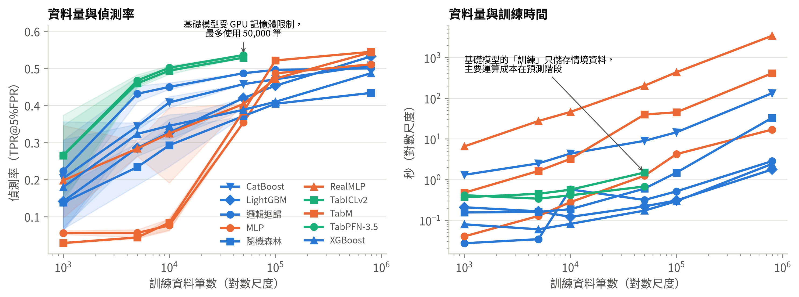{#fig-learning-curve width=100%}

需要特別說明的是，TabM 在 1 萬筆以下的偵測率僅 0.03 至 0.08，與隨機猜測（約 0.05）相近，屬於模型訓練失效，而非一般性的效能下降。可能的原因是 1 萬筆資料中僅約 100 件詐騙，模型內部用於提早停止訓練的驗證資料所含的詐騙件數過少；此一推測尚待進一步驗證。由於本研究採用套件的預設設定，此結果反映的是「開箱即用」時的風險，而非 TabM 架構本身的上限。此外，全量資料下 LightGBM 與 CatBoost 的偵測率（0.532、0.508）與預設參數組（0.528、0.514）略有差異，來自訓練資料抽樣順序與隨機種子的不同，差距在 1 個百分點以內。

## 年齡公平性（RQ3）

### 公平性量測

@fig-group-fpr 為各模型在整體誤判率 5% 時，兩個年齡組的誤判率。所有模型皆呈現相同的模式：未滿 50 歲正常申請者的誤判率約為 3.3% 至 3.9%，50 歲以上則為 10.3% 至 12.7%，FPR 比介於 0.27 至 0.35，亦即年長的正常申請者被誤判的機率是年輕者的 2.8 至 3.6 倍，全部遠低於 0.8 的參考標準。新一代模型並未比較公平：FPR 比最低的反而是表格基礎模型 TabICLv2（0.27）與 TabPFN-3.5（0.30），與 @liu2026causal 對 TabPFN 公平性的觀察一致。此外，偵測率與公平性之間並沒有明顯的取捨（@fig-fairness-performance）：偵測率最高的 TabM，FPR 比也是十個模型中最高的（0.35）。

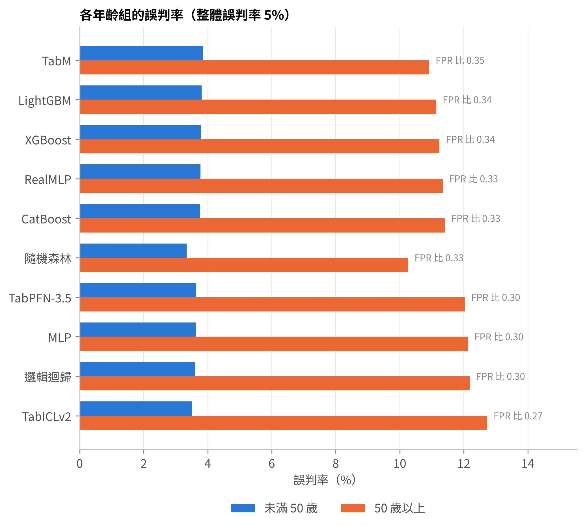{#fig-group-fpr width=80%}

{#fig-fairness-performance width=80%}

年長者的偵測率（TPR）也較高（0.57 至 0.69，年輕者為 0.37 至 0.48），顯示模型整體上較常將年長者標記為可疑。其根源在於兩組的詐騙基本率不同（2.34% 與 0.83%，3.2 節）：模型學到「年齡較長」與詐騙的關聯，使年長者的分數整體偏高，在單一門檻下便同時提高了兩組的偵測率與誤判率差距。

### 年齡分組的敏感度

@fig-cutoff-sensitivity 以不同的年長組定義計算各模型的 FPR 比。由於 BAF 的年齡以 10 歲為一級，「大於 40 歲」與「50 歲以上」選取的是同一群人，因此實際上只有四種不同的分組。在 Base 資料集上，無論採用哪一種分組，所有模型的 FPR 比皆介於 0.26 至 0.40，「模型對年長者不公平」的結論不受影響；然而，「哪一個模型最公平」會隨分組改變：以 40 歲以上為年長組時，XGBoost 的 FPR 比最高（0.40），以 50 歲以上分組時則是 TabM（0.35）。結合 4.1 節變體資料集的結果，分組定義不僅會改變模型排序，在偏差較明顯的資料中更可能改變不公平程度的判斷。

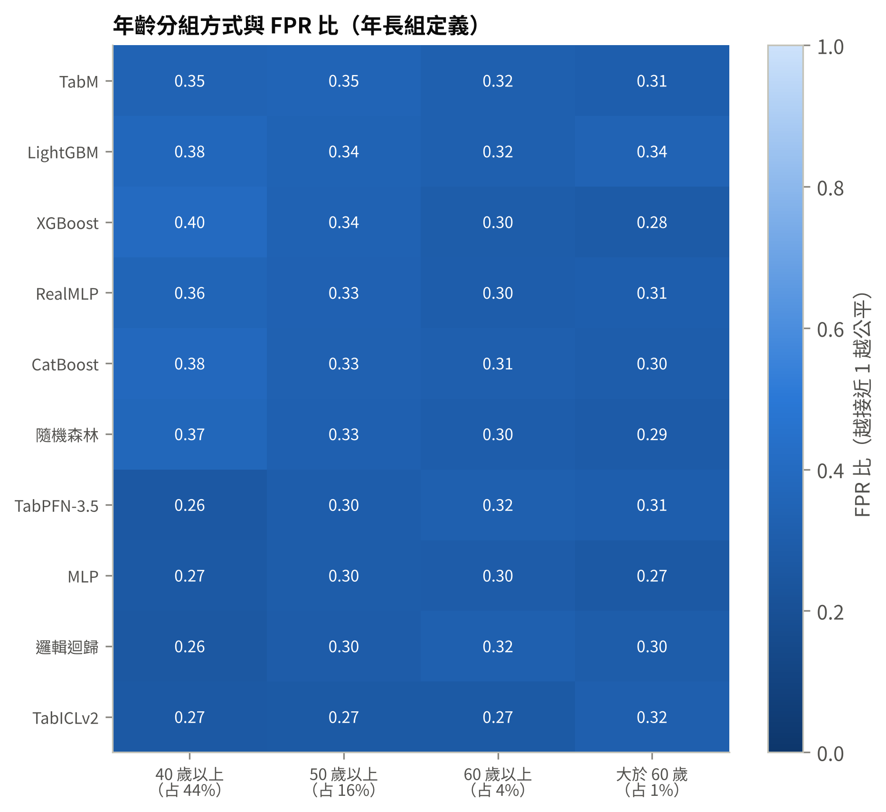{#fig-cutoff-sensitivity width=75%}

### 公平性處理

@tbl-mitigation 與 @fig-mitigation 比較兩種公平性處理方法。門檻皆在驗證月決定，再於測試月評估；由於測試月的分布與驗證月不同，實際的整體誤判率略高於目標的 5%（5.4% 至 6.0%），單一門檻下的偵測率因此也略高於 @tbl-benchmark。

| 方法 | TPR | 整體 FPR | 未滿 50 歲 FPR | 50 歲以上 FPR | FPR 比 |
|:------------------------------------|:------:|:-------:|:---------:|:---------:|:------:|
| LightGBM：單一門檻（未處理） | 0.551 | 5.9% | 4.5% | 13.2% | 0.34 |
| LightGBM：分組門檻（後處理） | 0.535 | 6.0% | 5.9% | 6.6% | 0.90 |
| TabPFN-3.5：單一門檻（未處理） | 0.560 | 5.7% | 4.3% | 12.8% | 0.33 |
| TabPFN-3.5：分組門檻（後處理） | 0.543 | 5.7% | 5.6% | 6.2% | 0.91 |
| LightGBM：與 FairGBM 同參數（未處理） | 0.549 | 5.5% | 4.0% | 13.0% | 0.31 |
| FairGBM：容許差距 0.02 | 0.526 | 5.4% | 4.9% | 7.9% | 0.62 |
| FairGBM：容許差距 0.01 | 0.526 | 5.9% | 5.6% | 7.2% | 0.77 |
| FairGBM：容許差距 0.005 | 0.534 | 5.8% | 5.3% | 8.0% | 0.67 |
| FairGBM：容許差距 0 | 0.533 | 5.8% | 5.5% | 7.4% | 0.74 |

: 公平性處理方法的比較（目標整體誤判率 5%） {#tbl-mitigation}

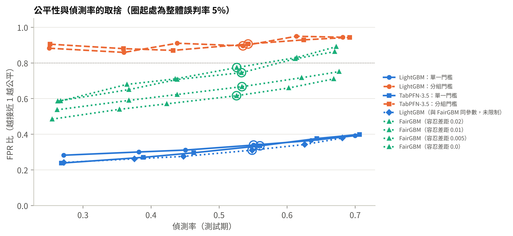{#fig-mitigation width=100%}

後處理的分組門檻效果最好：LightGBM 的 FPR 比由 0.34 提升至 0.90，TabPFN-3.5 由 0.33 提升至 0.91，偵測率僅分別下降 1.6 與 1.7 個百分點；且如 @fig-mitigation 所示，在 1% 至 10% 的各種整體誤判率下，分組門檻的 FPR 比皆維持在 0.86 以上。訓練中處理的 FairGBM 將 FPR 比提升至 0.62 至 0.77，偵測率下降 1.5 至 2.3 個百分點，改善幅度不及分組門檻，且容許差距越嚴格，FPR 比並未隨之單調上升（容許差距 0.01 時為 0.77，0.005 時反而為 0.67），顯示其訓練結果有一定的波動。兩種方法的取捨在於：分組門檻在決策時需要使用申請者的年齡組別，可能被視為對不同年齡「差別對待」；FairGBM 的公平性限制只在訓練時使用年齡組別，決策時對所有人使用同一門檻。此一取捨將於第五章進一步討論。

## 三級分流決策（RQ4）

@tbl-policies 與 @fig-policy-cost 比較各種決策政策在測試月的期望成本。所有政策皆在驗證月選定門檻，限制條件為人工審核不超過 2%、加強驗證不超過 10%。

| 政策 | 二級 | 三級 | 漏放詐騙 | 每件成本（元） | 成本較 BAF 二元 | 升級 FPR 比 | 人力 | 公平 |
|:-------------------------|:-------:|:-------:|:-------:|:--------:|:--------:|:--------:|:----:|:----:|
| 不用模型（全部正常開戶） | 0.0% | 0.00% | 2,878 | 2,808 | +80.9% | 1.00 | ✓ | ✓ |
| 不用模型（全部限額＋加強驗證） | 100.0% | 0.00% | 0 | 500 | −67.8% | 1.00 | ✗ | ✓ |
| 二元：5% 誤判率門檻轉人工 | 0.0% | 6.59% | 1,293 | 1,552 | 基準 | 0.34 | ✗ | ✗ |
| 二元：成本最佳門檻 | 0.0% | 1.35% | 2,206 | 2,242 | +44.5% | 0.27 | ✓ | ✗ |
| 三級分流 | 11.4% | 0.17% | 916 | 1,148 | −26.0% | 0.39 | ✗ | ✗ |
| 三級分流＋公平限制（分組門檻） | 11.4% | 0.32% | 954 | 1,181 | −23.9% | 0.96 | ✗ | ✓ |

: 各決策政策的測試月結果（成本為情境假設；「人力」與「公平」標示是否符合限制） {#tbl-policies}

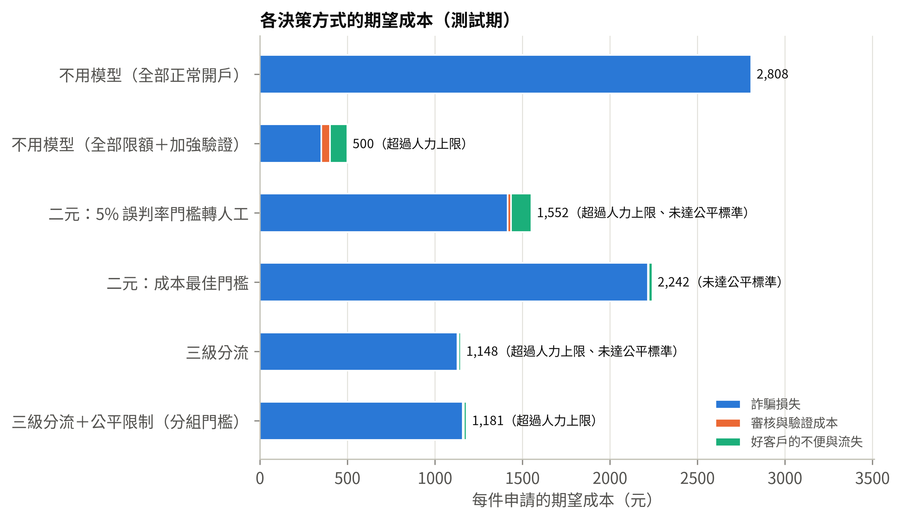{#fig-policy-cost width=95%}

主要發現如下。第一，原論文的二元決策（誤判率 5% 的申請轉人工審核）每件成本為 1,552 元，但需將 6.59% 的申請轉人工審核，超過 2% 的人力上限；在人力上限內的最佳二元政策只能審核 1.35% 的申請，漏放 2,206 件詐騙，成本反而升至 2,242 元。第二，三級分流將約 11.4% 的申請分到「限額開戶並加強驗證」，僅 0.17% 轉人工審核，每件成本降至 1,148 元，較 BAF 二元決策低 26.0%，較不使用模型低 59.1%。如 @fig-tiers 所示，雖然只有 11.4% 的申請進入第二級，卻涵蓋了 63.6% 的詐騙申請，使多數詐騙帳戶即使開立也只能在限額內使用。第三，加入公平性限制的分組門檻政策，將正常申請者被升級審查的 FPR 比由 0.39 提升至 0.96，每件成本僅增加 33 元（2.9%）；若要求兩個年齡組使用同一組門檻，則在驗證月找不到滿足公平性限制的政策，顯示單一門檻無法達成年齡公平。

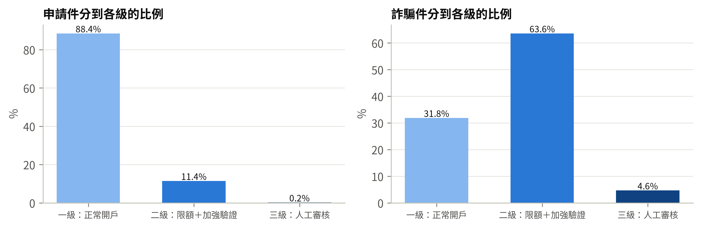{#fig-tiers width=95%}

兩項結果需要特別說明。其一，若不考慮人力限制，「全部限額開戶並加強驗證」的成本最低（500 元），因為在本研究的成本假設下，限額能大幅降低詐騙損失，而加強驗證對正常客戶的成本相對低廉。此結果顯示「限制新帳戶功能」本身即是強而有力的防詐手段，與台灣第三類數位存款帳戶的設計理念一致；然而，對所有申請者進行視訊等加強驗證並不可行，模型的價值即在於決定有限的驗證人力應用在哪些申請上。其二，第二級比例在驗證月控制於 9.9%，在測試月卻增加為 11.4%，超過 10% 的上限。這是因為測試月的分數分布與驗證月不同（3.2 節的詐騙率上升即為一例），以固定門檻上線時，實際的審核量會隨資料漂移而改變，需定期重新校準門檻（第五章）。

@tbl-sensitivity 一次改變一項成本假設，檢驗三級分流相對於 BAF 二元決策的節省是否穩健。在所有情境下，三級分流皆較 BAF 二元決策節省成本（2.7% 至 47.4%），但節省幅度主要取決於加強驗證的人力上限：上限為 5% 時僅節省 2.7%（加入公平限制後甚至增加 1.0%），上限放寬至 20% 時則可節省 47.4%。相對地，詐騙損失、驗證攔截率與客戶不便成本的改變，雖影響節省的幅度（20.1% 至 38.6%），並不改變結論。此外，當好客戶被加強驗證的不便成本提高至 1,000 元時，「全部限額」的節省由 67.8% 降至 10.7%，低於三級分流的 20.1%，顯示越重視客戶體驗，越需要以模型精準地挑選加強驗證的對象。

| 假設 | 設定值 | 全部限額 | 三級分流 | 三級分流＋公平 | 三級分流的二級比例 |
|:---------------------------|:------:|:-------:|:-------:|:---------:|:---------:|
| 基準 | — | 67.8% | 26.0% | 23.9% | 11.4% |
| 詐騙損失倍數 | ×0.25 | 51.8% | 38.6% | 36.8% | 11.4% |
| 詐騙損失倍數 | ×4 | 73.2% | 22.3% | 20.0% | 10.2% |
| 加強驗證攔截率 | 0.3 | 58.8% | 21.5% | 19.2% | 10.2% |
| 加強驗證攔截率 | 0.8 | 81.4% | 34.6% | 32.4% | 11.4% |
| 好客戶被加強驗證的不便成本 | 500 元 | 42.4% | 23.3% | 21.2% | 11.2% |
| 好客戶被加強驗證的不便成本 | 1,000 元 | 10.7% | 20.1% | 17.8% | 10.8% |
| 人工審核上限 | 1% | 67.8% | 26.0% | 23.9% | 11.4% |
| 人工審核上限 | 5% | 67.8% | 26.0% | 23.9% | 11.4% |
| 加強驗證上限 | 5% | 67.8% | 2.7% | −1.0% | 5.8% |
| 加強驗證上限 | 20% | 67.8% | 47.4% | 45.8% | 21.7% |

: 敏感度分析：各政策相較 BAF 二元決策的成本節省（一次改變一項假設；「全部限額」不符合驗證人力上限，僅供參考） {#tbl-sensitivity}

## 知識發現（RQ5）

@tbl-shap 與 @fig-shap 為 LightGBM 的 SHAP 分析結果。對詐騙判斷影響最大的特徵依序為申請裝置的作業系統（`device_os`）、前一居住地址的居住月數（`prev_address_months_count`）、住房狀態（`housing_status`）與住家電話是否有效（`phone_home_valid`）。由方向來看，前一地址居住月數較短或缺失、住家電話無效、未保持登入狀態（`keep_alive_session`）、沒有其他信用卡（`has_other_cards`）、姓名與電子郵件相似度低，以及使用免費電子郵件信箱的申請者，被判定為詐騙的風險較高。這些特徵多與「身分資訊是否穩定、可驗證」有關，符合人頭帳戶申請者常使用臨時或不實資料的直覺。

| 排名 | 特徵 | 意義 | 平均 \|SHAP\| | 較可疑的情形 |
|:----:|:-----------------------------|:---------------------|:--------:|:---------------|
| 1 | `device_os` | 申請裝置的作業系統 | 0.421 | 類別特徵（見規則） |
| 2 | `prev_address_months_count` | 前一地址的居住月數 | 0.392 | 數值低或缺失 |
| 3 | `housing_status` | 住房狀態 | 0.350 | 類別特徵（見規則） |
| 4 | `phone_home_valid` | 住家電話是否有效 | 0.339 | 無效 |
| 5 | `keep_alive_session` | 是否保持登入 | 0.250 | 未保持登入 |
| 6 | `has_other_cards` | 是否持有其他卡片 | 0.243 | 沒有 |
| 7 | `current_address_months_count` | 目前地址的居住月數 | 0.237 | 數值高 |
| 8 | `name_email_similarity` | 姓名與電子郵件的相似度 | 0.235 | 相似度低 |
| 9 | `income` | 收入（分位數） | 0.216 | 數值高 |
| 10 | `email_is_free` | 是否為免費電子郵件 | 0.176 | 是 |

: SHAP 特徵重要性前十名（LightGBM；測試月 5,000 筆抽樣） {#tbl-shap}

{#fig-shap width=85%}

為使分析結果可直接作為風控規則，本研究以決策樹模仿 LightGBM 在 5% 誤判率門檻下的判定。深度 3 與 4 的代理模型與原模型判定一致的比例（忠實度）分別為 77.5% 與 83.5%。其中最具代表性的規則為：「住房狀態為 BA、沒有其他卡片、且使用 Windows 裝置」。符合此條件的申請占測試月的 4.8%，詐騙率達 10.0%，約為整體詐騙率（1.40%）的 7 倍，並涵蓋了 33.8% 的詐騙申請；若再加上「前一地址居住月數不超過 3 個月」，則申請占比為 4.1%、詐騙率提高至 10.8%，涵蓋 31.6% 的詐騙。此類規則可作為銀行在模型之外的第一層篩選，或作為風控人員判讀模型結果時的參考；BAF 特徵與台灣銀行可取得資料的對應，將於第五章討論。

## 小銀行困境（RQ6，延伸）

本研究將資料分配給五家規模不同的模擬銀行（@tbl-banks），比較資料較少的銀行可採取的策略（@tbl-small-bank、@fig-small-bank）。

| 銀行 | 訓練資料 | 訓練期詐騙 | 測試資料 | 測試期詐騙 | 主要住房狀態 |
|:-------|-----------:|-----------:|-----------:|-----------:|:---------------|
| 銀行 A | 431,777 | 4,030 | 106,451 | 1,361 | BC（58%） |
| 銀行 B | 156,795 | 2,576 | 42,952 | 956 | BB（37%） |
| 銀行 C | 118,893 | 1,047 | 31,910 | 414 | BB（55%） |
| 銀行 D | 46,245 | 287 | 12,992 | 86 | BB（66%） |
| 銀行 E | 41,279 | 211 | 10,706 | 61 | BB（58%） |

: 五家模擬銀行的資料概況 {#tbl-banks}

| 方法 | 銀行 A | 銀行 B | 銀行 C | 銀行 D | 銀行 E |
|:---------------------|:-------:|:-------:|:-------:|:-------:|:-------:|
| 自建 LightGBM | 0.502 | 0.460 | 0.452 | 0.267 | 0.295 |
| 自建 TabPFN-3.5 | 0.550 | 0.517 | 0.527 | 0.395 | 0.443 |
| 自建 MLP | 0.467 | 0.416 | 0.447 | 0.279 | 0.230 |
| 聯合學習 MLP（FedAvg） | 0.512 | 0.470 | 0.505 | 0.395 | 0.492 |
| 資料集中 LightGBM（參考） | 0.540 | 0.496 | 0.514 | 0.430 | 0.393 |
| 資料集中 MLP（參考） | 0.459 | 0.414 | 0.432 | 0.302 | 0.344 |

: 各銀行在不同策略下的偵測率（TPR@5%FPR） {#tbl-small-bank}

{#fig-small-bank width=95%}

資料最少的銀行 D 與 E，若僅以自有資料訓練 LightGBM，偵測率只有 0.267 與 0.295，遠低於大型銀行；改用表格基礎模型 TabPFN-3.5（0.395、0.443）或加入聯合學習（0.395、0.492），偵測率可提升 10 至 20 個百分點，接近甚至達到資料集中訓練的水準（0.430、0.393）。由於兩家銀行的測試期詐騙僅 86 與 61 件，偵測率的 95% 信賴區間寬達約 ±0.11（例如銀行 E 的 TabPFN-3.5 為 0.31 至 0.56、FedAvg 為 0.34 至 0.61），因此基礎模型與聯合學習之間的差異並不顯著，但兩者皆明顯優於自建 LightGBM。對資料充足的銀行 A 至 C，自建 TabPFN-3.5 也是最佳的選擇（0.517 至 0.550），甚至略高於資料集中的 LightGBM。此外，聯合學習的 MLP 在各銀行皆優於資料集中訓練的 MLP，與一般預期不同，可能是 FedAvg 的參數平均產生了類似正則化的效果，本研究未進一步探究。

就管理意涵而言，基礎模型與聯合學習對小銀行的效益相當，但導入條件不同：聯合學習需要多家銀行協調資料格式、訓練流程與治理機制；基礎模型則可由單一銀行自行導入，門檻較低，但需注意預測的運算成本與模型權重的授權條件。

## 研究假說檢驗與小結

@tbl-hypothesis-results 彙整四項研究假說的檢驗結果。

| 假說 | 內容 | 結果 | 主要證據 |
|:-----|:----------------------------|:--------:|:------------------------------|
| H1 | 小資料量下基礎模型優於梯度提升樹，差距隨資料量增加而縮小 | 支持 | 1 萬筆時基礎模型 0.494–0.501，梯度提升樹 0.327–0.408；全量時差距消失（4.3 節） |
| H2 | 未經公平性處理的模型，FPR 比低於 0.8 | 支持 | 十個模型的 FPR 比皆介於 0.27–0.35（4.4 節） |
| H3 | 公平性結論對年齡分組方式敏感 | 部分支持 | Base 中「不公平」的結論不變，但模型排序改變；變體中兩種定義的 FPR 比差距可達三倍（4.1、4.4 節） |
| H4 | 三級分流的期望損失低於 BAF 二元決策 | 支持 | 基準情境節省 26.0%，所有敏感度情境皆節省 2.7%–47.4%（4.5 節） |

: 研究假說的檢驗結果 {#tbl-hypothesis-results}

最後，@tbl-vs-paper 對照本研究與原論文的研究範圍。本研究在重現原論文主要發現的基礎上，將分析由單一模型的效能與公平性量測，延伸至三代模型的比較、公平性處理、成本導向的分級決策、知識萃取與小銀行情境，並將結果連結到台灣的開戶制度。

| 項目 | BAF 原論文 [@jesus2022turning] | 本研究 |
|:---|:-------|:-----------|
| 模型 | 僅 LightGBM | 三類十個模型 |
| 公平性 | 僅量測 | 量測、兩種處理方法、分組敏感度 |
| 決策 | 無 | 三級分流決策模型 |
| 資料量情境 | 全量 | 學習曲線、小銀行聯合學習 |
| 解釋 | 無 | SHAP、風控規則 |
| 在地化 | 無 | 台灣數位帳戶制度與法規 |

: 原論文與本研究的比較 {#tbl-vs-paper}

# 管理意涵與建議

本章將第四章的實驗結果轉化為銀行可採行的管理建議：5.1 節提出開戶審查的分級作業流程；5.2 節說明不同情境下的模型導入策略；5.3 節提出公平性稽核的做法；5.4 節整理可供風控人員使用的規則，並對照台灣銀行可取得的資料；5.5 節說明上線後的監控與門檻校準；5.6 節將上述建議對照國內的 AI 相關法規；5.7 節介紹本研究開發的風控門檻模擬器，協助銀行依自身的條件檢視上述建議。需要強調的是，本研究的資料並非台灣銀行的實際資料，成本參數亦為情境假設，以下建議旨在提供決策的方向與架構，實際導入時仍應以各銀行的資料重新驗證。

## 開戶審查的分級作業流程

第四章的結果顯示，將開戶審查由「通過或轉人工」的二元決策改為三級分流，可在人工審核量更少的情況下降低期望損失（4.5 節）。據此，本研究建議銀行採用 @fig-tier-process 的分級作業流程：申請經模型評分後，低風險者正常開戶；中風險者先開立限額帳戶，並安排視訊或電信認證等加強驗證，通過後再解除限額，未通過者轉人工審核；高風險者直接轉人工審核。此設計的關鍵在於以「限額開戶」取代「直接拒絕」：中風險申請中的正常客戶仍能立即使用帳戶，而詐騙者即使通過開戶，也只能在限額內使用，與台灣第三類數位存款帳戶「完成視訊驗證後可提高限額」的制度精神一致[（中央通訊社，2021）]{.cite}。

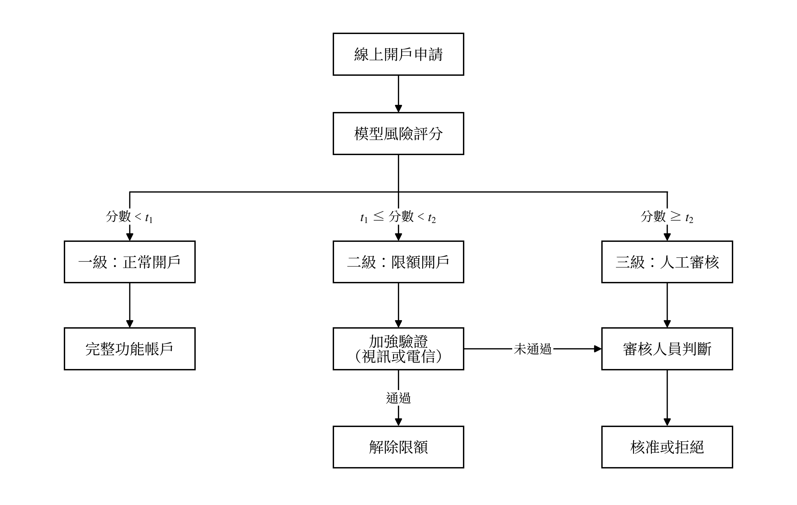{#fig-tier-process width=90%}

@tbl-tier-sop 整理各級的作業重點。在本研究的情境模擬中，第二級僅占申請量的約 11%，卻涵蓋了約六成的詐騙申請；第三級僅需審核約 0.2% 至 0.3% 的申請。換言之，銀行可將有限的人力集中於少數高風險案件，而將大部分的風險控制交由「限額」與「加強驗證」完成。

| 等級 | 申請占比 | 詐騙占比 | 處置 | 管理重點 |
|:---------------|:--------:|:---------:|:-----------------------|:-----------------------|
| 一級：正常開戶 | 約 88% | 約 32%–33% | 依帳戶類別提供完整功能 | 漏放的詐騙需由開戶後的交易監控補強 |
| 二級：限額開戶 | 約 11% | 約 59%–64% | 限額開戶並進行加強驗證，通過後解除限額 | 驗證人力是三級分流效益的關鍵 |
| 三級：人工審核 | 約 0.2%–0.3% | 約 5%–8% | 由審核人員判斷核准或拒絕 | 保留人類監督，並記錄判斷理由 |

: 三級分流的作業重點（比例取自 4.5 節兩種三級分流政策的測試月結果） {#tbl-tier-sop}

在資源配置上，敏感度分析顯示三級分流的效益主要取決於加強驗證的人力上限：上限由 10% 降至 5% 時，相較二元決策的節省由 26.0% 降至 2.7%；放寬至 20% 時則提高至 47.4%（@tbl-sensitivity）。因此，本研究建議銀行優先投資「加強驗證」的處理能量，例如擴充視訊驗證的人力或導入自動化的電信認證，其效益可能高於單純提升模型的偵測率。相對地，人工審核人力在 1% 至 5% 之間變動時，三級分流的成本幾乎不變，顯示在此流程下，人工審核並非主要瓶頸。

## 模型導入策略

第四章的比較顯示，「哪一個模型最好」取決於銀行的資料量、運算資源與維運能力。@tbl-adoption 依情境整理本研究的建議。

| 情境 | 建議做法 | 依據 |
|:------------------|:--------------------------|:--------------------------|
| 資料充足（數十萬筆以上）的大型銀行 | 以梯度提升樹（如 XGBoost、LightGBM）為主，投入少量調參 | 調參後偵測率最高（0.552–0.553），訓練與預測僅需數秒（4.2 節） |
| 追求最高偵測率、可不調參 | 可評估表格深度學習（如 TabM） | 預設參數下偵測率最高（0.546），但運算時間約為 LightGBM 的百倍以上（4.2 節） |
| 資料較少的銀行、新產品或新通路 | 優先評估表格基礎模型（如 TabPFN-3.5） | 1 萬筆資料即達 0.50，梯度提升樹僅 0.33–0.41（4.3 節）；小銀行可提升 10–15 個百分點（4.7 節） |
| 多家中小型銀行願意合作 | 可評估跨行聯合學習 | 最小兩家銀行偵測率提升 10–20 個百分點，不需交換原始資料（4.7 節） |

: 依情境的模型導入建議 {#tbl-adoption}

導入表格基礎模型時，有三點需要特別注意。第一，其運算成本集中在預測階段，對 20 萬筆申請的預測時間約 13 分鐘（4.2 節），若需即時審查大量申請，應評估批次處理或硬體需求。第二，部分基礎模型的權重限於非商業用途，商業導入前應確認授權條件。第三，基礎模型並未比較公平（FPR 比 0.27–0.30，4.4 節），導入時仍需搭配公平性處理。此外，在資料充足時，不同世代模型的偵測率差距僅 1 至 2 個百分點，遠小於決策流程設計（三級分流）帶來的效益；因此，對多數銀行而言，「如何使用模型分數」的重要性，可能高於「選擇哪一個模型」。

## 公平性稽核

第四章的結果顯示，未經處理的模型皆對年長的正常申請者較不公平（FPR 比 0.27–0.35），且新一代模型並未改善此問題（4.4 節）。本研究據此建議銀行將公平性稽核納入模型的上線與定期檢視程序，重點如 @tbl-fairness-audit。

| 稽核項目 | 建議做法 | 本研究依據 |
|:------------------|:------------------------------|:------------------------|
| 明確定義受保護群體 | 書面定義分組方式（如「50 歲以上」或「大於 50 歲」），並固定使用 | 兩種定義可使 FPR 比相差 2 至 3 倍（4.1 節） |
| 分組敏感度檢查 | 以多個年齡切點計算 FPR 比，確認結論不因切點而改變 | 不同切點下最公平的模型不同（4.4 節） |
| 以誤判率衡量公平 | 定期計算各組正常申請者被誤判或被升級審查的比例 | 年長者的誤判率約為年輕者的 3 倍（4.4 節） |
| 選擇公平性處理方法 | 評估分組門檻與訓練中處理的取捨，並記錄選擇理由 | 分組門檻 FPR 比 0.90、FairGBM 0.62–0.77（4.4 節） |
| 評估公平的代價 | 以期望損失量化公平性限制的成本 | 三級分流加入公平限制僅增加 2.9% 成本（4.5 節） |

: 公平性稽核的建議項目 {#tbl-fairness-audit}

在處理方法的選擇上，兩種方法各有取捨。分組門檻的效果最好，且公平性的代價很小（偵測率僅降低約 1.6 個百分點），但決策時需要依申請者的年齡組別使用不同門檻，可能被視為對不同年齡的「差別對待」；FairGBM 只在訓練時使用年齡組別，決策時對所有人一視同仁，但改善幅度較小且結果較不穩定。本研究建議銀行由法遵、風控與資料科學單位共同決定採用的方法，並將決策理由記錄於模型的說明文件中。

## 風控規則與資料對照

4.6 節的分析顯示，模型最重視的特徵多與「身分資訊是否穩定、可驗證」有關，且可萃取出簡單的規則：例如「住房狀態為 BA、沒有其他卡片、使用 Windows 裝置」的申請，詐騙率約為整體的 7 倍，並涵蓋約三分之一的詐騙申請。此類規則可作為模型之外的第一層篩選，或供審核人員判讀模型結果時參考。

由於 BAF 的欄位經過匿名化，且非台灣的資料，銀行若要應用上述發現，需要找到台灣實務上可取得的對應資料。@tbl-feature-mapping 整理主要特徵可能的對應來源，供銀行規劃資料蒐集時參考。

| BAF 特徵 | 意義 | 台灣銀行可能的對應資料 |
|:---------------------------------------|:-----------------|:-----------------------------|
| `device_os`、 `keep_alive_session` | 申請裝置與登入行為 | 線上開戶時的裝置資訊與連線紀錄 |
| `prev_address_months_count`、 `current_address_months_count` | 居住地址的穩定度 | 開戶申請書填寫的地址與居住期間 |
| `housing_status` | 住房狀態 | 開戶申請書的居住狀況欄位 |
| `phone_home_valid`、 `phone_mobile_valid` | 電話是否有效 | 電話驗證或電信認證的結果 |
| `has_other_cards` | 是否持有其他卡片 | 本行既有往來資料，或經客戶同意查詢的信用資料 |
| `name_email_similarity`、 `email_is_free` | 聯絡資訊的一致性 | 申請資料中的姓名與電子郵件 |
| `velocity_6h`、 `velocity_24h`、 `velocity_4w` | 短期內的申請頻率 | 同一裝置、地址或聯絡資訊的近期申請次數 |

: BAF 主要特徵與台灣銀行可能的對應資料（概念對照，實際可用性需依各銀行的資料與法規確認） {#tbl-feature-mapping}

需要注意的是，部分特徵（例如裝置資訊與信用資料）涉及個人資料的蒐集與利用，銀行應確認其蒐集目的、告知與同意程序符合個人資料保護的相關規定。

## 上線監控與門檻校準

模型上線後，申請者的特徵與行為會隨時間改變。本研究以驗證月（第 5 個月）決定 5% 誤判率的門檻後固定不變，逐月追蹤模型的表現（@fig-monitoring、@tbl-monitoring）。結果顯示，上線第一個月（第 6 個月）的誤判率由 5.0% 升至 6.2%，警示率由 5.6% 升至 6.9%；偵測率則由 0.528 略升至 0.541 與 0.561，FPR 比維持在 0.33 至 0.35。換言之，即使模型的偵測能力沒有下降，固定的門檻也會因資料分布改變而讓審核量增加約兩成，這與 4.5 節三級分流的第二級比例超出上限的現象一致。

{#fig-monitoring width=95%}

| 月份 | 角色 | 申請量 | 詐騙率 | 警示率 | 誤判率 | 偵測率 | FPR 比 |
|:----:|:----------|-------:|:------:|:------:|:------:|:------:|:------:|
| 5 | 驗證（設定門檻） | 119,323 | 1.18% | 5.56% | 5.00% | 0.528 | 0.35 |
| 6 | 上線後 | 108,168 | 1.34% | 6.86% | 6.21% | 0.541 | 0.33 |
| 7 | 上線後 | 96,843 | 1.47% | 6.30% | 5.55% | 0.561 | 0.35 |

: 門檻固定後的逐月追蹤（LightGBM） {#tbl-monitoring}

在特徵層面，本研究以母體穩定指標（PSI）比較訓練期與測試月的分布。依常用的經驗法則，PSI 低於 0.1 視為穩定、0.1 至 0.25 為中度變化、高於 0.25 為顯著變化 [@siddiqi2006credit]。結果顯示，30 個特徵中有 5 個出現顯著變化，以申請頻率相關的特徵最為明顯（@tbl-psi），其中 `velocity_4w` 在第 7 個月的 PSI 達 3.70；這類特徵計算的是一段期間內的申請次數，可能直接反映申請量的逐月下降（3.2 節）。值得注意的是，這些特徵的大幅變化並未造成偵測率下降，顯示 PSI 適合作為「需要檢查」的預警，而不宜單獨作為重新訓練的依據。

| 特徵 | 第 6 個月 PSI | 第 7 個月 PSI | 判斷 |
|:---------------------------------------|:------------:|:------------:|:----------:|
| `velocity_4w` | 2.70 | 3.70 | 顯著變化 |
| `velocity_24h` | 1.28 | 2.32 | 顯著變化 |
| `velocity_6h` | 0.74 | 1.22 | 顯著變化 |
| `zip_count_4w` | 0.23 | 0.79 | 顯著變化 |
| `date_of_birth_distinct_emails_4w` | 0.28 | 0.43 | 顯著變化 |
| `credit_risk_score` | 0.20 | 0.24 | 中度變化 |

: PSI 達中度以上變化的特徵（其餘 24 個特徵皆低於 0.1） {#tbl-psi}

據此，本研究建議銀行建立以下的監控機制：

1. 每月計算特徵的 PSI，以及模型的警示率、誤判率與各年齡組的 FPR 比，並與上線時的基準比較；
2. 每月依最新資料重新校準門檻，使警示率與各級的審核量維持在人力上限內；設定門檻時可預留緩衝，例如以 9% 而非 10% 作為第二級的目標比例；
3. 當偵測率較基準下降超過一定幅度（例如 5 個百分點），或 FPR 比低於 0.8 時，啟動模型的重新訓練與重新驗證；
4. 以模型說明文件（model card）記錄模型的用途、資料、效能、公平性與限制，並於每次重新訓練後更新。

## 法規對照

金管會的《金融業運用人工智慧（AI）指引》以治理與問責、公平性與以人為本、隱私保護、系統穩健與安全、透明與可解釋、永續發展等核心原則為基礎，要求金融機構於 AI 系統的生命週期中落實[（金融監督管理委員會，2024）]{.cite}；《人工智慧基本法》亦明定人類自主、透明與可解釋、公平與不歧視等原則[（人工智慧基本法，2026）]{.cite}。@tbl-regulation 對照本研究的建議與上述原則。

| 法規原則 | 本研究的對應做法 | 相關章節 |
|:--------------------|:------------------------------------|:--------:|
| 公平與不歧視；重視公平性 | 年齡公平性量測、分組敏感度檢查、公平性處理與公平代價的量化 | 4.4、5.3 |
| 透明與可解釋 | 以 SHAP 解釋模型，並萃取可直接檢視的風控規則 | 4.6、5.4 |
| 人類自主（保留人類監督） | 高風險申請由審核人員判斷；加強驗證未通過者轉人工審核 | 5.1 |
| 治理與問責 | 以模型說明文件記錄模型的用途、限制與公平性處理的決策理由 | 5.3、5.5 |
| 系統穩健與安全 | 逐月監控特徵漂移與模型表現，並定期校準門檻與重新訓練 | 5.5 |
| 隱私保護 | 規劃資料蒐集時確認蒐集目的、告知與同意程序；跨行合作可採聯合學習 | 4.7、5.4 |

: 法規原則與本研究建議的對照 {#tbl-regulation}

## 決策支援工具：風控門檻模擬器

上述建議中的門檻與成本參數，都需要依各銀行的情況調整。為了讓不具模型背景的風控主管也能檢視不同設定的影響，本研究將三級分流決策模型實作為互動式的網頁工具「風控門檻模擬器」（@fig-simulator）。使用者可在左側調整兩項門檻，即升級至第二、三級的申請比例，以及其中轉人工審核的比例，並可修改詐騙損失、驗證與審核成本、正常客戶的不便與流失成本等假設；右側則即時顯示偵測率、正常客戶被升級的比例、年齡組間的 FPR 比與每件申請的期望成本，並與不使用模型的情況比較。

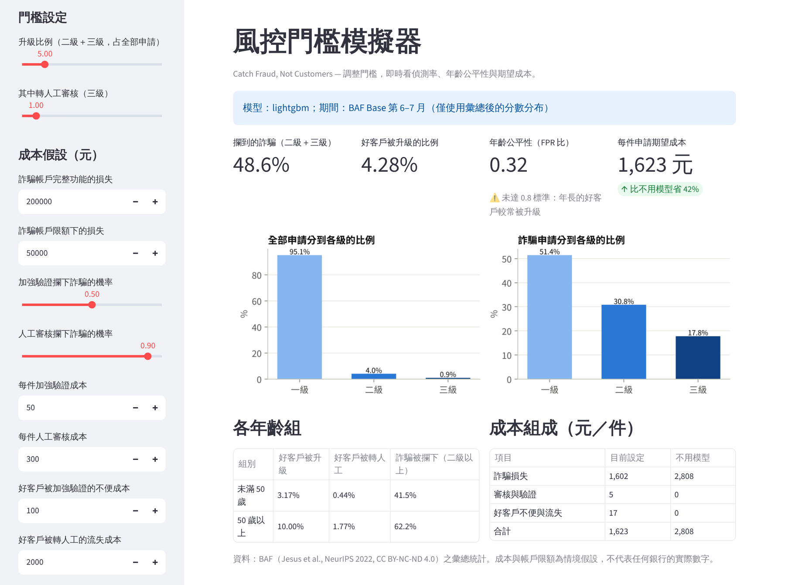{#fig-simulator width=100%}

以 @fig-simulator 的設定為例，將 5% 的申請升級至第二、三級，可攔下 48.6% 的詐騙申請，每件申請的期望成本由不使用模型時的 2,808 元降至 1,623 元，約節省 42%；然而，50 歲以上正常申請者被升級的比例（10.0%）約為未滿 50 歲者（3.2%）的 3 倍，FPR 比僅 0.32，畫面會同時提示未達 0.8 的標準。

此工具有三項管理用途。第一，作為門檻決策的溝通介面：風控、業務與法遵單位可在同一畫面上檢視「多攔一些詐騙」與「多打擾一些正常客戶」之間的取捨，使門檻的決定有共同的依據。第二，彌補本研究成本參數為假設值的限制：銀行可代入自身的損失與作業成本，立即檢視三級分流在該情境下的效益。第三，作為 5.5 節每月校準門檻時的輔助工具。在資料保護上，此工具僅使用模型分數的彙總分布（各分數區間的件數），不含任何個別申請者的資料，因此可對外展示而不違反資料的授權條款。

## 小結

綜合本章，本研究對銀行的開戶詐騙防制提出四項主要建議。第一，以三級分流取代二元決策，並優先擴充加強驗證的處理能量，因為驗證人力是決定效益的關鍵。第二，模型的選擇應依資料量與運算資源而定：資料充足時，經調參的梯度提升樹即具成本效益；資料較少時，表格基礎模型或跨行聯合學習可明顯提升偵測能力。第三，將公平性稽核制度化，明確定義受保護群體並量化公平的代價；在本研究的情境中，達成年齡公平的成本僅約 3%。第四，上線後應逐月監控並校準門檻，避免資料漂移使審核量超出人力負荷。這些建議同時呼應了金管會 AI 指引與《人工智慧基本法》對公平、可解釋與人類監督的要求；本研究開發的風控門檻模擬器（5.7 節）則可協助銀行代入自身的成本參數，檢視上述建議的效益。

# 結論

本章總結本研究的發現：6.1 節依研究問題歸納研究結論；6.2 節說明本研究的貢獻；6.3 節說明研究限制；6.4 節提出未來研究方向。

## 研究結論

本研究以銀行開戶詐騙偵測為情境，從管理者的角度回答「如何在攔截詐騙、不誤傷正常客戶、控制審核成本與公平對待各客群之間做出決策」。研究以 NeurIPS 2022 的 BAF 資料集為基礎，先重現原論文的發現，再比較三代表格模型的效能、公平與成本，並提出對應台灣數位存款帳戶分類的三級分流決策模型。@tbl-conclusions 依研究問題彙整主要結論。

| 研究問題 | 主要結論 | 管理意涵 |
|:------------------|:------------------------------------|:------------------------|
| RQ1 重現 | 重現成功：最佳模型的 FPR 比為 0.331，與原論文約 0.3 一致；並發現年齡分組定義會大幅改變變體資料的公平性結論 | 公平性稽核須明確定義受保護群體 |
| RQ2 三代模型 | 資料充足時三代模型差距僅 1–2 個百分點，調參後的梯度提升樹最佳且成本最低；資料少時表格基礎模型明顯領先 | 依資料量與運算資源選擇模型 |
| RQ3 年齡公平性 | 所有模型對年長者皆不公平（FPR 比 0.27–0.35），新一代模型並未改善；分組門檻可將 FPR 比提升至 0.90，偵測率僅降低約 1.6 個百分點 | 公平性處理的代價小，應制度化 |
| RQ4 三級分流決策 | 期望損失較 BAF 二元決策低 26.0%；加入公平限制僅增加 2.9% 成本；效益主要取決於加強驗證的人力 | 以限額開戶取代直接拒絕，優先投資驗證人力 |
| RQ5 知識發現 | 身分資訊的穩定性與可驗證性最能預警詐騙；簡單規則即可涵蓋約三分之一的詐騙申請 | 規則可作為第一層篩選與審核參考 |
| RQ6 小銀行困境 | 資料少的銀行改用表格基礎模型或聯合學習，偵測率可提升 10–20 個百分點，兩者差異不顯著 | 基礎模型的導入門檻較低 |

: 研究結論總表 {#tbl-conclusions}

綜合上述，本研究有三項主要結論。第一，在開戶詐騙偵測中，「如何使用模型分數」比「選擇哪一個模型」更重要。在資料充足的情況下，新一代的表格深度學習與基礎模型只比梯度提升樹多出約 1 至 2 個百分點的偵測率，運算成本卻高出兩至三個數量級；相對地，將二元決策改為三級分流，在相同的人力限制下可降低約四分之一的期望損失。第二，模型的不公平並未隨模型世代而改善，但改善公平的代價很小：無論是偵測率（約 1.6 個百分點）或期望損失（約 2.9%），達成年齡公平所需付出的代價都相當有限，銀行沒有理由忽略公平性。第三，模型上線後的管理與模型本身同樣重要：資料分布會隨時間改變，即使偵測率維持穩定，固定的門檻仍會使審核量增加約兩成，需要定期監控並重新校準。

## 研究貢獻

本研究的貢獻可分為學術與實務兩方面。在學術上，第一，本研究在極度不平衡且資料隨時間變化的詐騙情境中，同時比較三代表格模型的效能、公平與成本，補充了現有大型評比以整體預測指標為主的不足；第二，本研究將三支決策應用於開戶審查，並納入審核人力與公平性的限制，提出可求解且可檢驗的三級分流決策模型；第三，本研究在重現過程中發現原論文的年齡分組定義不一致，並以切點敏感度分析證明分組定義會影響公平性結論，提醒後續研究應明確報告受保護群體的定義。

在實務上，本研究提供銀行一套從模型選擇、分級審核、公平性稽核到上線監控的完整決策架構（第五章），並將其對照台灣數位存款帳戶的制度與國內的 AI 相關規範。此外，本研究將三級分流決策模型實作為互動式的風控門檻模擬器（5.7 節），且程式碼與實驗流程皆可完整重現，銀行或後續研究者可以依自身的資料與成本參數重新執行分析。

## 研究限制

本研究有以下限制。第一，BAF 是以真實、匿名化的銀行開戶資料經生成模型合成的資料，且並非台灣的資料；因此本研究與台灣數位存款帳戶制度的對應屬於情境模擬，研究發現不宜直接套用於特定銀行。第二，三級分流決策模型中的詐騙損失、驗證攔截率與各項成本皆為假設值；雖然敏感度分析顯示三級分流在所有情境下皆優於二元決策，但節省的幅度會隨假設改變。第三，受限於 GPU 記憶體，表格基礎模型在全量實驗中僅以 5 萬筆訓練資料作為情境資料，其在全量資料下的表現可能被低估。第四，本研究的模型比較以單一隨機種子進行，雖以拔靴法估計測試資料的抽樣變異，但未涵蓋模型訓練本身的隨機變異；此外，TabM 在小資料量下的失效原因尚未釐清。第五，公平性分析僅涵蓋年齡，未分析收入、就業狀態等其他屬性，也未分析多重屬性交織下的公平性。第六，小銀行的情境是以單一特徵切分資料所模擬，聯合學習亦僅以 MLP 實作，與實際的跨行合作環境仍有差距。第七，BAF 僅涵蓋 8 個月的開戶申請，且研究範圍限於開戶階段，無法涵蓋既有帳戶轉為人頭帳戶的情形。

## 未來研究方向

針對上述限制，本研究提出以下未來研究方向。第一，與國內銀行合作，以實際的開戶資料與成本數據驗證三級分流決策模型，並評估其在實際作業流程中的可行性。第二，以多個隨機種子重複實驗以估計模型的訓練變異，並探討表格基礎模型在更大規模情境資料或微調下的表現，以及 TabM 在小資料量下的失效原因。第三，將公平性分析延伸至收入、就業狀態等其他屬性，以及多重屬性的交織公平性。第四，結合 FiFAR 資料集所提供的模擬審核人員判斷 [@alves2023fifar]，以實際的人員能力取代本研究對人工審核攔截率的假設，進一步探討模型與審核人員的分工。第五，比較以梯度提升樹為基礎的聯合學習，以及在更接近實務的跨行資料差異下的表現。第六，將研究範圍延伸至開戶後的交易監控，例如結合交易網路分析，以偵測既有帳戶轉為人頭帳戶的情形；並參考 @zhang2026mule 以大型語言模型產生審核說明的做法，提升模型結果對審核人員的可用性。

# 參考文獻 {.unnumbered}

```{=typst}
#set par(first-line-indent: 0em, hanging-indent: 2em)
```

## 中文文獻 {.unnumbered}

::: {custom-style="Bibliography"}
ETtoday財經雲（2025年10月7日）。自然人憑證開戶大復活！金管會：16家銀行已受理。**ETtoday新聞雲**。<https://finance.ettoday.net/news/3046520>

人工智慧基本法（2026年1月14日）。

中央通訊社（2021年11月16日）。第三類數位存款帳戶轉帳上限 提高至每日10萬。**中央社**。<https://www.cna.com.tw/news/afe/202111160397.aspx>

中央通訊社（2026年8月6日）。8銀行強化AI防詐戰線 提升警示帳戶辨識精確率。**中央社**。<https://www.cna.com.tw/news/afe/202608060315.aspx>

今周刊（2026年1月6日）。「16.2萬個悲慘故事」詐團去年騙走893億…投資詐騙變少、網路購物卻變多…他上小紅書百萬被詐光。**今周刊**。<https://www.businesstoday.com.tw/article/category/183017/post/202601060042/>

金融監督管理委員會（2024年6月20日）。**金融業運用人工智慧（AI）指引**。

臺灣中小企業銀行（無日期）。**數位存款帳戶約定條款**（數位11105版）。<https://www.tbb.com.tw/zh-tw/-/media/tbb/files/zh-tw/about/information/download/adhesion-contract/deposit/digital-deposit-account-agreement-v11105.pdf>

優分析（2025年10月）。〈財委會質詢〉AI打詐頻傳鎖帳災情 金管會：9月警示帳戶控管見效 促提高精準度。**優分析 UAnalyze**。<https://uanalyze.com.tw/articles/9514134924>
:::

## 英文文獻 {.unnumbered}

::: {#refs}
:::

```{=typst}
#set par(first-line-indent: (amount: 2em, all: true), hanging-indent: 0em)
```

# 附錄 {.unnumbered}

## 附錄 A　程式碼與專案架構 {.unnumbered}

本研究的程式碼、設定檔與報告原始檔皆公開於 GitHub（網址見封面），包含逾 5,000 行 Python 程式碼與 85 個單元測試，並以 GitHub Actions 於每次更新時自動執行程式碼檢查與測試。BAF 原始資料依其授權條款（CC BY-NC-ND 4.0）不重新散布，使用者可透過專案提供的腳本自 Kaggle 下載。專案的主要架構如下：

```
fair-fraud-detection/
├── src/frauddetect/          核心程式（可匯入、可測試）
│   ├── data/                 資料下載、欄位驗證、時間切分
│   ├── models/               十個模型的統一介面、前處理、超參數搜尋
│   ├── evaluation/           效能指標、公平性指標、拔靴法檢定
│   ├── decision/             三級分流決策模型
│   ├── explain/              SHAP 與代理模型規則萃取
│   ├── monitoring/           PSI 資料漂移監控
│   ├── federated/            小銀行模擬與聯合學習（FedAvg）
│   ├── experiments/          實驗 E0–E11 的執行程式
│   ├── viz/                  統一的圖表風格
│   └── cli.py                命令列介面
├── configs/                  實驗設定（模型參數、成本假設、資料切分）
├── tests/                    單元測試
├── reports/paper/            本報告的原始檔、圖表與參考文獻
├── app/                      互動式風控門檻模擬器（Streamlit）
├── docs/                     研究計畫書、實驗手冊、環境建置說明
├── Makefile                  一鍵執行的指令
└── .github/workflows/        自動化測試（CI）
```

所有實驗皆可透過 `make` 指令重新執行，各實驗與報告章節的對應如 @tbl-reproduce 所示（實驗程式皆位於 `src/frauddetect/experiments/`）。實驗的完整設定記錄於 `configs/` 目錄，每次執行時亦會自動記錄硬體、套件版本與程式版本。

| 實驗 | 指令 | 主要程式 | 章節 |
|:-------------------------|:-------------------------------|:-----------------------------|:------:|
| E0 探索式資料分析 | `make eda` | `eda.py` | 3.2 |
| E1 重現原論文 | `make reproduce` | `reproduce.py` | 4.1 |
| E2–E3 三代模型比較 | `make benchmark`、 `make tuned` | `benchmark.py` | 4.2 |
| E4 學習曲線 | `make learning-curve` | `benchmark.py` | 4.3 |
| E5–E6 年齡公平性 | `make fairness` | `fairness_exp.py` | 4.4 |
| E7 三級分流決策 | `make decision` | `decision_exp.py` | 4.5 |
| E8 知識發現 | `make explain` | `explain_exp.py` | 4.6 |
| E9 上線監控 | `make monitor` | `monitoring_exp.py` | 5.5 |
| E10 小銀行困境 | `make small-bank` | `small_bank.py` | 4.7 |
| E11 風控門檻模擬器 | `make app-data`、 `make app` | `app_data.py` | 5.7 |
| 報告 | `make report` | `reports/paper/index.qmd` | 全文 |

: 實驗、指令與程式的對應 {#tbl-reproduce}

## 附錄 B　生成式 AI 使用說明 {.unnumbered}

本研究使用生成式 AI 工具（Claude）協助程式開發、文獻整理與圖表製作；
研究問題的選定、結果解讀與報告論述由作者負責並以自己的文字撰寫。
（待依實際使用情形修訂。）
