::: {custom-style="RepoLink"}
本報告的程式碼與完整實驗紀錄：<https://github.com/rtudvb/fair-fraud-detection>

程式碼與實驗設定公開，主要結果皆可依附錄 A 的指令重現
:::

# 摘要 {.unnumbered}

詐騙集團以人頭帳戶收受與移轉詐騙所得，使開戶審查成為銀行防堵詐騙的第一道關卡。然而審查時，銀行必須同時兼顧攔截詐騙、不誤傷正常客戶、控制審核成本與公平對待各客群。本研究以 NeurIPS 2022 發表的銀行開戶詐騙資料集（BAF）為基礎 [@jesus2022turning]，在重現原論文的發現後，比較梯度提升樹、表格深度學習與表格基礎模型三代共十個模型的偵測效能、年齡公平性與運算成本，並以三支決策為理論基礎，提出對應台灣數位存款帳戶分類的三級分流決策模型。

研究結果顯示：第一，在資料充足時，三代模型的偵測率差距僅 1 至 2 個百分點，經調參的梯度提升樹成本最低；資料較少時，表格基礎模型則明顯領先。第二，所有模型對 50 歲以上的正常申請者皆不公平，其誤判率約為較年輕者的 3 倍；以分組門檻處理後，誤判率比可由 0.34 提升至 0.90，偵測率僅降低約 1.6 個百分點。第三，以「加強驗證搭配限額開戶」取代直接拒絕的三級分流，將 10% 的申請導入加強驗證、1% 轉人工審核（原論文的二元決策需將 6.59% 轉人工審核）。在本研究的情境成本下（詐騙損失以帳戶轉帳限額為代理值，屬社會總成本觀點，而非銀行實際的財務節省），並以測試期的分數分布換算門檻、使各級比例維持在人力上限內的理想化校準為前提，其期望成本較人力上限內最佳的二元決策低 44.8%，也較原論文的二元決策低 23.8%。若再以年齡組別的分位數門檻（兩組各用一組門檻）使兩組正常申請者被升級的比例相近（升級 FPR 比 0.95），期望成本較未加此限制的三級分流增加 3.6%。三級分流的效益主要來自以限額帳戶降低詐騙損失，其成立的前提是限額確能降低短期的風險暴露，並取決於加強驗證的處理能量。此外，固定門檻上線後的審核量會隨分數分布漂移而超出人力上限，需以近期的分數分布定期校準門檻。最後，本研究在重現時發現，原論文正文、資料生成程式與公平性評估程式對年長組的定義不一致；原論文圖中變體資料的誤判率比與正文的定義相符，但若以資料中實際被注入偏差的年齡組計算，誤判率比低 2 至 3 倍，顯示原論文對變體資料公平性的解讀仍需進一步確認。

本研究據此提出分級審核流程、模型導入策略、公平性稽核與上線監控等管理建議，對照金管會的 AI 指引與《人工智慧基本法》，並將決策模型實作為互動式的開戶風控決策支援系統，供銀行代入自身的成本參數。

# Abstract {.unnumbered}

Fraud rings move scam proceeds through mule accounts, which makes the account-opening review a bank's first line of defence against fraud. At that point, however, a bank must balance four goals: stopping fraud, not harming legitimate customers, controlling review costs and treating customer groups fairly. Building on the Bank Account Fraud (BAF) dataset published at NeurIPS 2022 [@jesus2022turning], this study first reproduces the original paper's findings and then compares ten models from three generations (gradient-boosted trees, tabular deep learning and tabular foundation models) in detection performance, age fairness and computational cost. Grounded in three-way decision theory, it proposes a three-tier decision model mapped to Taiwan's classification of digital deposit accounts.

The results are as follows. First, with ample data the three generations differ by only one to two percentage points in detection rate, and tuned gradient-boosted trees are the cheapest; with little data, tabular foundation models clearly lead. Second, every model is unfair to legitimate applicants aged 50 and over, whose false positive rate is about three times that of younger applicants; group-specific thresholds raise the FPR ratio from 0.34 to 0.90 at a cost of only about 1.6 percentage points in detection rate. Third, a three-tier policy that replaces outright rejection with enhanced verification and a limited-function account sends 10% of applications to enhanced verification and 1% to manual review, whereas the original paper's binary policy sends 6.59% to manual review. Under the study's scenario costs (fraud losses proxied by account transfer limits, a social-cost view rather than savings a bank would realise) and an idealised calibration that derives thresholds from the test period's score distribution so that each tier stays within staff capacity, its expected cost is 44.8% lower than that of the best binary policy within capacity and 23.8% lower than that of the original paper's binary policy. Using per-age-group quantile thresholds to bring the escalation rates of legitimate applicants in the two groups close together (escalation FPR ratio 0.95) raises the expected cost by 3.6% relative to the three-tier policy without this constraint. The benefit of the three-tier policy comes mainly from limiting the losses of fraudulent accounts: it holds only if account limits do reduce short-term exposure, and it depends on the capacity for enhanced verification. Moreover, review volumes under fixed thresholds drift beyond staff capacity once deployed, so thresholds should be recalibrated regularly from recent score distributions. Finally, the reproduction reveals that the paper text, the data-generation code and the fairness-evaluation code define the older group inconsistently. The FPR ratios reported for the variant datasets match the paper's definition, but computed on the age group into which bias was actually injected they are two to three times lower, suggesting that the original interpretation of fairness on the variant datasets warrants further verification.

Based on these findings, the study proposes a tiered review process, model-adoption strategies, fairness auditing and post-deployment monitoring, relates them to the Financial Supervisory Commission's AI guidelines and Taiwan's AI Basic Act, and implements the decision model as an interactive decision support system into which banks can enter their own cost parameters.

::: {custom-style="ShowcaseTitle"}
從模型到管理實務：【開戶風控決策支援系統】
:::

::: {custom-style="ShowcaseImage"}
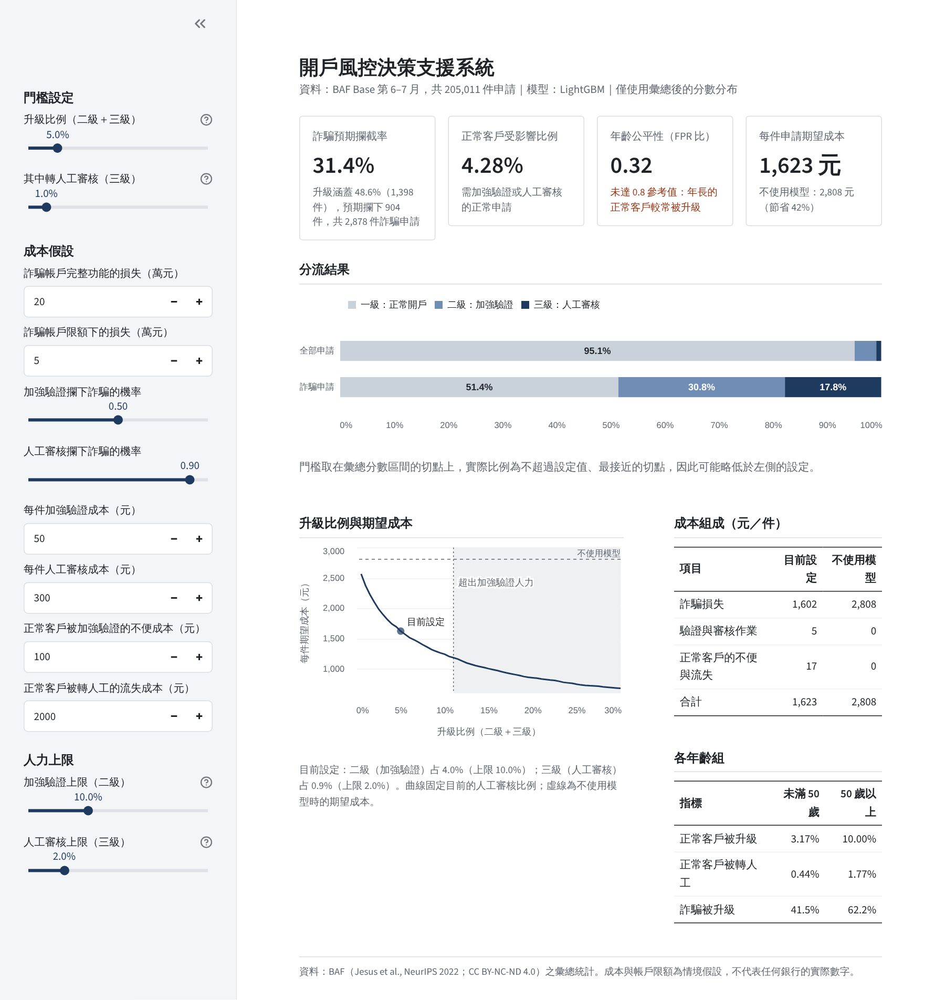{width=100%}
:::

::: {custom-style="ShowcaseNote"}
本研究將模型的風險分數結合三級分流決策，實作為風控主管可直接操作的決策支援系統：調整門檻與成本假設，即可即時檢視預期攔下的詐騙比例、正常客戶受影響的比例、年齡公平性與每件申請的期望成本（詳見 [5.6](#sec-dss) 節）。
:::

```{=typst}
#heading(level: 1, numbering: none, outlined: false)[目錄]
#outline(title: none, depth: 2, indent: auto)
#heading(level: 1, numbering: none, outlined: false)[圖目錄]
#outline(title: none, target: figure.where(kind: "quarto-float-fig"))
#heading(level: 1, numbering: none, outlined: false)[表目錄]
#outline(title: none, target: figure.where(kind: "quarto-float-tbl"))
```

```{=openxml}
<w:p><w:pPr><w:pStyle w:val="FrontMatterHeading"/></w:pPr><w:r><w:t>目錄</w:t></w:r></w:p>
<w:p><w:r><w:fldChar w:fldCharType="begin" w:dirty="true"/></w:r><w:r><w:instrText xml:space="preserve"> TOC \o "1-2" \h \z \u </w:instrText></w:r><w:r><w:fldChar w:fldCharType="separate"/></w:r><w:r><w:t>（請在 Word 中按 F9 更新）</w:t></w:r><w:r><w:fldChar w:fldCharType="end"/></w:r></w:p>
<w:p><w:pPr><w:pStyle w:val="FrontMatterHeading"/></w:pPr><w:r><w:t>圖目錄</w:t></w:r></w:p>
<w:p><w:r><w:fldChar w:fldCharType="begin" w:dirty="true"/></w:r><w:r><w:instrText xml:space="preserve"> TOC \h \z \t "Image Caption,1" </w:instrText></w:r><w:r><w:fldChar w:fldCharType="separate"/></w:r><w:r><w:t>（請在 Word 中按 F9 更新）</w:t></w:r><w:r><w:fldChar w:fldCharType="end"/></w:r></w:p>
<w:p><w:pPr><w:pStyle w:val="FrontMatterHeading"/></w:pPr><w:r><w:t>表目錄</w:t></w:r></w:p>
<w:p><w:r><w:fldChar w:fldCharType="begin" w:dirty="true"/></w:r><w:r><w:instrText xml:space="preserve"> TOC \h \z \t "Table Caption,1" </w:instrText></w:r><w:r><w:fldChar w:fldCharType="separate"/></w:r><w:r><w:t>（請在 Word 中按 F9 更新）</w:t></w:r><w:r><w:fldChar w:fldCharType="end"/></w:r></w:p>
```

# 緒論 {#sec-intro}

## 研究背景與動機 {#sec-background}

詐騙已是台灣社會最受關注的治安與金融問題之一。依警政署 165 打詐儀表板的統計，2025 年全年詐騙案件受理約 16.2 萬件，財損金額達 893.26 億元[（今周刊，2026）]{.cite}。詐騙所得必須經由銀行帳戶移轉，人頭帳戶因此成為詐騙金流的關鍵環節，而隨著數位存款帳戶普及，民眾不必臨櫃即可開戶，「開戶審查」便成為銀行攔阻人頭帳戶的第一道關卡。

2025 年的自然人憑證事件，凸顯了開戶審查在管理上的難題。部分民眾受騙交出自然人憑證，遭詐騙集團用於線上開立數位存款帳戶，一度有 17 家銀行暫停受理以自然人憑證線上開戶；金融監督管理委員會（以下簡稱金管會）要求銀行依風險基礎強化身分驗證後恢復受理，銀行多改為搭配他行存款帳戶驗證、視訊或電信認證，至同年 9 月底已有 16 家恢復[（ETtoday財經雲，2025）]{.cite}。全面暫停雖能止血，卻也讓正常客戶無法開戶；恢復受理則必須回答「哪些申請需要加強驗證」。換言之，開戶審查需要依申請者的風險高低採取不同強度的處置，而不只是「通過」與「拒絕」兩種選擇。

銀行導入人工智慧（artificial intelligence, AI）偵測可疑帳戶，雖提升了攔阻效率，也帶來誤判的代價。立法委員於立法院財政委員會質詢 AI 打詐造成正常民眾帳戶遭誤鎖、影響薪資轉帳與日常扣款等問題，金管會隨後要求銀行提升模型精準度，並提供 24 小時解除管控的服務[（優分析，2025）]{.cite}。由此可見，銀行在開戶審查上同時面對三個彼此牽制的目標，如 @tbl-tradeoffs 所示：審查越嚴，越能攔下詐騙，但也越容易誤擋正常客戶、增加人工審核的負擔；審查越鬆，客戶體驗與成本較佳，卻可能放行人頭帳戶。此外，若誤判集中於特定客群，還會衍生公平性與法規風險。

| 管理目標 | 未達成時的後果 | 主要承擔者 |
|:------------|:------------------------------|:----------------|
| 攔截詐騙開戶 | 人頭帳戶被用於收受詐騙款項，造成民眾財損，銀行面臨聲譽與監理壓力 | 被害民眾、銀行 |
| 不誤傷正常客戶 | 正常客戶開戶受阻或帳戶遭誤鎖，造成不便、客訴與客戶流失 | 正常客戶、銀行 |
| 控制審核成本 | 轉人工審核的案件過多，人力負擔與開戶等待時間增加 | 銀行 |
| 公平對待各客群 | 特定年齡客群被誤判的比例偏高，違反公平原則並引發法規風險 | 特定客群、銀行 |

: 開戶審查的管理目標與取捨 {#tbl-tradeoffs}

在法規面，公平性與可解釋性已從倫理原則走向制度要求。金管會於 2024 年發布《金融業運用人工智慧（AI）指引》，要求金融機構運用 AI 時應盡可能避免演算法偏見所造成的不公平[（金融監督管理委員會，2024）]{.cite}；立法院於 2025 年 12 月 23 日三讀通過《人工智慧基本法》，並於 2026 年 1 月 14 日公布施行，明定政府推動 AI 研發與應用應遵循「公平與不歧視」「透明與可解釋」等七項原則[（人工智慧基本法，2026）]{.cite}。然而，詐騙偵測模型是否公平，過去較少受到檢驗。@jesus2022turning 於 NeurIPS 2022 發表銀行開戶詐騙基準資料集（Bank Account Fraud，以下簡稱 BAF），其實驗發現：在誤判率固定為 5% 的操作點下，表現最佳的 LightGBM 模型在年齡組間的誤判率比（FPR 比）僅約 0.3，亦即年長的正常申請者（論文以 50 歲為分界）被誤判為詐騙的機率，是較年輕申請者的三倍以上。對銀行而言，這代表一個「最準」的模型，可能正是一個需要被稽核的模型。

在技術面，銀行可選擇的工具也在快速變化。表格資料的預測長期由梯度提升樹（gradient boosted decision trees, GBDT）主導 [@grinsztajn2022tree]；近年則出現新一代的表格深度學習模型，如 TabM [@gorishniy2025tabm] 與 RealMLP [@holzmuller2024better]，以及在大量合成資料上預訓練、可直接對新資料集進行預測的表格基礎模型（tabular foundation models），如發表於 *Nature* 的 TabPFN [@hollmann2025accurate]，以及 2026 年發表的 TabPFN-3.5 [@jaeger2026tabpfn35] 與 TabICLv2 [@qu2026tabiclv2]。大型評比 TabArena 指出，GBDT 在實務表格資料上仍具競爭力，而基礎模型在較小的資料集上表現特別突出 [@erickson2025tabarena]；但這些新模型在高風險決策中是否同樣公平仍無定論，@liu2026causal 對 TabPFN 的實證研究即發現，其公平性改善有限且不穩定。對銀行而言，問題不在於哪個模型分數最高，而在於「是否值得導入」：新模型帶來的偵測效益，是否足以抵銷其運算成本與潛在的公平性風險？資料較少的中小型銀行，又該如何取得足夠的偵測能力？產業界已開始探索跨行合作，2026 年 8 月，由台北富邦銀行領銜的 8 家銀行公布以聯合學習（federated learning）共同訓練防詐模型的驗證結果，在不交換原始資料的前提下，整體警示帳戶辨識精確率提升約兩倍[（中央通訊社，2026）]{.cite}。

綜合上述，現有研究與實務之間存在落差。BAF 的原作者僅以未考慮公平性的 LightGBM 建立基準，並明確鼓勵後續研究嘗試具公平性考量的方法 [@jesus2022turning]；而新一代模型在極度不平衡（詐騙約占 1%）、資料分布隨時間變化的詐騙情境中，其效能、公平與成本之間的取捨，以及如何將模型分數轉化為符合台灣制度、兼顧審核人力與公平性的開戶決策，據筆者所知尚少研究探討。本研究即以此為動機，站在銀行管理者的角度，以 BAF 為基礎評估三代 AI 模型的導入價值，並提出對應台灣數位存款帳戶分類的三級分流審查機制。

## 研究目的與研究問題 {#sec-purpose}

本研究的核心目的，是協助銀行在開戶審查中，於「攔截詐騙」「不誤傷正常客戶」「控制審核成本」與「公平對待各客群」之間做出有依據的決策。具體而言，本研究期望回答以下管理問題，並提供對應的決策工具：

1. 導入決策：評估傳統機器學習、從頭訓練的深度學習與預訓練表格基礎模型三類共十個模型的偵測效益、公平性與運算成本，作為銀行選擇與導入 AI 模型的依據；
2. 公平性稽核：檢驗模型是否對特定年齡客群較不公平，並量化改善公平性所需付出的偵測率代價，作為法規遵循與內部稽核的參考；
3. 審查流程設計：提出三級分流決策模型，將模型的風險分數轉化為「正常開戶、加強驗證後限額開戶、人工審核」三種處置，並在審核人力與公平性的限制下使期望損失最小；
4. 風控知識萃取：從模型中萃取最能預警詐騙開戶的特徵，轉換為風控人員可直接使用的規則；
5. 管理建議：綜合上述結果，提出分級審核流程、公平性稽核、上線監控與法規對照等可落地的建議。

為確保上述分析建立在可信的基礎上，本研究亦獨立重現 BAF 論文的基準實驗，確認實驗結果與原論文一致後，再進行延伸分析。

依據上述研究目的，本研究提出六個研究問題，各問題所對應的管理意涵如 @tbl-rq 所示。其中 RQ1 至 RQ5 為核心問題，RQ6 為延伸問題；各問題對應的研究假說於第三章說明。

| 研究問題 | 內容 | 管理意涵 |
|:----------------|:-----------------------------|:--------------------|
| RQ1 重現 | 能否重現 BAF 論文的基準發現？ | 確認分析基礎可信 |
| RQ2 三代模型 | 傳統機器學習、深度學習、基礎模型，何者最適合詐騙偵測？代價為何？ | 是否值得導入新一代 AI 模型 |
| RQ3 年齡公平性 | 模型是否對年長者不公平？公平性處理的代價為何？結論是否隨年齡切點改變？ | 公平性稽核與法規遵循 |
| RQ4 三級分流決策 | 在公平與審核人力限制下，如何設定三級分流門檻使期望損失最小？ | 開戶審查流程與門檻設計 |
| RQ5 知識發現 | 哪些特徵最能預警詐騙開戶？能轉成哪些風控規則？ | 風控規則與人員訓練 |
| RQ6 小銀行困境（延伸） | 資料較少的銀行該採用基礎模型，還是加入跨行聯合學習？ | 中小型銀行的策略選擇 |

: 研究問題與管理意涵 {#tbl-rq}

## 研究貢獻 {#sec-contrib}

本研究的貢獻有三，分別對應管理實務與學術研究，如 @tbl-contributions 所示。

| 貢獻 | 內容 | 對管理實務 | 對學術研究 | 對應 |
|:----|:--------------|:-------------------|:-------------------|:----------|
| 一 | 三級分流決策模型 | 提供兼顧損失、人力與公平的開戶審查機制，以「加強驗證搭配限額開戶」取代直接拒絕，並實作為互動式的決策支援系統 | 將三支決策結合台灣數位帳戶制度，並納入公平與人力限制 | RQ4 |
| 二 | 三代 AI 模型的導入評估 | 提供選擇與導入模型時，偵測效益、公平性與成本的比較依據 | 在極度不平衡、隨時間變化的詐騙情境中，同時評估三代模型的效能、公平與成本 | RQ2、RQ3 |
| 三 | 公平性結論的穩健性 | 提醒銀行稽核公平性時須明確定義分組方式 | 發現原論文年齡分組定義不一致，並進行切點敏感度分析 | RQ1、RQ3 |

: 研究貢獻 {#tbl-contributions}

第一，本研究的主要貢獻在於開戶審查的決策設計。本研究以三支決策（three-way decisions）[@yao2010threeway] 為理論基礎，將模型分數對應到台灣數位存款帳戶的分類，於中間一級以「加強驗證搭配限額開戶」取代直接拒絕，並在審核人力與年齡公平的限制下最小化期望損失，使模型的預測結果能直接轉化為銀行的審查流程。第二，本研究將 2024 至 2026 年間發表的表格深度學習與基礎模型，置於詐騙偵測這一極度不平衡且資料隨時間變化的高風險情境中，同時檢驗其效能、公平與成本，為銀行的導入決策提供依據，據筆者所知，目前尚少研究在此情境下進行三者並重的比較。第三，本研究在重現過程中發現，BAF 論文正文以「年齡大於 50 歲」劃分年長組，而官方的公平性評估程式則以「50 歲以上」劃分；由於 BAF 的年齡以 10 歲為一級，兩者會使 50 歲這一級被歸入不同組別。本研究據此分析公平性結論對年齡切點的敏感度，提醒銀行在進行公平性稽核時，分組定義本身即可能影響結論。

## 研究範圍與限制 {#sec-scope}

本研究的範圍如下。第一，研究對象為銀行線上開戶申請階段的詐騙偵測與審查決策，不包含開戶之後的交易監控，因此無法涵蓋既有帳戶轉為人頭帳戶的情形。第二，資料以 BAF 的基礎資料集（Base）為主，重現實驗另涵蓋其五個變體。第三，BAF 提供年齡、收入與就業狀態三個可作為受保護屬性的欄位，本研究與原論文一致，聚焦於年齡。

本研究的限制如下。第一，BAF 是以真實、匿名化的銀行開戶資料經生成模型合成的資料，且並非台灣的資料；因此本研究與台灣數位存款帳戶制度的對應屬於情境模擬，研究發現不宜直接套用於特定銀行。第二，三級分流決策模型中的損失與成本參數為假設值，本研究以敏感度分析檢驗結論是否依賴特定數值，實際導入時應以銀行自身的數據校正。第三，受限於 GPU 記憶體，表格基礎模型在部分實驗中以分層抽樣的訓練子集進行。第四，BAF 僅涵蓋 8 個月的申請資料，難以觀察更長期的分布變化。第五，詐騙標籤來自開戶後可觀察到的結果，可能受既有審查流程影響（選擇性標籤），模型學到的風險關係不一定能推廣至所有申請者。

## 研究流程與時程 {#sec-flow}

本研究的流程如 @fig-research-flow 所示：第一章說明研究背景、目的、問題與貢獻；第二章回顧詐騙偵測、不平衡學習、表格資料模型、演算法公平性、可解釋 AI、三支決策與聯合學習的相關文獻，並歸納研究缺口；第三章說明研究架構、資料、模型、評估指標、三級分流決策模型與實驗設計；第四章依六個研究問題報告實驗結果；第五章將結果轉化為管理意涵與建議；第六章總結研究結論、限制與未來研究方向。

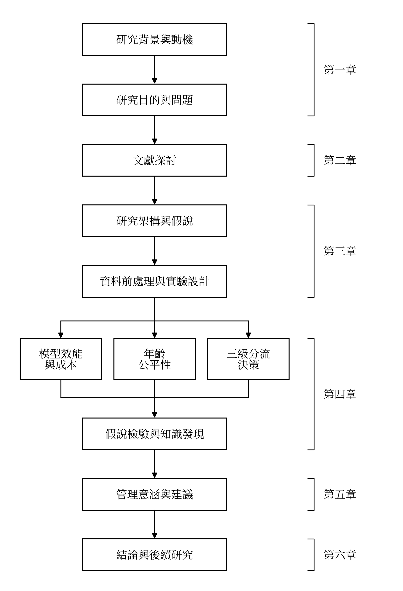{#fig-research-flow width=85%}

本研究自 2026 年 10 月 2 日開始，至 11 月 28 日定稿，為期約兩個月，各階段的時程如甘特圖 @fig-gantt 所示。實驗程式先以合成資料完成開發與測試，再於真實資料上執行，因此程式開發與實驗執行的時程部分重疊；報告撰寫則隨實驗結果陸續進行。

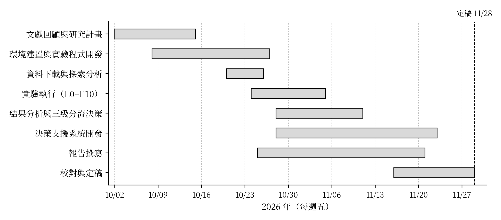{#fig-gantt width=100%}

# 文獻探討 {#sec-literature}

本章回顧與本研究相關的文獻：[2.1](#sec-lit-fraud) 節說明金融詐騙與人頭帳戶偵測的研究脈絡與資料集；[2.2](#sec-lit-imbalance) 節討論不平衡資料與成本敏感學習；[2.3](#sec-lit-models) 節整理表格資料模型從梯度提升樹、表格深度學習到表格基礎模型的發展；[2.4](#sec-lit-fairness) 節回顧演算法公平性的定義與處理方法；[2.5](#sec-lit-xai) 節介紹可解釋人工智慧與三支決策；[2.6](#sec-lit-fl) 節說明聯合學習在跨機構防詐的應用；[2.7](#sec-gap) 節歸納研究缺口。

## 金融詐騙與人頭帳戶偵測 {#sec-lit-fraud}

詐騙偵測是資料探勘最早的應用領域之一。@bolton2002statistical 回顧統計方法在信用卡、電信與洗錢等詐騙偵測上的應用，將方法區分為以已標記樣本訓練的監督式方法，以及偵測異常行為的非監督式方法，並討論詐騙者會隨偵測手段調整行為等挑戰。@dalpozzolo2018credit 從實務運作的角度指出，信用卡詐騙偵測系統須面對資料分布隨時間改變的概念漂移（concept drift）、交易須經查核才能取得標籤的驗證延遲，以及調查人員每日僅能查核有限警示等限制，因此評估模型時應重視最前段警示的精確度，而非整體正確率。這些特性同樣存在於開戶詐騙偵測：詐騙申請占比低、手法隨時間改變，而審核人力有限。

近年的系統性文獻回顧顯示，此領域已由傳統統計與機器學習方法擴展至深度學習。@chen2025fraudslr 以 Kitchenham 的系統性文獻回顧方法，分析 2019 至 2024 年間 57 篇以深度學習進行金融詐騙偵測的研究；@jerialvarado2025banking 則回顧 2019 至 2025 年間 61 篇銀行業以機器學習偵測詐騙的期刊論文，並指出模型之間的比較，以及尚未涵蓋的銀行業務情境，仍有待後續研究。

在人頭帳戶方面，@zhang2026mule 提出新加坡華僑銀行（OCBC）的人頭帳戶偵測流程：先以 LightGBM 對 280 個特徵建模，再以 TreeSHAP 拆解每筆預測的特徵貢獻，最後由大型語言模型生成供調查人員閱讀的說明。該系統上線後，警示的有效率（yield rate）由原本規則式系統的 61% 提升至 89%。此研究顯示，梯度提升樹搭配特徵歸因，已是銀行防制人頭帳戶的實務做法。

開戶詐騙的公開研究長期受限於資料取得，因為銀行資料涉及個人隱私而難以公開。@jesus2022turning 因此發表 BAF 資料集：以真實、匿名化的銀行開戶資料訓練生成模型，合成六個各含一百萬筆申請紀錄、涵蓋八個月的資料集；除基準資料集外，其餘五個變體刻意注入不同型態的偏差，可用於檢驗模型在偏差、極度不平衡（詐騙約占 1%）與資料隨時間變化下的表現。同一研究團隊後續以 BAF 為基礎發表 FiFAR 資料集，加入 50 位模擬詐騙分析師的判斷與人工審查容量的限制，用於研究模型何時應將案件轉交人工審查（learning to defer）[@alves2023fifar]。BAF 的設計貼近本研究關注的問題，因此本研究以其作為實驗資料（詳見第三章）。

## 不平衡資料與成本敏感學習 {#sec-lit-imbalance}

當某一類別的樣本遠少於另一類別時，以整體正確率為目標的分類器會傾向預測多數類別。@he2009learning 回顧此類不平衡學習問題，將對策歸納為抽樣方法、成本敏感方法、核方法與主動學習等類型，並指出正確率在此情境下具有誤導性，應改以 ROC 曲線、精確率—召回率曲線等方式評估。抽樣方法中最具代表性者為 SMOTE [@chawla2002smote]，以在少數類別樣本之間內插的方式合成新樣本。

成本敏感學習（cost-sensitive learning）則直接將不同錯誤的代價納入決策。@elkan2001foundations 指出，當模型輸出的機率經過校準時，最小化期望成本的決策只需調整分類門檻：若將正常申請誤判為詐騙的成本為 $c_{FP}$、漏判詐騙的成本為 $c_{FN}$，且正確判斷的成本為零，則應在詐騙機率 $p \geq c_{FP}/(c_{FP}+c_{FN})$ 時判定為詐騙。換言之，成本的差異可以透過門檻反映，不一定需要改變訓練資料的分布。

在詐騙偵測實務中，誤判成本往往不易精確量化，因此常改以限制誤判率的方式設定操作點。BAF 論文即以「誤判率（false positive rate, FPR）為 5% 時的偵測率（true positive rate, TPR）」作為主要指標，對應銀行限制正常客戶遭誤擋比例的考量 [@jesus2022turning]。本研究沿用此指標以便與原論文比較，並在三級分流決策中進一步納入成本與審核人力的限制（第三章）。

## 表格資料模型：從梯度提升樹到基礎模型 {#sec-lit-models}

梯度提升樹（gradient boosted decision trees, GBDT）以逐步加入決策樹的方式修正前一階段的誤差，是表格資料最常用的模型。XGBoost 以正規化的目標函數與可處理稀疏資料的分裂演算法，使梯度提升可擴展至大規模資料 [@chen2016xgboost]；LightGBM 提出以梯度為基礎的單邊抽樣（GOSS）與互斥特徵綁定（EFB），大幅縮短訓練時間 [@ke2017lightgbm]；CatBoost 則以有序提升（ordered boosting）與類別特徵的有序目標統計，緩解預測偏移（prediction shift）的問題 [@prokhorenkova2018catboost]。BAF 論文的基準模型即為 LightGBM [@jesus2022turning]。

@grinsztajn2022tree 以 45 個中型資料集（約一萬筆樣本）比較樹模型與深度學習，發現樹模型仍明顯較佳，並將原因歸納為三項：神經網路傾向學習過度平滑的函數、容易受無資訊特徵影響，以及其旋轉不變性與表格資料的特性不符。

為縮小與樹模型的差距，近年的表格深度學習研究轉向改良多層感知器（multilayer perceptron, MLP）。@holzmuller2024better 提出 RealMLP，並以 118 個資料集調校 GBDT 與 RealMLP 的預設超參數、再以另外 90 個資料集驗證，發現在中大型資料集上，RealMLP 的時間與準確度取捨優於其他神經網路，且與 GBDT 相當；經調校的預設參數也使模型不需逐一調參即有良好表現。@gorishniy2025tabm 提出 TabM，以參數高效的集成方式（基於 BatchEnsemble）讓單一 MLP 同時輸出多組預測；這些隱含的子模型共享大部分參數，在效能與效率上優於傳統的深度集成，且研究顯示注意力或檢索式架構所增加的複雜度並未帶來相應的效益。

@vanbreugel2024position 主張，相較於文字與影像，表格資料的基礎模型研究明顯不足，應列為研究優先方向。表格基礎模型的代表為 TabPFN：@hollmann2025accurate 以大量由結構因果模型生成的合成資料集預訓練 Transformer，使其能以情境學習（in-context learning）的方式，在一次前向傳遞中對新資料集進行預測，不需針對資料集訓練；在一萬筆樣本以內的資料集上，其表現優於經四小時調參的強基準模型集成。

早期的表格基礎模型受限於可處理的資料量。2026 年發表的新一代模型大幅提升了規模：TabPFN-3.5 的技術報告指出其可處理多達一百萬筆訓練資料，且在 TabArena 評比上明顯優於前一代 TabPFN-3 [@jaeger2026tabpfn35]；TabICLv2 以新的合成資料生成引擎、可擴展的 softmax 注意力與 Muon 最佳化器進行預訓練，在不調參的情況下即超越經調參、集成並以真實資料微調的 RealTabPFN-2.5，並能在 50 GB 以內的 GPU 記憶體處理百萬筆規模的資料 [@qu2026tabiclv2]。由於 BAF 單一資料集即有一百萬筆，新一代基礎模型的規模擴展，使其得以在完整規模的詐騙資料上與梯度提升樹比較。

為公平比較上述模型，@erickson2025tabarena 建立持續更新的表格資料評比 TabArena，在預設參數、調參與集成三種情境下評估模型。結果顯示 GBDT 在實務表格資料上仍具競爭力，而基礎模型在較小的資料集上表現特別突出；由於部分基礎模型無法處理所有資料集，其僅在適用的資料集子集上評估。三代表格模型的特性整理如 @tbl-model-generations 所示。

| 世代 | 代表模型 | 學習方式 | 主要優勢 | 主要限制 |
|:-----------|:----------------|:----------------|:-------------------|:-------------------|
| 梯度提升樹 | XGBoost、LightGBM、CatBoost | 針對每個資料集從頭訓練決策樹集成 | 訓練快、不受特徵尺度影響、可用 TreeSHAP 精確解釋 | 需調參；不具跨資料集的先驗知識 |
| 深度學習 | TabM、RealMLP | 針對每個資料集從頭訓練神經網路 | 可用 GPU 加速、易與其他神經網路模組結合 | 需前處理與調參；訓練成本較高 |
| 基礎模型 | TabPFN-3.5、TabICLv2 | 以合成資料預訓練，對新資料集進行情境學習 | 不需調參即有強表現；小資料集優勢明顯 | 推論成本高；大型資料常需抽樣；部分模型權重限非商業使用 |

: 三代表格模型比較 {#tbl-model-generations}

然而，上述評比多以整體預測指標衡量模型，較少在極度不平衡且資料隨時間變化的詐騙情境中，以固定誤判率下的偵測率進行比較，也未同時檢驗模型的公平性與決策成本。

## 演算法公平性 {#sec-lit-fairness}

群體公平性多以模型在不同群體間的錯誤率或預測結果是否一致來衡量。@hardt2016equality 提出「均等勝算」（equalized odds），要求各群體的真陽性率與偽陽性率皆相等，以及僅要求真陽性率相等的「機會均等」（equal opportunity），並說明可透過針對各群體設定不同門檻（或隨機化門檻）的後處理方式達成。在詐騙偵測中，偽陽性代表正常客戶被誤認為詐騙而遭拒絕或加強審查，因此 BAF 以年齡組間的偽陽性率比值衡量公平性，比值越接近 1 越公平 [@jesus2022turning]。以各群體偽陽性率相等為目標的定義，又稱為預測均等（predictive equality）[@corbettdavies2017algorithmic]。

不同的公平性定義往往無法同時成立。@chouldechova2017fair 證明，當各群體的基本率不同時，各群體陽性預測值相等的預測工具，無法同時使各群體的偽陽性率與偽陰性率相等；@kleinberg2017inherent 也證明，除了完美預測或各群體基本率相同等特殊情況外，群體內校準與錯誤率平衡等條件無法同時滿足。因此，實務上須依應用情境選擇公平性定義，並揭露其與效能之間的取捨。

公平性處理方法依介入的時點，可分為調整訓練資料的前處理、在訓練中加入限制的訓練中處理，以及調整模型輸出的後處理三類。後處理方法如前述的群體門檻調整 [@hardt2016equality]，不需改變模型本身。訓練中處理方面，@cruz2023fairgbm 提出 FairGBM，以可微分的錯誤率代理函數與代理拉格朗日（proxy-Lagrangian）方法，在梯度提升樹的訓練中加入公平性限制，其訓練時間較相關方法快約一個數量級，且對預測效能的影響很小。此外，FairGBM 的實證案例即為銀行開戶詐騙資料：在逾 50 萬筆、詐騙約占 1% 的開戶申請中，以年齡組間的偽陽性率相等為公平性目標，與本研究的設定一致。

在金融領域，@hurlin2026fairness 針對信用評分模型提出正式的公平性檢定方法，找出造成不公平的變數，並據以改善公平與效能之間的取捨。對於新興的表格基礎模型，@liu2026causal 檢驗 TabPFN 的效能、公平性與穩健性，發現其預測準確度較高且對虛假相關較穩健，但公平性的改善幅度有限且不一致，在資料非隨機缺失（missing not at random, MNAR）的共變量偏移下尤其明顯；作者因此認為因果預訓練本身不足以確保公平，部署時仍需額外的公平性處理。

## 可解釋人工智慧與三支決策 {#sec-lit-xai}

金融業運用 AI 須能說明決策的理由。SHAP [@lundberg2017unified] 以合作賽局中的 Shapley 值，將單筆預測分解為各特徵的貢獻，並證明其為同時滿足局部準確性、缺失性與一致性的唯一加法式特徵歸因方法。@lundberg2020local 進一步提出 TreeExplainer，可在多項式時間內精確計算樹模型的 Shapley 值，並將大量的局部解釋彙整為對模型整體行為的理解；前述 @zhang2026mule 的人頭帳戶偵測系統即採用此方法。另一方面，@rudin2019stop 主張在高風險決策中，應優先採用本身即可解釋的模型，而非事後解釋黑箱模型。本研究兼採兩種觀點：以 SHAP 解釋模型，並以決策樹將模型行為萃取為可直接檢視的風控規則（RQ5）。

傳統的二元分類只有「接受」與「拒絕」兩種結果。@yao2010threeway 以機率粗糙集（probabilistic rough sets）為基礎提出三支決策，依樣本屬於某一概念的條件機率，將其分為正域、負域與邊界域，分別對應接受、拒絕與延遲決策；兩個門檻 $(\alpha, \beta)$ 可依貝氏決策理論，由各種決策的損失函數推導而得，使期望損失最小。邊界域代表資訊不足、需要進一步查核的案件，恰好對應開戶審查中的「加強驗證」。FiFAR 的研究也強調，將案件轉交人工審查時須考慮審查人力的容量限制 [@alves2023fifar]。本研究據此將三支決策應用於開戶審查，並加入審核人力與年齡公平的限制（第三章）。

## 聯合學習與跨機構防詐 {#sec-lit-fl}

資料量較少的銀行難以單獨訓練有效的模型，而個人資料保護又限制了銀行之間直接共享資料。聯合學習讓多個機構在不交換原始資料的前提下共同訓練模型，其中最基本的演算法為 FedAvg：各參與者以本地資料訓練模型後，由伺服器依資料量加權平均各方的模型參數 [@mcmahan2017communication]。

在詐騙偵測上，@roth2026flare 以 NVIDIA FLARE 模擬多家金融機構的聯合訓練，聯合模型的平均 F1 分數為 0.903，明顯高於各機構單獨訓練的 0.643，並接近集中訓練的 0.925；加入差分隱私後，在隱私預算 $\varepsilon$ 低於 10 時效能僅中度下降。@alhasawi2025fedfraud 提出 FedFraud 架構，依各參與者更新的可靠程度加權聚合，以因應各機構資料分布不一致（non-IID）的問題。台灣亦已有 8 家銀行以聯合學習共同訓練防詐模型[（中央通訊社，2026）]{.cite}。然而，上述研究多以信用卡或支付交易為對象；對資料較少的銀行而言，加入聯合學習與直接採用不需大量資料的表格基礎模型何者較佳，仍待比較（RQ6）。

## 研究缺口 {#sec-gap}

本章主要文獻涵蓋的研究面向整理如 @tbl-gap 所示。綜合上述文獻，可歸納出三項研究缺口。第一，表格模型的大型評比多以整體預測指標衡量，較少在極度不平衡且資料隨時間變化的詐騙情境中，同時比較三代模型的偵測率、公平性與運算成本。第二，詐騙偵測的公平性研究多以梯度提升樹為對象，表格基礎模型的公平性證據仍然有限 [@liu2026causal]，而公平性結論對年齡分組方式的敏感度也較少受到檢驗。第三，既有研究多停留在模型層次的評估，較少將模型分數轉化為兼顧成本、審核人力與公平性的分級決策，並對應到特定國家的開戶制度。本研究即針對上述缺口設計研究方法（第三章）。

| 研究 | 詐騙資料 | 新一代模型 | 公平性 | 分級決策 | 台灣情境 |
|:----------------------|:-----------:|:-----------:|:-----------:|:-----------:|:-----------:|
| @jesus2022turning（本研究之重現基礎文獻） | ✓ |  | 量測 |  |  |
| @cruz2023fairgbm | ✓ |  | 處理 |  |  |
| @alves2023fifar | ✓ |  |  | 人力容量 |  |
| @zhang2026mule | ✓ |  |  |  |  |
| @roth2026flare | ✓ |  |  |  |  |
| @erickson2025tabarena |  | ✓ |  |  |  |
| @liu2026causal |  | ✓ | 量測 |  |  |
| @yao2010threeway |  |  |  | ✓ |  |
| 本研究 | ✓ | ✓ | 量測、處理 | ✓ | ✓ |

: 相關研究比較 {#tbl-gap}

::: {custom-style="TableNote"}
註：打勾表示該研究涵蓋此面向，空白表示未涵蓋。公平性一欄中，「量測」指量測模型的公平性，「處理」指提出或比較公平性處理方法；分級決策一欄的「人力容量」指在審核人力有限的條件下分配案件。
:::

# 研究方法 {#sec-method}

本章說明本研究的方法：[3.1](#sec-framework) 節提出研究架構；[3.2](#sec-data) 節介紹資料集、前處理與資料切分；[3.3](#sec-models) 節介紹模型與比較設計；[3.4](#sec-metrics) 節定義評估指標、統計檢定與公平性分析方法；[3.5](#sec-tier-model) 節提出三級分流決策模型；[3.6](#sec-other-methods) 節說明知識發現、上線監控與小銀行模擬的方法；[3.7](#sec-design) 節彙整實驗設計與研究假說。

## 研究架構 {#sec-framework}

本研究的研究架構如 @fig-research-framework 所示。研究以 BAF 開戶詐騙資料為基礎，比較梯度提升樹、表格深度學習與表格基礎模型三代模型在偵測效能、運算成本與年齡公平性三方面的表現。其中，模型世代對偵測效能的影響（H1）預期會受到訓練資料量的調節；模型對年齡公平性的影響（H2）以年齡組間的偽陽性率比衡量，而公平性的結論可能因年齡分組定義而改變（H3）。在模型表現的基礎上，本研究建立三級分流決策，檢驗其期望損失是否低於二元決策（H4），最後將結果歸納為管理意涵（第五章）。各假說的內容與檢驗方式詳見 [3.7](#sec-design) 節。

{#fig-research-framework width=100%}

註：實線箭頭為研究假說的檢驗路徑；虛線箭頭表示影響該關係的調節因素；運算成本僅作比較，不另設假說。知識發現（RQ5）與小銀行困境（RQ6）屬探索性分析，未列於圖中。

## 資料與前處理 {#sec-data}

本研究採用 @jesus2022turning 發表的 BAF（Bank Account Fraud）資料集。該資料集以真實、匿名化的銀行線上開戶申請資料訓練生成模型而合成，共包含六個資料集，每個資料集各有一百萬筆申請紀錄、30 個特徵、表示申請月份的 `month`（0 至 7，共八個月）與詐騙標籤 `fraud_bool`，詐騙約占 1%。其中 Base 資料集最接近原始資料，其餘五個變體則刻意注入不同型態的偏差（如 @tbl-baf-variants 所示），可用於檢驗模型在偏差與資料分布變化下的表現。BAF 以 CC BY-NC-ND 4.0 授權釋出；依授權條款，本研究不重新散布原始資料，程式碼儲存庫僅提供下載腳本。

| 資料集 | 偏差設計 |
|:----------------|:----------------------------------------------------------------|
| Base | 依原始資料取樣；少數群體約占 20%，其詐騙率為多數群體的兩倍以上 |
| Variant I | 群體規模的差異加大，兩群體的詐騙率相同 |
| Variant II | 兩群體規模相同，詐騙率的差異加大 |
| Variant III | 兩群體規模與詐騙率相同，但多數群體較容易區分詐騙（另含兩個合成特徵） |
| Variant IV | 與 Variant II 類似的詐騙率差異，但差異隨時間改變 |
| Variant V | 多數群體較容易區分詐騙的優勢僅存在於前六個月，之後減弱 |

: BAF 的六個資料集 {#tbl-baf-variants}

::: {custom-style="TableNote"}
註：整理自 @jesus2022turning。
:::

除特別說明外，本研究的實驗皆使用 Base 資料集；五個變體用於重現原論文的實驗（RQ1）。

BAF 的 30 個特徵包含 25 個數值特徵與 5 個類別特徵，依其意義可分為六組，如 @tbl-baf-features 所示。部分特徵以負值表示缺失（例如 `prev_address_months_count`、 `bank_months_count`），本研究將於探索式資料分析中報告其比例。

| 類別 | 特徵 |
|:---------------|:-----------------------------------------------------------------|
| 申請人基本資料 | `customer_age`、 `income`、 `employment_status`、 `housing_status` |
| 居住與地址 | `prev_address_months_count`、 `current_address_months_count`、 `zip_count_4w` |
| 聯絡方式 | `name_email_similarity`、 `email_is_free`、 `phone_home_valid`、 `phone_mobile_valid`、 `date_of_birth_distinct_emails_4w` |
| 申請行為與頻率 | `days_since_request`、 `intended_balcon_amount`、 `payment_type`、 `velocity_6h`、 `velocity_24h`、 `velocity_4w`、 `bank_branch_count_8w` |
| 信用與往來 | `credit_risk_score`、 `bank_months_count`、 `has_other_cards`、 `proposed_credit_limit` |
| 申請管道與裝置 | `source`、 `foreign_request`、 `session_length_in_minutes`、 `keep_alive_session`、 `device_os`、 `device_distinct_emails_8w`、 `device_fraud_count` |

: BAF 的特徵分組 {#tbl-baf-features}

本研究以年齡作為公平性分析的保護屬性。BAF 的 `customer_age` 以 10 歲為一級，原論文正文以「年齡大於 50 歲」劃分年長組，官方的公平性評估程式則以「50 歲以上」劃分 [@jesus2022turning]。本研究的主要分析依官方評估程式採用「50 歲以上」與「未滿 50 歲」兩組，並另以正文的定義及其他切點進行敏感度分析（[3.4](#sec-metrics) 節）。

Base 資料集各月份的申請量與詐騙率如 @fig-eda-monthly 所示。申請量由第 3 個月的約 15.1 萬件，逐月降至第 7 個月的約 9.7 萬件；詐騙率則先降後升，由第 2 個月的 0.87% 上升至第 7 個月的 1.47%，作為測試期的第 6、7 個月詐騙率（1.34%、1.47%）明顯高於訓練期。此外，50 歲以上申請者的占比在第 0 至 6 個月介於 17% 至 20%，第 7 個月卻降至 13%。這些變化顯示資料分布確實隨時間改變，支持本研究以時間切分資料，並於上線監控（第五章）追蹤分布變化。

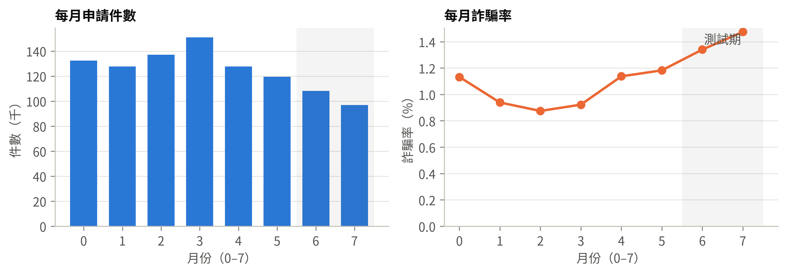{#fig-eda-monthly width=95%}

各年齡層的人數與詐騙率如 @fig-eda-age 所示。申請者以 20 至 40 多歲為主，50 歲以上約占 18%；詐騙率則隨年齡明顯上升，由 10 多歲的 0.35% 增加至 60 多歲的 3.30%。整體而言，50 歲以上申請者的詐騙率為 2.34%，約為未滿 50 歲者（0.83%）的 2.8 倍。兩組基本率的差異，是後續公平性分析的重要背景：依 @chouldechova2017fair 的推論，當基本率不同時，模型難以同時滿足各種公平性定義。

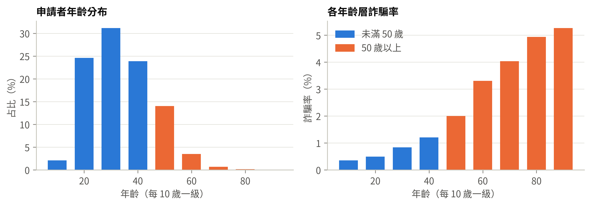{#fig-eda-age width=95%}

以負值表示缺失的特徵及其缺失比例如 @fig-eda-missing 所示。`intended_balcon_amount` 與 `prev_address_months_count` 的缺失比例超過七成，`bank_months_count` 約四分之一。值得注意的是，缺失本身與詐騙相關：`prev_address_months_count` 缺失者的詐騙率為 1.42%，有填寫者僅 0.31%；`bank_months_count` 缺失者為 1.63%，有填寫者為 0.92%。因此，本研究保留缺失的原值而不補值，使模型能利用缺失所隱含的風險訊號。

{#fig-eda-missing width=70%}

為使比較公平，所有模型接收相同的輸入：30 個特徵中的數值特徵維持原值，類別特徵以類別型態傳入，並以訓練資料出現過的類別為準，測試時出現的新類別視為缺失。以負值表示缺失的特徵保留原值，不另行補值，由模型自行學習缺失所隱含的訊號。各模型依其需求進行最少的轉換：梯度提升樹與表格基礎模型直接處理類別特徵；邏輯迴歸與 MLP 對類別特徵做獨熱編碼（one-hot encoding）並將數值特徵標準化；隨機森林則將類別特徵轉為整數編碼。與原論文相同，`customer_age` 也是模型的輸入特徵之一。

詐騙偵測的模型必須以過去的資料預測未來的申請，因此本研究依申請月份切分資料，而非隨機切分。如 @fig-data-split 所示，本研究採用兩種切分方式：

1. 最終評估（final）：以第 0 至 5 個月訓練、第 6 至 7 個月測試，與原論文相同 [@jesus2022turning]，用於重現實驗、模型比較與公平性量測。
2. 開發（dev）：以第 0 至 4 個月訓練、第 5 個月驗證、第 6 至 7 個月測試。所有需要「選擇」的步驟，包括超參數調整、公平性處理的門檻，以及三級分流決策的門檻，都只在驗證月進行，再於測試月評估，以避免以測試資料做選擇而高估成效。

{#fig-data-split width=90%}

## 模型與比較設計 {#sec-models}

本研究比較三類共十個模型，如 @tbl-models 所示。傳統機器學習包含作為基準的邏輯迴歸與隨機森林 [@breiman2001random]，以及 XGBoost [@chen2016xgboost]、LightGBM [@ke2017lightgbm] 與 CatBoost [@prokhorenkova2018catboost] 三種梯度提升樹；從頭訓練的深度學習包含以 scikit-learn [@pedregosa2011scikit] 實作的多層感知器（MLP）、TabM [@gorishniy2025tabm] 與 RealMLP [@holzmuller2024better]；預訓練表格基礎模型包含 TabPFN-3.5 [@jaeger2026tabpfn35] 與 TabICLv2 [@qu2026tabiclv2]。所有模型皆包裝為相同的 scikit-learn 介面，使用同一套評估程式，以確保比較條件一致。

| 類別 | 模型 | 實作套件 | 輸入轉換 | 調參組 |
|:-------------|:-------------|:-------------|:---------------------|:--------|
| 傳統機器學習 | 邏輯迴歸 | scikit-learn | 獨熱編碼、標準化 | ✓ |
| | 隨機森林 | scikit-learn | 整數編碼 | ✓ |
| | XGBoost | xgboost | 原生類別處理 | ✓ |
| | LightGBM | lightgbm | 原生類別處理 | ✓ |
| | CatBoost | catboost | 原生類別處理 | ✓ |
| 深度學習 | MLP | scikit-learn | 獨熱編碼、標準化 | ✓ |
| | TabM | pytabkit | 套件內建前處理 | ✓ |
| | RealMLP | pytabkit | 套件內建前處理 | ✓ |
| 基礎模型 | TabPFN-3.5 | tabpfn | 模型內建前處理 | — |
| | TabICLv2 | tabicl | 模型內建前處理 | — |

: 模型陣容 {#tbl-models}

::: {custom-style="TableNote"}
註：打勾表示納入調參組（E3）；表格基礎模型以情境學習進行預測，不需調參，以「—」表示。
:::

參考 TabArena 的評比方式 [@erickson2025tabarena]，本研究的模型比較分為三部分：

1. 預設參數組（E2）：十個模型皆使用套件的預設參數，只設定執行所需的技術參數（例如執行緒數），反映模型「開箱即用」的表現。
2. 調參組（E3）：傳統機器學習與深度學習模型以相同預算調參，使用 Optuna [@akiba2019optuna] 的 TPE 演算法 [@bergstra2011algorithms] 各進行 30 次試驗，以驗證月的 TPR@5%FPR 為目標選出最佳超參數（例如梯度提升樹的樹數量、學習率、樹的深度或葉節點數、抽樣比例與正則化強度；各模型的搜尋範圍與選定值見 @tbl-hpo），再以第 0 至 5 個月重新訓練並於測試月評估。深度學習模型若以全量資料調參過於耗時，則在 10 萬筆分層抽樣的子樣本上調參。表格基礎模型依其設計不進行調參。
3. 學習曲線（E4）：以分層抽樣取 1 千、5 千、1 萬、5 萬、10 萬筆與全量的訓練資料，比較各模型的表現如何隨資料量變化；1 萬筆以下的資料量重複抽樣三次，以降低抽樣的隨機性。

實驗在一部桌上型電腦上，以 Windows 的 WSL2（Ubuntu）環境執行，硬體為 Intel Core i7-12700 處理器（12 核心、20 執行緒）、64 GB 記憶體（WSL 配置 48 GB）與 NVIDIA GeForce RTX 2080 Ti 顯示卡（11 GB 記憶體）。其中，TabM、RealMLP 與兩個表格基礎模型以 GPU 執行，其餘模型（包括以 scikit-learn 實作的 MLP）以 CPU 執行，因此 @tbl-benchmark 的運算時間同時反映了模型本身與運算裝置的差異；每次實驗皆自動記錄硬體、套件版本、程式版本與執行時間，作為運算成本比較的依據。受限於 GPU 記憶體，表格基礎模型在全量實驗中以 5 萬筆分層抽樣的訓練資料作為情境資料，此限制於結果中一併說明。

## 評估指標與公平性分析 {#sec-metrics}

本研究的主要效能指標沿用原論文的 TPR@5%FPR [@jesus2022turning]：在偽陽性率（FPR）低於 5% 的條件下，選擇使偵測率最高的門檻，並以該門檻下的真陽性率（TPR）衡量模型。其定義如 @eq-tpr 所示：

$$
\tau^{*} = \min\{\tau : \text{FPR}(\tau) < 0.05\}, \qquad \text{TPR@5\%FPR} = \text{TPR}(\tau^{*})
$$ {#eq-tpr}

其中，$\tau$ 代表門檻，模型分數大於或等於 $\tau$ 的申請判定為疑似詐騙；$\text{FPR}(\tau)$ 與 $\text{TPR}(\tau)$ 分別代表以 $\tau$ 為門檻時的偽陽性率（正常申請被判定為疑似詐騙的比例）與真陽性率（詐騙申請被偵測出的比例）；$\tau^{*}$ 則為偽陽性率低於 5% 的最低門檻，亦即在誤判率限制內偵測率最高的門檻。與原論文相同，模型比較時的門檻於測試資料上決定，用以比較各模型在相同誤判率下的區辨能力，此門檻並非實務部署時可事先取得的門檻；決策相關的實驗則改在驗證月決定門檻（[3.2](#sec-data) 節）。此外，本研究以 ROC-AUC 與 PR-AUC 衡量模型整體的排序能力，後者在類別極度不平衡時更能反映模型對少數類別的辨識；以 Brier 分數衡量預測機率的校準程度；並記錄訓練與預測時間，作為運算成本的指標。

主要的公平性指標為兩個年齡組偽陽性率的比值（FPR 比），其定義如 @eq-fpr-ratio 所示：

$$
\text{FPR 比} = \frac{\min(\text{FPR}_{\text{年輕}},\ \text{FPR}_{\text{年長}})}{\max(\text{FPR}_{\text{年輕}},\ \text{FPR}_{\text{年長}})}
$$ {#eq-fpr-ratio}

其中，$\text{FPR}_{\text{年輕}}$ 與 $\text{FPR}_{\text{年長}}$ 分別代表未滿 50 歲與 50 歲以上的正常申請者被判定為疑似詐騙的比例。FPR 比介於 0 與 1 之間，越接近 1 表示兩組正常申請者被誤判的機率越接近，對應預測均等的公平性定義 [@corbettdavies2017algorithmic]。本研究以 0.8 作為可接受的參考值；此為分析上的操作性門檻，並非臺灣現行法規訂定的數值標準，達到 0.8 也不代表即符合法規要求。本研究並另以 TPR 比衡量兩組詐騙者被偵測率的差異，對應機會均等 [@hardt2016equality]。

為量化結果的不確定性，本研究在測試資料上以拔靴法（bootstrap）[@efron1993introduction] 重抽 1,000 次，計算各指標的 95% 百分位信賴區間；重抽時依詐騙標籤分層，使每次重抽皆維持原有的詐騙比例。比較兩個模型時，以相同的重抽樣本計算兩模型指標的差異（配對拔靴法），並以差異落在 0 另一側的比例乘以 2 作為雙尾 p 值。

公平性分析分為量測與處理兩部分（E5、E6）：

1. 量測：在 TPR@5%FPR 的操作點計算各模型兩個年齡組的 FPR、TPR 與 FPR 比。
2. 切點敏感度：分別以 40、50、60 歲為切點，並比較「大於」與「大於或等於」兩種定義，檢驗公平性的結論是否隨年齡分組方式改變。
3. 後處理：在驗證月為兩個年齡組各自決定門檻，使兩組的 FPR 皆接近目標值，再於測試月評估 [@hardt2016equality]。此方法不需重新訓練模型，但決策時需使用申請者的年齡組別。
4. 訓練中處理：以 FairGBM [@cruz2023fairgbm] 在訓練時加入「兩組 FPR 差距不超過容許值」的限制，容許值設為 0.02、0.01、0.005 與 0，並與相同參數、不加限制的 LightGBM 比較。

為公平比較，上述方法皆在 1% 至 10% 的多個整體誤判率下評估，繪製偵測率與 FPR 比的取捨曲線。

## 三級分流決策模型 {#sec-tier-model}

### 分級規則

本研究以三支決策 [@yao2010threeway] 為理論基礎，提出三級分流決策模型。給定模型分數 $s$ 與兩個門檻 $t_1 \le t_2$，申請依 @tbl-tiers 所示的規則分為三級。

台灣的數位存款帳戶依開戶時的身分驗證方式分為三類，驗證方式較弱的第三類帳戶，其非約定轉帳限額也較低：以臺灣中小企業銀行的約定條款為例，第一、二類帳戶經網路銀行的非約定轉帳上限為每月 20 萬元，第三類帳戶則為每月 5 萬元[（臺灣中小企業銀行，無日期）]{.cite}；第三類帳戶完成視訊驗證後，可將限額提高至每月 20 萬元[（中央通訊社，2021）]{.cite}。本研究借用此一「驗證強度越低、功能越受限」的設計，將中間一級設計為先加強驗證，通過者以限額帳戶開戶，以取代直接拒絕。需要說明的是，實務上帳戶類別取決於驗證方式而非風險分數，此處的對應屬情境模擬；初始限額、觀察期與解除限制的條件，須由銀行依帳戶約定條款與相關規範確認。

| 等級 | 條件 | 處置 | 參照的帳戶限制 |
|:-----|:---------------|:-------------------------|:-------------------------|
| 一級 | $s < t_1$ | 正常開戶 | 第一、二類帳戶（每月 20 萬元） |
| 二級 | $t_1 \le s < t_2$ | 加強驗證（如視訊）；通過者限額開戶，未通過者婉拒 | 第三類帳戶（每月 5 萬元） |
| 三級 | $s \ge t_2$ | 轉人工審核 | 審核通過後開戶 |

: 三級分流的規則 {#tbl-tiers}

::: {custom-style="TableNote"}
註：$s$ 為模型的詐騙分數，$t_1$ 與 $t_2$ 為兩個門檻。每月限額為網路銀行的非約定轉帳上限，以臺灣中小企業銀行的約定條款為例。
:::

### 期望損失

令 $N^{F}_{k}$ 與 $N^{L}_{k}$ 分別為被分到第 $k$ 級的詐騙與正常申請數，$N_k = N^{F}_{k} + N^{L}_{k}$，$N$ 為申請總數。依 @elkan2001foundations 的成本敏感決策觀點，本研究將一個分級政策的期望損失定義如 @eq-cost 所示，其中詐騙損失、客戶成本與作業成本三項分別如 @eq-loss 與 @eq-ops 所示：

$$
\text{Cost}(t_1, t_2) = \text{Loss}_{\text{fraud}} + \text{Cost}_{\text{customer}} + \text{Cost}_{\text{ops}}
$$ {#eq-cost}

$$
\text{Loss}_{\text{fraud}} = N^{F}_{1} L_{\text{full}} + N^{F}_{2} (1 - v) L_{\text{limited}} + N^{F}_{3} (1 - r) L_{\text{full}}
$$ {#eq-loss}

$$
\text{Cost}_{\text{customer}} = N^{L}_{2} C_{\text{friction}} + N^{L}_{3} C_{\text{attrition}}, \qquad \text{Cost}_{\text{ops}} = N_{2} C_{\text{verify}} + N_{3} C_{\text{review}}
$$ {#eq-ops}

其中，$\text{Loss}_{\text{fraud}}$ 代表詐騙造成的損失：進入第一級的詐騙帳戶可完整使用，進入第二級者須先通過加強驗證，被攔下者（機率 $v$）婉拒開戶而不造成損失，未被攔下者（機率 $1 - v$）則以限額帳戶開戶，在觀察期內只能於限額內使用（本研究假設人頭帳戶的損失主要發生在開戶後的短期內，故以限額作為其損失），進入第三級者若未被人工審核攔下（機率 $1 - r$）則可完整使用；$L_{\text{full}}$ 與 $L_{\text{limited}}$ 分別為詐騙帳戶在完整功能與限額下的損失，$v$ 與 $r$ 分別為加強驗證與人工審核攔下詐騙的機率。$\text{Cost}_{\text{customer}}$ 代表對正常客戶造成的成本，$C_{\text{friction}}$ 與 $C_{\text{attrition}}$ 分別為正常客戶被加強驗證的不便成本與被轉人工審核的流失成本；$\text{Cost}_{\text{ops}}$ 則為作業成本，$C_{\text{verify}}$ 與 $C_{\text{review}}$ 分別為每件加強驗證與人工審核的成本。各參數的設定如 @tbl-cost-params 所示；由於實際數值因銀行而異，本研究將其視為情境假設，並以敏感度分析檢驗結論的穩健性。需要說明的是，@eq-cost 僅計入隨申請件數變動的成本，不包含系統開發、人員與模型維運等導入 AI 的固定成本；固定成本的影響另以損益兩平分析討論（[5.2](#sec-adoption) 節）。

| 參數 | 意義 | 設定值 | 敏感度分析 |
|:--------|:----------------------|:------------------|:--------------------------|
| $L_{\text{full}}$ | 詐騙帳戶完整功能下的損失 | 200,000 元（第一、二類每月上限） | ×0.25、×1、×4 |
| $L_{\text{limited}}$ | 詐騙帳戶限額下的損失 | 50,000 元（第三類每月上限） | 隨 $L_{\text{full}}$ 等比調整；另單獨調整為 25,000、100,000 元 |
| $v$ | 加強驗證攔下詐騙的機率 | 0.5 | 0.3、0.5、0.8 |
| $r$ | 人工審核攔下詐騙的機率 | 0.9 | 0.7、0.9、0.95 |
| $C_{\text{verify}}$ | 每件加強驗證的作業成本 | 50 元 | 25、50、150 元 |
| $C_{\text{review}}$ | 每件人工審核的作業成本 | 300 元 | 150、300、600 元 |
| $C_{\text{friction}}$ | 正常客戶被加強驗證的不便成本 | 100 元 | 100、500、1,000 元 |
| $C_{\text{attrition}}$ | 正常客戶被轉人工審核的流失成本 | 2,000 元 | 1,000、2,000、5,000 元 |
| $\kappa$ | 人工審核占申請量的上限 | 2% | 1%、2%、5% |
| $\rho$ | 加強驗證占申請量的上限 | 10% | 5%、10%、20% |

: 三級分流決策模型的參數（情境假設） {#tbl-cost-params}

::: {custom-style="TableNote"}
註：敏感度分析一次改變一項參數，其餘維持設定值；另以樂觀與保守兩種情境同時改變多項參數（[4.4](#sec-decision) 節）。
:::

需要說明的是，以轉帳上限作為詐騙損失，代表的是詐騙帳戶一個月內可轉出的風險暴露金額，而非實際損失：帳戶內未必有足額款項，銀行也可能在交易時攔阻或事後追回部分款項。因此 $L_{\text{full}}$ 與 $L_{\text{limited}}$ 應視為損失的代理值，其影響以敏感度分析檢驗（[4.4](#sec-decision) 節）。

### 限制條件與求解

最佳政策須滿足三項限制。第一為審核人力限制：轉人工審核的比例不得超過上限 $\kappa$，即 $N_3 / N \le \kappa$。第二為驗證人力限制：視訊或電信等加強驗證同樣需要人力，且會延長開戶時間，因此第二級的比例不得超過上限 $\rho$，即 $N_2 / N \le \rho$；若不設此限制，在本研究的成本假設下，對所有申請者加強驗證反而成本最低，模型將失去作用（[4.4](#sec-decision) 節）。第三為公平性限制：令 $E_g$ 為年齡組 $g$ 的正常申請者被分到第二級以上的比例，要求 $\min_g E_g / \max_g E_g \ge 0.8$，使正常客戶被加強審查的負擔在兩個年齡組間相近。

求解時，本研究以驗證月的分數分布設定候選門檻：令警示比例（分數高於門檻的申請占比）在 0.1% 至 12% 之間取 27 個值，並在人力上限附近加密（如 1% 至 2% 之間每 0.25 個百分點、5% 至 10% 之間每 0.5 個百分點），12% 以上另取 15%、20%、25%、30%、40% 與 50%，共 33 個值；$t_1$ 與 $t_2$ 分別取其中一個值所對應的門檻（$t_2$ 的警示比例不大於 $t_1$），以網格搜尋找出滿足限制且期望損失最小的組合；當 $t_1 = t_2$ 時即退化為一般的二元決策。選定的門檻再於測試月評估。除「全部申請皆加強驗證並限額開戶」作為不受人力限制的參考外，本研究比較以下六種政策：

1. 不使用模型：所有申請皆正常開戶。
2. BAF 二元決策：以原論文 5% 誤判率的門檻將高風險申請轉人工審核。
3. 最佳二元決策：在人力限制下期望損失最小的二元政策。
4. 三級分流：在人力限制下期望損失最小的三級政策。
5. 三級分流加公平限制：另加入公平性限制，兩個年齡組使用同一組門檻。
6. 分組三級分流加公平限制：將分數轉換為各年齡組內的百分位（以驗證月正常申請者為基準）後再設定門檻，相當於兩組各自使用一組門檻。

比較政策 4 至 6 的期望損失，可估計滿足公平性要求的代價。此外，在驗證月選定的固定門檻上線後，各級的審核量會隨分數分布改變，可能超出人力上限。因此，本研究對政策 3、4 與 6 另以兩種方式使其在測試月仍符合人力上限：一是預留緩衝，以人力上限的 90%（人工審核 1.8%、加強驗證 9%）選擇門檻；二是分位數門檻，沿用驗證月選定的各級申請比例，但於測試期依當期的分數分布（不需標籤）換算門檻，模擬以近期分數滾動更新門檻的做法。由於後者一次使用整個測試期的分數分布，相當於校準頻率很高的理想情況，實務上以每週或每日的分數滾動更新時，各級比例會在設定值附近小幅波動。

## 其他分析方法 {#sec-other-methods}

為回答 RQ5，本研究以 TreeSHAP [@lundberg2020local] 計算 LightGBM 對測試月 5,000 筆抽樣申請的 SHAP 值，分析各特徵的全域重要性，以及特徵值與貢獻的關係（相依圖）。此外，以深度 3 與 4 的決策樹模仿 LightGBM 在 5% 誤判率門檻下的判定結果（代理模型，surrogate model）[@craven1996extracting]，將模型行為轉換為可直接檢視的規則，並以代理模型與原模型判定一致的比例（忠實度，fidelity）衡量規則的可信程度；由於原模型判為可疑的申請很少，另以兩類判定各自一致率的平均（平衡忠實度）為主要指標。

在上線監控方面，模型上線後，申請者的特徵分布可能隨時間改變。本研究以母體穩定指標（population stability index, PSI）比較訓練期與各測試月的特徵分布 [@siddiqi2006credit]，其計算方式如 @eq-psi 所示：

$$
\text{PSI} = \sum_{i} (a_i - e_i) \ln \frac{a_i}{e_i}
$$ {#eq-psi}

其中，$i$ 代表將特徵值切分後的第 $i$ 個區間，$e_i$ 與 $a_i$ 分別為訓練期與測試月的申請落在該區間的比例；兩期的分布越接近，PSI 越接近 0。數值特徵以訓練期的十分位數切成 10 個區間（最外側的區間向兩端延伸），類別特徵則以各類別為區間；比例為 0 的區間以 $10^{-6}$ 代替，以避免取對數時發散。因此當某區間在其中一期幾乎沒有樣本時，PSI 會被放大，宜以 0.1、0.25 等區間判斷，而不宜比較其精確大小。此外，以驗證月決定的門檻固定不變，逐月追蹤警示率、FPR、偵測率與 FPR 比，模擬銀行上線後的監控情境（E9）。

為回答 RQ6，本研究以 40%、25%、15%、12%、8% 為五家模擬銀行的目標規模，並依 `housing_status` 以 Dirichlet 分配（$\alpha = 0.5$）決定各住房類別分到各銀行的比例，使各銀行的客群組成不同，模擬資料分布不一致（non-IID）的情境 [@hsu2019measuring]；由於各類別的分配權重不同，實際切分後各銀行的資料占比為 54% 至 5%（[4.6](#sec-small-bank) 節）。比較的方法包括：各銀行僅以自有資料訓練的 LightGBM、表格基礎模型與 MLP；以 FedAvg [@mcmahan2017communication] 共同訓練的 MLP（最多 30 輪，各輪本地訓練 1 個 epoch）；以及將所有資料集中訓練的 LightGBM 與 MLP 作為參考。所有 MLP 皆使用相同的網路架構與訓練預算，並各自保留 10% 的訓練資料作為驗證資料，保留驗證損失最低的權重，連續 5 輪未改善即提前停止；聯合學習時，各銀行只回傳自身驗證資料的損失，不交換資料。各方法皆以各銀行自身的測試資料評估，並特別關注資料最少的銀行。

## 實驗設計與研究假說 {#sec-design}

本研究的實驗、對應的研究問題與使用的資料切分彙整如 @tbl-experiments 所示。所有實驗由同一套程式執行，設定集中於設定檔，圖表由程式直接產生並放入報告。

| 編號 | 實驗 | 研究問題 | 資料切分 | 主要產出 |
|:-----|:----------------|:---------|:--------|:--------------------|
| E0 | 探索式資料分析 | 背景 | 全部月份 | 分月詐騙率、年齡分布、缺失比例 |
| E1 | 重現原論文 | RQ1 | final | 100 組 LightGBM 的效能與 FPR 比 |
| E2 | 預設參數組 | RQ2 | final | 十個模型的效能、公平與時間 |
| E3 | 調參組 | RQ2 | dev → final | 預設參數與調參的比較 |
| E4 | 學習曲線 | RQ2、RQ6 | final | 不同資料量下的表現 |
| E5 | 公平性量測與切點敏感度 | RQ1、RQ3 | final | 各組 FPR、切點敏感度 |
| E6 | 公平性處理 | RQ3 | dev | 偵測率與 FPR 比的取捨 |
| E7 | 三級分流決策 | RQ4 | dev | 各政策的期望損失、敏感度分析 |
| E8 | SHAP 與規則萃取 | RQ5 | final | 特徵重要性、風控規則 |
| E9 | 上線監控 | 第五章 | dev | PSI、逐月指標 |
| E10 | 小銀行模擬 | RQ6 | 依銀行切分 | 各銀行、各方法的表現 |
| E11 | 開戶風控決策支援系統 | 第五章 | dev | 互動式決策支援工具 |

: 實驗總覽 {#tbl-experiments}

::: {custom-style="TableNote"}
註：final 與 dev 為兩種時間切分方式，見 @fig-data-split；「依銀行切分」見 [4.6](#sec-small-bank) 節。
:::

重現實驗（E1）依原論文附錄的 LightGBM 超參數範圍隨機抽取 100 組設定 [@jesus2022turning]，於 Base 資料集訓練並測試，記錄每組設定的 TPR@5%FPR 與 FPR 比，並同時以「大於 50 歲」與「50 歲以上」兩種分組計算，檢驗兩種定義是否影響原論文的結論；五個變體各以前 20 組設定，加上 Base 表現前 5 名中未包含在內的設定重複實驗。

依據文獻探討與研究問題，本研究提出四項假說，如 @tbl-hypotheses 所示。RQ5 與 RQ6 屬探索性問題，不另設假說。

| 假說 | 內容 | 對應 | 檢驗方式 |
|:-----|:-------------------------------|:----------|:------------------------|
| H1 | 在預設參數下，表格基礎模型在小資料量（1 萬筆以下）時的 TPR@5%FPR 高於梯度提升樹，且差距隨資料量增加而縮小 | RQ2 | 比較學習曲線（E4）中各資料量的平均偵測率，1 萬筆以下輔以三次抽樣的範圍 |
| H2 | 未經公平性處理的模型，年齡組間的 FPR 比低於 0.8 | RQ3 | 比較 E5 中各模型的 FPR 比與 0.8 |
| H3 | 公平性的結論對年齡分組方式敏感，不同切點會得到不同的 FPR 比 | RQ1、RQ3 | 比較各切點與兩種定義下的 FPR 比（E1、E5） |
| H4 | 在審核人力的限制下，三級分流決策的期望損失低於 BAF 的二元決策 | RQ4 | 比較測試月的期望損失（E7），並以敏感度分析檢驗 |

: 研究假說 {#tbl-hypotheses}

# 實驗結果與分析 {#sec-results}

本章依研究問題報告實驗結果：[4.1](#sec-repro) 節為重現原論文的結果（RQ1）；[4.2](#sec-benchmark) 節比較三代模型的效能、成本與資料量的影響（RQ2）；[4.3](#sec-fairness) 節分析年齡公平性與公平性處理（RQ3）；[4.4](#sec-decision) 節評估三級分流決策模型（RQ4）；[4.5](#sec-knowledge) 節為知識發現（RQ5）；[4.6](#sec-small-bank) 節為小銀行困境的延伸分析（RQ6）；[4.7](#sec-hypotheses) 節彙整研究假說的檢驗結果。除特別說明外，結果皆來自 Base 資料集的測試月（第 6、7 個月，共 205,011 件申請，其中詐騙 2,878 件，詐騙率 1.40%）。

## 重現原論文（RQ1） {#sec-repro}

本研究依原論文公開的方法重新實作實驗，而非直接執行其程式：原論文只公開資料與訓練程式，並未公開訓練完成的模型，因此無論如何皆須重新訓練；其程式檔亦附有禁止重製的著作權聲明，無法納入本研究公開的程式碼。兩者的實驗設定比較如 @tbl-repro-setup 所示：資料、切分、模型、超參數範圍與評估指標皆相同，差異在於隨機抽出的超參數設定、各變體的設定數與軟體版本。

| 項目 | 原論文 | 本研究 |
|:----------------|:----------------------------|:----------------------------|
| 資料與時間切分 | BAF 六個資料集；前 6 個月訓練、後 2 個月測試 | 相同（Kaggle 公開版本） |
| 模型與超參數範圍 | LightGBM；論文附錄所列的範圍 | 相同 |
| 評估指標 | TPR@5%FPR、FPR 比 | 相同 |
| 超參數設定 | 官方程式隨機抽出的 100 組 | 本研究程式隨機抽出的 100 組（與原論文不同） |
| 各變體的設定數 | 100 組 | Base 100 組；各變體為其中前 20 組，加上 Base 前 5 名中的其餘 4 組 |
| 年齡分組 | 正文為「大於 50 歲」；程式為「50 歲以上」 | 兩種皆計算 |
| 軟體版本 | Python 3.7、LightGBM 3.1.1 | Python 3.10 以上、LightGBM 4 |

: 本研究與原論文的實驗設定比較 {#tbl-repro-setup}

各組設定的偵測率與 FPR 比如 @fig-reproduction 所示，各資料集的結果則彙整如 @tbl-reproduction 所示。

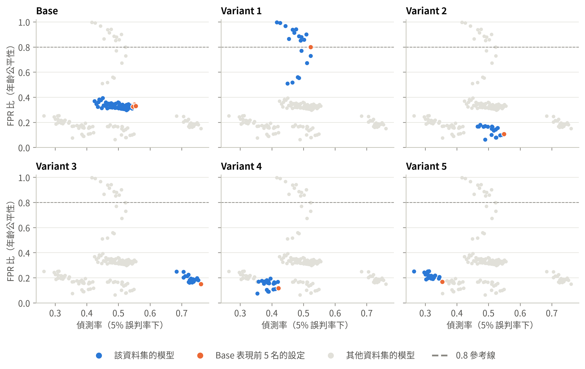{#fig-reproduction width=100%}

| 資料集 | 設定數 | TPR@5%FPR｜中位數 | TPR@5%FPR｜最高 | TPR@5%FPR｜前 5 名 |
|:----------------------|:----------:|:-------------:|:-------------:|:-------------:|
| Base | 100 | 0.521 | 0.555 | 0.550 |
| Variant I | 24 | 0.489 | 0.532 | 0.527 |
| Variant II | 24 | 0.520 | 0.554 | 0.550 |
| Variant III | 24 | 0.734 | 0.765 | 0.760 |
| Variant IV | 24 | 0.393 | 0.427 | 0.420 |
| Variant V | 24 | 0.320 | 0.354 | 0.346 |

: 重現實驗的偵測率 {#tbl-reproduction}

::: {custom-style="TableNote"}
註：TPR@5%FPR 為誤判率 5% 下的偵測率。「前 5 名」為 Base 表現前 5 名的設定在各資料集的平均偵測率；變體的設定數為前 20 組設定，加上 Base 前 5 名中不在其內的 4 組。
:::

由於原論文未提供數值表，本研究自其圖 1 讀取 Base 表現前 5 名的設定在各資料集的偵測率與 FPR 比，並與本研究相同設定的結果對照，如 @tbl-repro-compare 所示。

| 資料集 | 偵測率｜原論文 | 偵測率｜本研究 | FPR 比｜原論文 | FPR 比｜本研究：50 歲以上 | FPR 比｜本研究：大於 50 歲 |
|:------------|:----------:|:--------:|:----------:|:-------------------:|:-------------------:|
| Base | 0.55–0.56 | 0.550 | 0.32–0.33 | 0.331 | 0.318 |
| Variant I | 0.52–0.53 | 0.527 | 0.64–0.71 | 0.775 | 0.665 |
| Variant II | 0.55–0.56 | 0.550 | 0.31–0.32 | 0.103 | 0.320 |
| Variant III | 0.76 | 0.760 | 0.35–0.37 | 0.175 | 0.365 |
| Variant IV | 0.42–0.44 | 0.420 | 0.33 | 0.111 | 0.332 |
| Variant V | 0.34–0.38 | 0.346 | 0.36–0.39 | 0.198 | 0.381 |

: 本研究與原論文圖 1 的對照 {#tbl-repro-compare}

::: {custom-style="TableNote"}
註：本研究的數值為 Base 表現前 5 名的設定在各資料集的平均。原論文的數值為自其圖 1 讀取的近似範圍。本研究的 FPR 比分別以「50 歲以上」（官方評估程式的定義）與「大於 50 歲」（論文正文的定義）作為年長組。
:::

在偵測率方面，六個資料集的結果皆落在原論文的範圍內。各變體的相對表現也與原論文一致：可分離性較高的 Variant III 偵測率最高（0.760），偏差隨時間改變的 Variant IV 與 V 偵測率最低（0.420 與 0.346），反映訓練期與測試期的關係改變。在公平性方面，Base 的 FPR 比為 0.331，與原論文「表現最佳的模型 FPR 比約為 0.3」的描述一致 [@jesus2022turning]；亦即在誤判率 5% 的操作點，50 歲以上的正常申請者被誤判為詐騙的機率，約為較年輕者的 3.0 倍。據此，本研究的實驗流程能重現原論文的模型表現與 Base 的公平性結論，後續分析建立在可信的基礎上。

然而，五個變體的 FPR 比只有在以「大於 50 歲」分組時才與原論文相符（皆落在原論文的範圍內，或相差不到 0.01）；若依官方評估程式的「50 歲以上」分組，Variant II 至 V 的 FPR 比僅 0.103 至 0.198，遠低於原論文圖中的 0.31 至 0.39。Base 的兩種分組結果相近（0.331 與 0.318），因此差異只在變體中顯現。進一步核對原作者公開的程式，產生變體資料的程式以 `customer_age > 50` 定義群體，與論文正文一致。然而，在公開的變體資料中，若以「50 歲以上」分組，Variant II 的年長組占 50.6%，其詐騙率約為年輕組的 5 倍，恰與生成程式設定的「兩群體各占 50%、詐騙率相差 5 倍」相符；Variant I 的年長組占 11.1%，也接近設定的 10%。若以「大於 50 歲」（在十年級距下即 60 歲以上）分組，則與上述設定不符。可能的原因是生成時的年齡尚未四捨五入至十年級距，使 `> 50` 實際選到的多為資料中標示為 50 歲以上的申請者；此外，公開的生成程式有部分變數未定義，未必是實際產生資料時的版本。據此，變體資料中實際被注入偏差的群體，較接近資料中的「50 歲以上」，原論文圖 1 的數值則與「大於 50 歲」的分組一致；若此推論成立，原論文評估變體公平性時所用的分組，與被注入偏差的群體並不相同，使變體的 FPR 比高出約 2 至 3 倍。此一推論也能解釋原論文的一項意外發現：原論文指出 Variant II 的群體詐騙率差異較大，公平性卻與 Base 相當，並對此感到意外 [@jesus2022turning]；而以「50 歲以上」分組時，Variant II 的 FPR 比僅 0.103，正符合其設計的預期。不過，本研究無法取得生成資料時的原始年齡，上述推論仍有待以原作者的完整程式驗證，因此不據此斷定原論文低估了變體資料的不公平程度。此結果顯示，公平性結論高度依賴分組定義，銀行在稽核模型公平性時，必須明確且一致地定義受保護群體（[4.3](#sec-fairness) 節）。

## 三代模型比較（RQ2） {#sec-benchmark}

### 預設參數組

十個模型在預設參數下的結果如 @tbl-benchmark 與 @fig-benchmark-tpr 所示。TabM 的偵測率最高（0.546），其次為 RealMLP（0.538）、TabPFN-3.5（0.532）與 LightGBM（0.528）。然而，前幾名模型之間的差距很小：以配對拔靴法檢定，TabM 與 RealMLP（p = 0.27）及 TabPFN-3.5（p = 0.058）的差異未達 5% 顯著水準，與 LightGBM 的差異（1.8 個百分點，p = 0.006）則達顯著。值得注意的是，TabPFN-3.5 只使用 5 萬筆訓練資料（約全量的 6%），偵測率即與使用約 79.5 萬筆的 LightGBM 相當。從三代模型的角度來看，新一代的深度學習與基礎模型在預設參數下略優於梯度提升樹，但差距僅約 1 至 2 個百分點。在預測機率的準確度上，各模型的 Brier 分數介於 0.0124 至 0.0146，除 RealMLP 外皆低於以詐騙率作為固定預測時的 0.0138；RealMLP 的偵測率雖高，其輸出的機率卻較不準確，若要以預測機率直接計算期望損失，需先經過校準。

| 模型 | TPR@5%FPR（95% CI） | ROC-AUC | PR-AUC | Brier | FPR 比 | TPR 比 | 時間（秒） |
|:-----------|:---------------------:|:------:|:------:|:------:|:-----:|:-----:|:-------:|
| TabM | 0.546（0.527–0.563） | 0.891 | 0.190 | 0.0124 | 0.35 | 0.70 | 407.2 |
| RealMLP | 0.538（0.520–0.557） | 0.889 | 0.191 | 0.0146 | 0.33 | 0.68 | 3,371.1 |
| TabPFN-3.5 | 0.532（0.512–0.551） | 0.889 | 0.190 | 0.0124 | 0.30 | 0.66 | 773.5 |
| LightGBM | 0.528（0.509–0.546） | 0.890 | 0.170 | 0.0128 | 0.34 | 0.69 | 2.4 |
| TabICLv2 | 0.523（0.504–0.541） | 0.888 | 0.188 | 0.0126 | 0.27 | 0.63 | 216.6 |
| CatBoost | 0.514（0.496–0.533） | 0.883 | 0.169 | 0.0127 | 0.33 | 0.67 | 149.6 |
| MLP | 0.512（0.495–0.531） | 0.883 | 0.173 | 0.0127 | 0.30 | 0.65 | 18.6 |
| 邏輯迴歸 | 0.500（0.482–0.520） | 0.877 | 0.162 | 0.0128 | 0.30 | 0.62 | 3.2 |
| XGBoost | 0.487（0.468–0.506） | 0.875 | 0.156 | 0.0128 | 0.34 | 0.67 | 2.6 |
| 隨機森林 | 0.435（0.417–0.452） | 0.840 | 0.145 | 0.0129 | 0.33 | 0.65 | 38.0 |

: 預設參數組的模型比較 {#tbl-benchmark}

::: {custom-style="TableNote"}
註：結果為測試月的表現；括號內為以拔靴法估計的 95% 信賴區間。Brier 分數越低表示預測機率越準確，以測試月的詐騙率作為固定預測時約為 0.0138。TPR 比為兩年齡組偵測率的比值（較小值除以較大值）。時間為訓練加預測的秒數；表格基礎模型僅使用 5 萬筆訓練資料，其餘模型使用全部約 79.5 萬筆。
:::

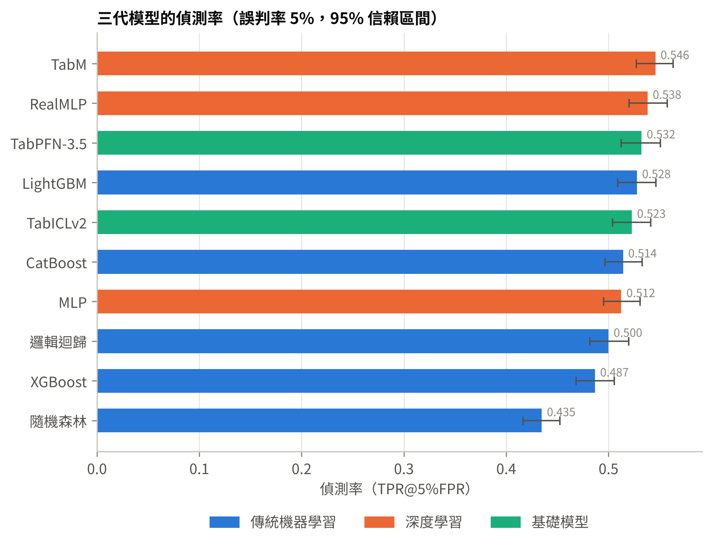{#fig-benchmark-tpr width=85%}

然而，如 @fig-benchmark-cost 所示，運算成本的差異遠大於效能的差異。LightGBM 的訓練與預測合計僅 2.4 秒，偵測率卻達 TabM（407 秒）的 97%；RealMLP 需時約 56 分鐘。表格基礎模型的成本集中在預測階段：TabPFN-3.5 的「訓練」僅 1.3 秒（儲存情境資料），對 20.5 萬筆測試申請的預測卻需 772 秒，因為每次預測都需以 Transformer 處理情境資料。對需要即時審查大量開戶申請的銀行而言，預測成本是導入基礎模型時必須考量的因素。

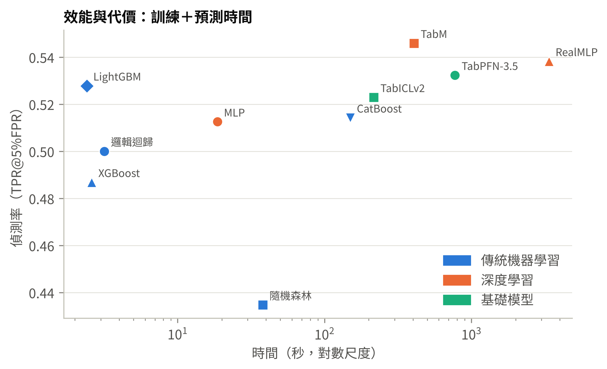{#fig-benchmark-cost width=80%}

### 調參組

各模型調參前後的偵測率如 @tbl-tuned 與 @fig-tuned 所示。在相同的調參預算（每個模型 30 次試驗）下，樹模型的進步最多：隨機森林由 0.435 提升至 0.519（+8.5 個百分點），XGBoost 由 0.487 提升至 0.553（+6.6 個百分點），成為所有模型中最高；LightGBM 與 CatBoost 亦分別提升至 0.552 與 0.548。不過，以配對拔靴法檢定，XGBoost 與 LightGBM（p = 0.88）、CatBoost（p = 0.36）及 TabM（p = 0.34）的差異皆未達顯著，四者應視為表現相當；MLP、RealMLP、隨機森林與邏輯迴歸則顯著低於 XGBoost（p ≤ 0.002）。相對地，TabM 調參後幾乎不變（0.547），RealMLP 反而略降（0.531），可能是因為深度學習模型在 10 萬筆子樣本上調參，所選的超參數未必適用於全量資料。調參的時間成本差異同樣很大：LightGBM 僅需約 4 分鐘，RealMLP 則需約 4.6 小時。

| 模型 | TPR@5%FPR｜預設參數 | TPR@5%FPR｜調參後（95% CI） | 差異（百分點） | 調參時間（秒） |
|:------------|:-------:|:-------------------:|:-----------:|:-----------:|
| XGBoost | 0.487 | 0.553（0.535–0.571） | +6.6 | 396 |
| LightGBM | 0.528 | 0.552（0.534–0.570） | +2.4 | 228 |
| CatBoost | 0.514 | 0.548（0.531–0.566） | +3.4 | 4,320 |
| TabM | 0.546 | 0.547（0.528–0.567） | +0.1 | 1,959 |
| RealMLP | 0.538 | 0.531（0.512–0.549） | −0.8 | 16,396 |
| MLP | 0.512 | 0.526（0.509–0.544） | +1.4 | 171 |
| 隨機森林 | 0.435 | 0.519（0.500–0.538） | +8.5 | 3,513 |
| 邏輯迴歸 | 0.500 | 0.500（0.482–0.520） | 0.0 | 76 |

: 預設參數與調參後的偵測率 {#tbl-tuned}

::: {custom-style="TableNote"}
註：每個模型的調參預算為 30 次試驗，調參時間為搜尋所需的秒數。表格基礎模型不需調參，故未列入。
:::

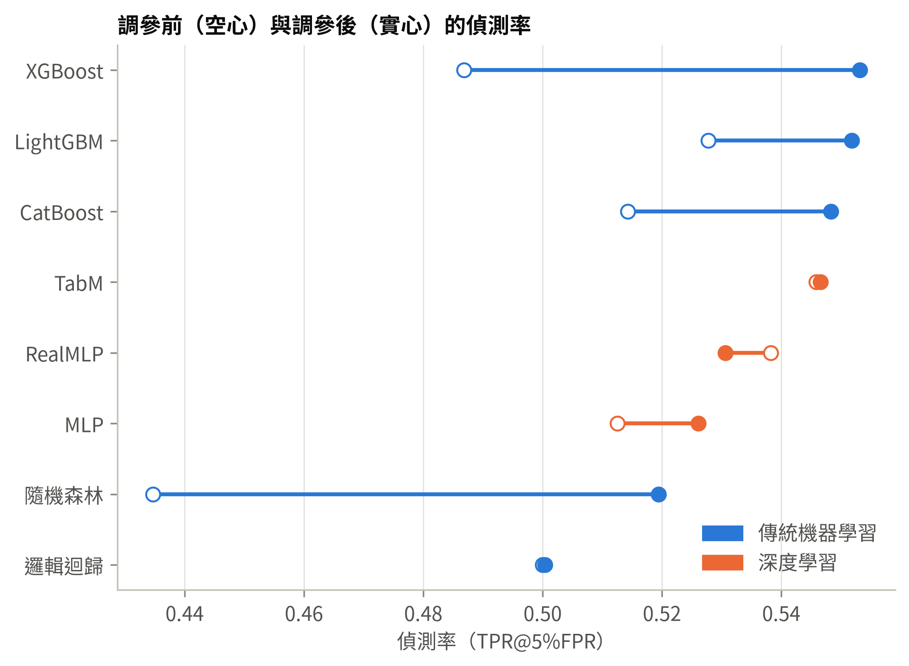{#fig-tuned width=75%}

綜合而言，在資料量充足（約 80 萬筆）的情境下，三代模型的偵測率差距很小：新一代模型在「不調參」時略占優勢，但梯度提升樹只要少量調參即可追上甚至超越，且運算成本低了兩至三個數量級。

### 資料量的影響 {#sec-data-size}

為了解資料量較少時的情況，本研究以不同大小的訓練子集重新訓練模型，結果如 @tbl-learning-curve 與 @fig-learning-curve 所示。受限於 GPU 記憶體（11 GB），本研究將表格基礎模型的訓練資料上限設為 5 萬筆，因此 10 萬筆與全量的結果從缺。表格基礎模型在小資料量下的優勢非常明顯：只有 1 萬筆訓練資料時，TabPFN-3.5 與 TabICLv2 的偵測率已達 0.501 與 0.494，梯度提升樹則僅 0.327 至 0.408；在 5 萬筆時，基礎模型（0.536 與 0.529）已高於其他模型在 10 萬筆以下的所有結果。隨著資料量增加，其他模型逐漸追上：在全量資料下，TabM（0.544）與 RealMLP（0.543）略高於只使用 5 萬筆的 TabPFN-3.5（0.536），LightGBM（0.532）則介於兩個基礎模型之間（0.536 與 0.529），三者與基礎模型相當。此外，簡單的邏輯迴歸在小資料量下表現穩健（1 萬筆時 0.450），優於所有梯度提升樹。

| 模型 | 訓練資料筆數｜1 千 | 訓練資料筆數｜5 千 | 訓練資料筆數｜1 萬 | 訓練資料筆數｜5 萬 | 訓練資料筆數｜10 萬 | 訓練資料筆數｜全量 |
|:------------|:------:|:------:|:------:|:------:|:------:|:------:|
| TabPFN-3.5 | 0.266 | 0.467 | 0.501 | 0.536 | — | — |
| TabICLv2 | 0.265 | 0.460 | 0.494 | 0.529 | — | — |
| 邏輯迴歸 | 0.223 | 0.431 | 0.450 | 0.487 | 0.496 | 0.500 |
| CatBoost | 0.203 | 0.344 | 0.408 | 0.457 | 0.470 | 0.508 |
| LightGBM | 0.141 | 0.285 | 0.327 | 0.420 | 0.453 | 0.532 |
| XGBoost | 0.180 | 0.323 | 0.345 | 0.388 | 0.410 | 0.487 |
| 隨機森林 | 0.138 | 0.234 | 0.292 | 0.371 | 0.404 | 0.434 |
| RealMLP | 0.197 | 0.284 | 0.324 | 0.404 | 0.472 | 0.543 |
| MLP | 0.056 | 0.056 | 0.076 | 0.354 | 0.486 | 0.511 |
| TabM | 0.029 | 0.044 | 0.084 | 0.384 | 0.521 | 0.544 |

: 不同訓練資料量下的偵測率 {#tbl-learning-curve}

::: {custom-style="TableNote"}
註：數值為 TPR@5%FPR；1 萬筆以下為三次抽樣的平均。表格基礎模型受 GPU 記憶體限制，最多使用 5 萬筆訓練資料，「—」表示未執行。TabM 與 MLP 在 1 萬筆以下屬訓練失效，見內文。
:::

{#fig-learning-curve width=100%}

需要特別說明的是，TabM 與 MLP 在 1 萬筆以下的偵測率僅 0.03 至 0.08，與隨機猜測（約 0.05）相近，屬於模型訓練失效，而非一般性的效能下降。兩者皆會從訓練資料中切出一部分作為驗證資料，以提早停止訓練；可能的原因是 1 萬筆資料中僅約 100 件詐騙，切出的驗證資料所含的詐騙件數過少，使訓練過早停止。此一推測尚待進一步驗證。由於本研究採用套件的預設設定，此結果反映的是神經網路模型在資料極少時「開箱即用」的風險，而非其架構本身的上限；相對地，表格基礎模型與梯度提升樹在相同資料量下並未出現此問題。此外，全量資料下各模型的偵測率與預設參數組（@tbl-benchmark）略有差異（LightGBM 0.532 對 0.528、CatBoost 0.508 對 0.514、RealMLP 0.543 對 0.538、TabM 0.544 對 0.546、MLP 0.511 對 0.512、隨機森林 0.434 對 0.435），來自訓練資料抽樣順序與隨機種子的不同，差距皆在 1 個百分點以內。

## 年齡公平性（RQ3） {#sec-fairness}

### 公平性量測

各模型在整體誤判率 5% 時，兩個年齡組的誤判率如 @fig-group-fpr 所示。所有模型皆呈現相同的模式：未滿 50 歲正常申請者的誤判率約為 3.3% 至 3.9%，50 歲以上則為 10.3% 至 12.7%，FPR 比介於 0.27 至 0.35，亦即年長的正常申請者被誤判的機率是年輕者的 2.8 至 3.6 倍，全部遠低於 0.8 的參考標準。新一代模型並未比較公平：FPR 比最低的反而是表格基礎模型 TabICLv2（0.27）與 TabPFN-3.5（0.30），與 @liu2026causal 對 TabPFN 公平性的觀察一致。此外，如 @fig-fairness-performance 所示，偵測率與公平性之間並沒有明顯的取捨：偵測率最高的 TabM，FPR 比也是十個模型中最高的（0.35）。

{#fig-group-fpr width=80%}

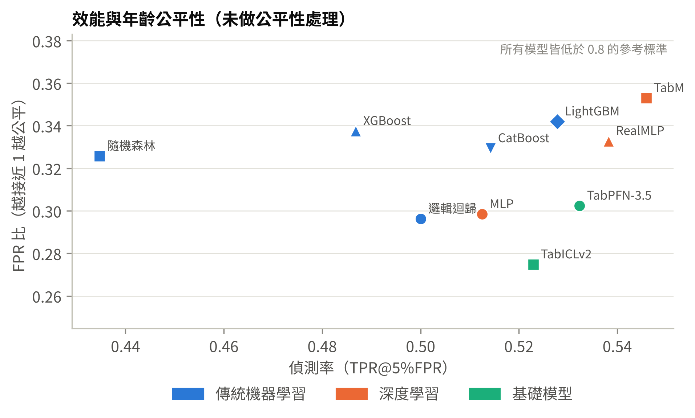{#fig-fairness-performance width=80%}

年長者的偵測率（TPR）也較高（0.57 至 0.69，年輕者為 0.37 至 0.48；TPR 比介於 0.62 至 0.70，見 @tbl-benchmark），顯示模型整體上較常將年長者標記為可疑。其根源在於兩組的詐騙基本率不同（2.34% 與 0.83%，[3.2](#sec-data) 節）：模型學到「年齡較長」與詐騙的關聯，使年長者的分數整體偏高，在單一門檻下便同時提高了兩組的偵測率與誤判率差距。

### 年齡分組的敏感度

以不同的年長組定義計算各模型的 FPR 比，結果如 @fig-cutoff-sensitivity 所示。由於 BAF 的年齡以 10 歲為一級，「大於 40 歲」與「50 歲以上」選取的是同一群人，因此實際上只有四種不同的分組。在 Base 資料集上，無論採用哪一種分組，所有模型的 FPR 比皆介於 0.26 至 0.40，「模型對年長者不公平」的結論不受影響；然而，「哪一個模型最公平」會隨分組改變：以 40 歲以上為年長組時，XGBoost 的 FPR 比最高（0.40），以 50 歲以上分組時則是 TabM（0.35）。結合 [4.1](#sec-repro) 節變體資料集的結果，分組定義不僅會改變模型排序，在偏差較明顯的資料中更可能改變不公平程度的判斷。

{#fig-cutoff-sensitivity width=75%}

### 公平性處理

兩種公平性處理方法的比較如 @tbl-mitigation 與 @fig-mitigation 所示。門檻皆在驗證月決定，再於測試月評估；由於測試月的分布與驗證月不同，實際的整體誤判率略高於目標的 5%（5.4% 至 6.0%），單一門檻下的偵測率因此也略高於 @tbl-benchmark 的結果。

| 方法 | TPR｜整體 | TPR｜未滿 50 歲 | TPR｜50 歲以上 | FPR｜整體 | FPR｜未滿 50 歲 | FPR｜50 歲以上 | FPR 比 |
|:----------------------------|:-----:|:-----:|:-----:|:-----:|:-----:|:-----:|:-----:|
| LightGBM：單一門檻（未處理） | 0.551 | 0.477 | 0.692 | 5.9% | 4.5% | 13.2% | 0.34 |
| LightGBM：分組門檻（後處理） | 0.535 | 0.535 | 0.536 | 6.0% | 5.9% | 6.6% | 0.90 |
| TabPFN-3.5：單一門檻（未處理） | 0.560 | 0.486 | 0.702 | 5.7% | 4.3% | 12.8% | 0.33 |
| TabPFN-3.5：分組門檻（後處理） | 0.543 | 0.541 | 0.546 | 5.7% | 5.6% | 6.2% | 0.91 |
| LightGBM：與 FairGBM 同參數（未處理） | 0.549 | 0.467 | 0.704 | 5.5% | 4.0% | 13.0% | 0.31 |
| FairGBM：容許差距 0.02 | 0.526 | 0.507 | 0.561 | 5.4% | 4.9% | 7.9% | 0.62 |
| FairGBM：容許差距 0.01 | 0.526 | 0.527 | 0.524 | 5.9% | 5.6% | 7.2% | 0.77 |
| FairGBM：容許差距 0.005 | 0.534 | 0.525 | 0.550 | 5.8% | 5.3% | 8.0% | 0.67 |
| FairGBM：容許差距 0 | 0.533 | 0.537 | 0.525 | 5.8% | 5.5% | 7.4% | 0.74 |

: 公平性處理方法的比較 {#tbl-mitigation}

::: {custom-style="TableNote"}
註：目標整體誤判率為 5%；門檻於驗證月決定，於測試月評估。容許差距為 FairGBM 訓練時兩組 FPR 差距的上限。
:::

{#fig-mitigation width=100%}

後處理的分組門檻效果最好：LightGBM 的 FPR 比由 0.34 提升至 0.90，TabPFN-3.5 由 0.33 提升至 0.91，偵測率僅分別下降 1.6 與 1.7 個百分點；且如 @fig-mitigation 所示，在 1% 至 10% 的各種整體誤判率下，分組門檻的 FPR 比皆維持在 0.85 以上。訓練中處理的 FairGBM 將 FPR 比提升至 0.62 至 0.77，偵測率下降 1.5 至 2.3 個百分點，改善幅度不及分組門檻，且容許差距越嚴格，FPR 比並未隨之單調上升（容許差距 0.01 時為 0.77，0.005 時反而為 0.67），顯示其訓練結果有一定的波動。從兩組的偵測率來看，單一門檻下年長詐騙申請的偵測率（約 0.69–0.70）明顯高於年輕者（約 0.47–0.49）；分組門檻與 FairGBM 在拉近誤判率的同時，也使兩組的偵測率趨於一致（兩組相差不到 0.06）。但這是以年長組偵測率的下降換得：以 LightGBM 為例，分組門檻使年長組的偵測率由 0.692 降至 0.536，年輕組則由 0.477 升至 0.535，整體只降低 1.6 個百分點，是因為年輕組的人數較多。兩種方法的取捨在於：分組門檻在決策時需要使用申請者的年齡組別，可能被視為對不同年齡「差別對待」；FairGBM 的公平性限制只在訓練時使用年齡組別，決策時對所有人使用同一門檻。此一取捨將於第五章進一步討論。

## 三級分流決策（RQ4） {#sec-decision}

各種決策政策在測試月的期望成本如 @tbl-policies 與 @fig-policy-cost 所示。此處的成本皆依 @tbl-cost-params 的情境假設計算，詐騙損失以帳戶的轉帳限額為代理值，屬社會總成本的觀點，並非銀行可直接實現的財務節省（[5.2](#sec-adoption) 節）。所有政策皆在驗證月選定門檻或各級比例，限制條件為人工審核不超過 2%、加強驗證不超過 10%。

| 政策 | 分流比例｜二級 | 分流比例｜三級 | 詐騙開戶（件）｜完整 | 詐騙開戶（件）｜限額 | 成本｜每件（元） | 成本｜較基準 | 升級 FPR 比 | 符合限制｜人力 | 符合限制｜公平 |
|:---------------------|:------:|:------:|:-----:|:-----:|:------:|:-------:|:------:|:-----:|:-----:|
| 不用模型（全部正常開戶） | 0.0% | 0.00% | 2,878 | 0 | 2,808 | +80.9% | 1.00 | ✓ | ✓ |
| 不用模型（全部限額＋加強驗證） | 100.0% | 0.00% | 0 | 1,439 | 500 | −67.8% | 1.00 | ✗ | ✓ |
| 二元：5% 誤判率門檻轉人工 | 0.0% | 6.59% | 1,452 | 0 | 1,552 | 基準 | 0.34 | ✗ | ✗ |
| 二元：成本最佳（固定門檻） | 0.0% | 2.26% | 2,033 | 0 | 2,026 | +30.5% | 0.30 | ✗ | ✗ |
| 二元：成本最佳（分位數門檻） | 0.0% | 1.75% | 2,162 | 0 | 2,141 | +38.0% | 0.28 | ✓ | ✗ |
| 三級分流（固定門檻） | 11.3% | 1.35% | 903 | 685 | 1,089 | −29.8% | 0.39 | ✗ | ✗ |
| 三級分流（預留緩衝） | 10.2% | 1.35% | 983 | 645 | 1,156 | −25.6% | 0.39 | ✗ | ✗ |
| 三級分流（分位數門檻） | 10.0% | 1.00% | 1,007 | 689 | 1,182 | −23.8% | 0.38 | ✓ | ✗ |
| 三級分流＋公平限制（單一門檻） | — | — | — | — | — | — | — | — | — |
| 三級分流＋公平限制（分組、固定門檻） | 11.4% | 1.36% | 957 | 682 | 1,142 | −26.5% | 0.94 | ✗ | ✓ |
| 三級分流＋公平限制（分組、分位數門檻） | 10.0% | 1.00% | 1,051 | 686 | 1,225 | −21.1% | 0.95 | ✓ | ✓ |

: 各決策政策的測試月結果 {#tbl-policies}

::: {custom-style="TableNote"}
註：成本為情境假設。分流比例為分到第二級（加強驗證）與第三級（人工審核）的申請比例；「較基準」為相較 BAF 二元決策（5% 誤判率門檻轉人工）的成本增減。「人力」標示是否符合人力上限（人工審核 2%、加強驗證 10%），「公平」標示是否符合公平性限制（升級 FPR 比不低於 0.8）。升級 FPR 比為兩年齡組正常申請者被分到第二級以上之比例的比值（較小值除以較大值）。詐騙開戶為依攔截率（$v = 0.5$、$r = 0.9$）計算的期望件數：「完整」為以完整功能開戶者，包含第一級的詐騙與通過人工審核者，「限額」為通過加強驗證者。固定門檻、預留緩衝與分位數門檻的差異見 [3.5](#sec-tier-model) 節。「—」表示在驗證月找不到同時滿足人力與公平限制的政策。
:::

{#fig-policy-cost width=95%}

主要發現如下。第一，固定門檻上線後的審核量會隨分數分布漂移。以三級分流為例，驗證月選定的門檻使第二級與第三級分別占 10.0% 與 1.0%，恰好用滿人力上限；但門檻固定不變時，測試月的比例增加為 11.33% 與 1.35%，超過加強驗證的上限。這是因為測試月的分數分布與驗證月不同（[3.2](#sec-data) 節的詐騙率上升即為一例）。預留 10% 的緩衝（以 9% 為目標）仍不足以吸收此一漂移，測試月的第二級比例為 10.21%；改以分位數門檻，依當期的分數分布換算門檻，則可使各級比例維持在 10.0% 與 1.0%；但此結果一次使用整個測試期的分數分布，屬校準頻率很高的理想化情境（[3.5](#sec-tier-model) 節）。二元政策也有相同的現象：成本最佳的固定門檻在測試月轉人工的比例為 2.26%，超過 2% 的上限。因此，以下的比較以符合人力上限的分位數門檻版本為主。

第二，在符合人力上限的條件下，三級分流的每件成本為 1,182 元，較人力上限內最佳的二元政策（2,141 元）低 44.8%，也較原論文的二元決策（1,552 元）低 23.8%；後者本身需將 6.59% 的申請轉人工審核，超過 2% 的人力上限。如 @fig-tiers 所示，第二、三級合計只占申請量的一成左右，卻涵蓋了約七成的詐騙申請（分位數門檻版本為以 11% 的申請涵蓋 66.9% 的詐騙）；依本研究的假設（$v = 0.5$、$r = 0.9$），預期可攔下 41.1% 的詐騙申請，其餘通過加強驗證者只能在限額內使用。值得注意的是，三級分流的成本優勢主要來自「限額」而非「攔下更多」：以完整功能開戶的詐騙由 BAF 二元決策的 1,452 件降至 1,007 件，但若連同以限額開戶的 689 件，成功開戶的詐騙合計約 1,695 件，反而多於 BAF 二元決策；其效益因此高度依賴限額能降低多少損失的假設（[3.5](#sec-tier-model) 節）。換言之，本研究支持的是「在限額能有效降低短期風險暴露」的前提下，三級分流具有成本優勢，並未證明限額帳戶在實際交易中可將詐騙損失降至本研究的設定值；若限額帳戶的損失由 5 萬元提高至 10 萬元，相較 BAF 二元決策的節省即由 23.8% 降至 14.5%（@tbl-sensitivity）。

第三，未加公平限制時，50 歲以上正常申請者被升級的比例（21.2%）約為未滿 50 歲者（8.1%）的 2.6 倍，被轉人工審核的比例也相差約 4 倍（2.0% 對 0.5%），升級 FPR 比僅 0.38。加入公平限制的分組門檻政策將兩組的升級比例拉近至 10.7% 與 10.2%（升級 FPR 比 0.95），轉人工的比例也相近（0.8% 與 0.8%），每件成本僅增加 42 元（3.6%），仍較人力上限內最佳的二元政策低 42.8%。若要求兩個年齡組使用同一組門檻，則在驗證月找不到滿足公平性限制的政策，顯示單一門檻無法滿足本研究設定的升級比例公平限制。

{#fig-tiers width=95%}

兩項結果需要特別說明。其一，若不考慮人力限制，「全部申請皆加強驗證並限額開戶」的成本最低（500 元），因為在本研究的成本假設下，限額能大幅降低詐騙損失，而加強驗證對正常客戶的成本相對低廉。此結果顯示「限制新帳戶功能」本身即是強而有力的防詐手段，與台灣第三類數位存款帳戶的設計理念一致；然而，對所有申請者進行視訊等加強驗證並不可行，模型的價值即在於決定有限的驗證人力應用在哪些申請上。其二，最佳政策只將 1.0% 至 1.35% 的申請轉人工審核，未用滿 2% 的上限，這反映的是成本參數的結構。依 @tbl-cost-params 的設定，一件詐騙申請進入第二級的期望成本為 25,050 元（$(1-v) L_{\text{limited}} + C_{\text{verify}}$），進入第三級為 20,300 元（$(1-r) L_{\text{full}} + C_{\text{review}}$）；正常申請則分別為 150 元與 2,300 元。令申請者為詐騙的機率為 $p$，只有在 $p$ 超過約 31%（$2{,}150 / 6{,}900$）時，送人工審核才比加強驗證划算，而這類申請僅占極少數。此外，本模型假設通過人工審核者以完整功能開戶、通過加強驗證者僅能限額開戶，使風險較高者通過後反而取得較高的額度；也假設正常客戶皆能通過加強驗證，未計入驗證失敗或中途放棄的流失。實務上，第三級通過者亦可搭配初期限額，並將驗證流失納入 $C_{\text{friction}}$，兩者都會提高人工審核的相對價值。

本研究改變成本假設，檢驗符合人力上限的三級分流（分位數門檻）是否穩健，結果如 @tbl-sensitivity 所示。在所有情境下，三級分流皆較人力上限內最佳的二元政策節省 30.6% 至 60.3%，也較 BAF 二元決策節省 4.6% 至 45.2%，結論不因單一假設而改變。節省幅度主要取決於兩項因素。一是加強驗證的人力上限：上限為 5% 時，相較 BAF 二元決策僅節省 4.6%（加入公平限制後為 1.4%），放寬至 20% 時則可節省 45.2%。二是限額帳戶能降低多少損失：若限額帳戶的損失由 5 萬元提高至 10 萬元，節省由 23.8% 降至 14.5%；同時假設驗證攔截率低、限額效果有限且客戶成本較高的保守情境下，節省降至 12.3%。人工審核上限的影響較小，但並非沒有作用：上限由 1% 提高至 5% 時，節省由 20.6% 增加至 26.8%，因為人工審核提供了加強驗證人力以外的另一個審查管道。此外，當好客戶被加強驗證的不便成本提高至 1,000 元時，「全部限額」的節省由 67.8% 降至 10.7%，低於三級分流的 18.4%，顯示越重視客戶體驗，越需要以模型精準地挑選加強驗證的對象。

| 假設 | 設定值 | 較 BAF 二元｜全部限額 | 較 BAF 二元｜三級分流 | 較 BAF 二元｜三級分流＋公平 | 較人力內最佳二元｜三級分流 |
|:---------------------------|:--------:|:-------:|:-------:|:---------:|:---------:|
| 基準 | — | 67.8% | 23.8% | 21.1% | 44.8% |
| 詐騙損失倍數 | ×0.25 | 51.8% | 34.8% | 32.4% | 42.9% |
| 詐騙損失倍數 | ×4 | 73.2% | 20.3% | 17.4% | 45.4% |
| 限額帳戶損失 | 25,000 元 | 79.1% | 29.2% | 26.5% | 48.7% |
| 限額帳戶損失 | 100,000 元 | 45.2% | 14.5% | 11.7% | 38.0% |
| 加強驗證攔截率 | 0.3 | 58.8% | 19.7% | 17.0% | 41.8% |
| 加強驗證攔截率 | 0.8 | 81.4% | 30.3% | 27.6% | 49.5% |
| 人工審核攔截率 | 0.7 | 73.2% | 32.9% | 30.4% | 45.6% |
| 人工審核攔截率 | 0.95 | 66.1% | 21.9% | 18.9% | 45.2% |
| 每件加強驗證成本 | 25 元 | 69.4% | 24.0% | 21.3% | 44.9% |
| 每件加強驗證成本 | 150 元 | 61.4% | 23.2% | 20.5% | 44.3% |
| 每件人工審核成本 | 150 元 | 67.6% | 23.4% | 20.7% | 44.8% |
| 每件人工審核成本 | 600 元 | 68.2% | 24.6% | 21.9% | 44.8% |
| 好客戶被加強驗證的不便成本 | 500 元 | 42.4% | 21.4% | 18.7% | 43.0% |
| 好客戶被加強驗證的不便成本 | 1,000 元 | 10.7% | 18.4% | 15.7% | 40.9% |
| 好客戶被轉人工的流失成本 | 1,000 元 | 66.6% | 21.4% | 18.5% | 44.8% |
| 好客戶被轉人工的流失成本 | 5,000 元 | 71.1% | 30.3% | 27.8% | 44.8% |
| 人工審核上限 | 1% | 67.8% | 20.6% | 17.6% | 49.1% |
| 人工審核上限 | 5% | 67.8% | 26.8% | 23.6% | 36.0% |
| 加強驗證上限 | 5% | 67.8% | 4.6% | 1.4% | 30.9% |
| 加強驗證上限 | 20% | 67.8% | 45.2% | 42.4% | 60.3% |
| 樂觀情境 | — | 85.4% | 30.3% | 27.5% | 51.1% |
| 保守情境 | — | 11.7% | 12.3% | 9.8% | 30.6% |

: 敏感度分析：三級分流（分位數門檻）的成本節省 {#tbl-sensitivity}

::: {custom-style="TableNote"}
註：三級分流與三級分流＋公平皆為分位數門檻版本，在所有情境下皆符合人力上限。除樂觀與保守情境外，一次改變一項假設，其餘維持 @tbl-cost-params 的設定值。樂觀情境為加強驗證攔截率 0.8、限額帳戶損失 25,000 元、不便成本 100 元、流失成本 1,000 元；保守情境為攔截率 0.3、限額帳戶損失 100,000 元、不便成本 500 元、流失成本 5,000 元。「全部限額」不符合驗證人力上限，僅供參考。
:::

## 知識發現（RQ5） {#sec-knowledge}

LightGBM 的 SHAP 分析結果如 @tbl-shap 與 @fig-shap 所示。對詐騙判斷影響最大的特徵依序為申請裝置的作業系統（`device_os`）、前一居住地址的居住月數（`prev_address_months_count`）、住房狀態（`housing_status`）與住家電話是否有效（`phone_home_valid`）。由方向來看，前一地址居住月數較短或缺失、住家電話無效、未保持登入狀態（`keep_alive_session`）、沒有其他信用卡（`has_other_cards`）、姓名與電子郵件相似度低，以及使用免費電子郵件信箱的申請者，被判定為詐騙的風險較高。其中多數特徵與「身分資訊是否穩定、可驗證」有關，符合人頭帳戶申請者常使用臨時或不實資料的直覺。但也有兩項特徵的方向與此直覺相反：目前地址的居住月數較長、收入較高的申請者，被判定為詐騙的風險反而較高。可能的原因有二：其一，這兩項特徵可能與年齡相關，而 50 歲以上申請者的詐騙率約為年輕者的 2.8 倍（[3.2](#sec-data) 節），模型可能部分透過它們捕捉年齡的風險；其二，收入與居住期間皆為申請者自行填寫的欄位，詐騙申請者可能刻意填寫較佳的條件。由於 BAF 的欄位經過匿名化與合成，本研究無法進一步驗證，因此不宜將這兩項特徵直接作為風控規則。

| 排名 | 特徵 | 意義 | 平均 \|SHAP\| | 較可疑的情形 |
|:----:|:-----------------------------|:---------------------|:--------:|:---------------|
| 1 | `device_os` | 申請裝置的作業系統 | 0.421 | 類別特徵（見規則） |
| 2 | `prev_address_months_count` | 前一地址的居住月數 | 0.392 | 數值低或缺失 |
| 3 | `housing_status` | 住房狀態 | 0.350 | 類別特徵（見規則） |
| 4 | `phone_home_valid` | 住家電話是否有效 | 0.339 | 無效 |
| 5 | `keep_alive_session` | 是否保持登入 | 0.250 | 未保持登入 |
| 6 | `has_other_cards` | 是否持有其他卡片 | 0.243 | 沒有 |
| 7 | `current_address_months_count` | 目前地址的居住月數 | 0.237 | 數值高 |
| 8 | `name_email_similarity` | 姓名與電子郵件的相似度 | 0.235 | 相似度低 |
| 9 | `income` | 收入（分位數） | 0.216 | 數值高 |
| 10 | `email_is_free` | 是否為免費電子郵件 | 0.176 | 是 |

: SHAP 特徵重要性前十名 {#tbl-shap}

::: {custom-style="TableNote"}
註：模型為 LightGBM，以測試月抽樣的 5,000 筆申請計算。「類別特徵（見規則）」表示該特徵為類別變數，沒有單一的高低方向，較可疑的類別見下文萃取的風控規則。
:::

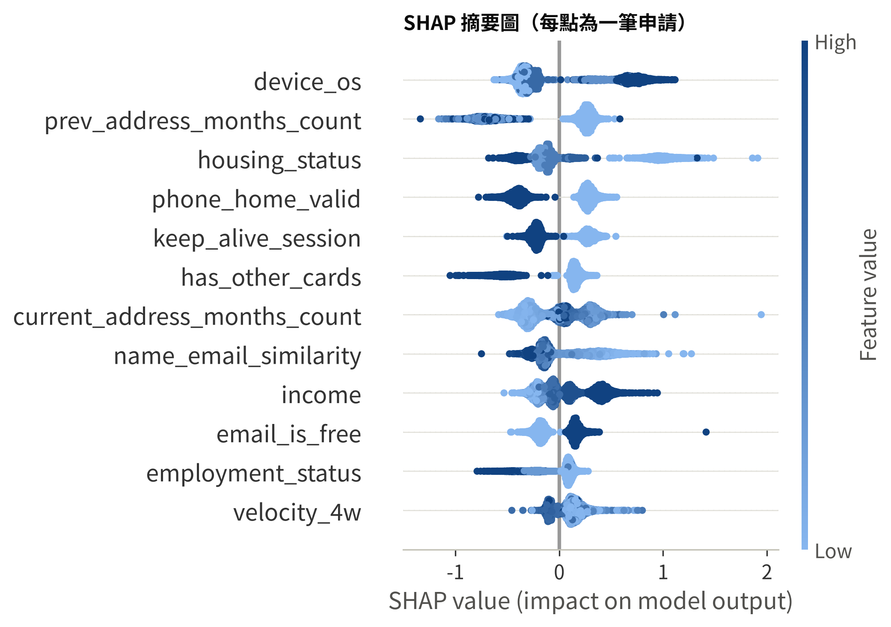{#fig-shap width=85%}

@fig-shap-dependence 進一步呈現三個重要數值特徵的特徵值與其 SHAP 值的關係。前一地址的居住月數接近 0 時（多為以 −1 表示的缺失值），SHAP 值皆為正，提高被判為詐騙的分數；有填寫時則幾乎全為負值，且與居住月數的長短關係不大。住家電話無效（0）與未保持登入（0）的申請，SHAP 值同樣全為正值。換言之，這些特徵的作用接近「有或無」的二分訊號，而非隨數值連續變化，這也使其容易轉換為下文的風控規則。

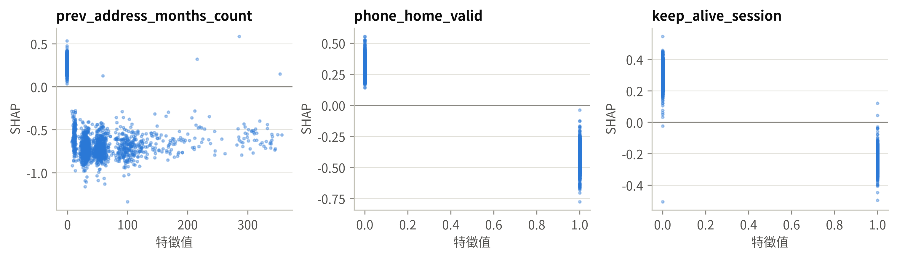{#fig-shap-dependence width=100%}

為使分析結果可直接作為風控規則，本研究以決策樹模仿 LightGBM 在 5% 誤判率門檻下的判定。由於原模型在此門檻下只將不到 6% 的申請判為可疑，即使全部預測為正常，與原模型的一致率也可達 94% 以上；因此本研究以類別權重平衡訓練代理模型，並以兩類判定各自的一致率平均（平衡忠實度）衡量。深度 3 與 4 的代理模型，平衡忠實度分別為 82.6% 與 83.5%，可找回原模型 88.3% 與 83.5% 的可疑判定；整體一致率則為 77.5% 與 83.5%，低於全部預測為正常的一致率，是以權重平衡換取捕捉可疑案件的結果。其中最具代表性的規則為：「住房狀態為 BA、沒有其他卡片、且使用 Windows 裝置」。符合此條件的申請占測試月的 4.8%，詐騙率達 10.0%，約為整體詐騙率（1.40%）的 7 倍，並涵蓋了 33.8% 的詐騙申請；若再加上「前一地址居住月數不超過 3 個月」，則申請占比為 4.1%、詐騙率提高至 10.8%，涵蓋 31.6% 的詐騙。此類規則可作為後續風控規則研究與人工審查的候選訊號，或作為風控人員判讀模型結果時的參考，但仍需在銀行自身的資料上驗證，不宜直接作為拒絕開戶的單一條件；BAF 特徵與台灣銀行可取得資料的對應，將於第五章討論。

## 小銀行困境（RQ6，延伸） {#sec-small-bank}

本研究將資料分配給五家規模不同的模擬銀行（如 @tbl-banks 所示），比較資料較少的銀行可採取的策略，結果如 @tbl-small-bank 與 @fig-small-bank 所示。

| 銀行 | 訓練期｜申請件數 | 訓練期｜詐騙件數 | 測試期｜申請件數 | 測試期｜詐騙件數 | 主要住房狀態 |
|:-------|-----------:|-----------:|-----------:|-----------:|:---------------|
| 銀行 A | 431,777 | 4,030 | 106,451 | 1,361 | BC（58%） |
| 銀行 B | 156,795 | 2,576 | 42,952 | 956 | BB（37%） |
| 銀行 C | 118,893 | 1,047 | 31,910 | 414 | BB（55%） |
| 銀行 D | 46,245 | 287 | 12,992 | 86 | BB（66%） |
| 銀行 E | 41,279 | 211 | 10,706 | 61 | BB（58%） |

: 五家模擬銀行的資料概況 {#tbl-banks}

::: {custom-style="TableNote"}
註：主要住房狀態為各銀行申請者占比最高的住房狀態類別。BAF 的住房狀態經匿名化處理，以 BA 至 BG 七個代碼表示，原資料未公開各代碼的實際意義；括號內為該類別占該銀行申請者的比例。
:::

| 方法 | 銀行｜A | 銀行｜B | 銀行｜C | 銀行｜D | 銀行｜E |
|:---------------------|:-------:|:-------:|:-------:|:-------:|:-------:|
| 自建 LightGBM | 0.502 | 0.460 | 0.452 | 0.267 | 0.295 |
| 自建 TabPFN-3.5 | 0.550 | 0.517 | 0.527 | 0.395 | 0.443 |
| 自建 MLP | 0.501 | 0.469 | 0.505 | 0.302 | 0.344 |
| 聯合學習 MLP（FedAvg） | 0.529 | 0.477 | 0.505 | 0.395 | 0.443 |
| 資料集中 LightGBM（參考） | 0.540 | 0.496 | 0.514 | 0.430 | 0.393 |
| 資料集中 MLP（參考） | 0.533 | 0.480 | 0.502 | 0.337 | 0.443 |

: 各銀行在不同策略下的偵測率 {#tbl-small-bank}

::: {custom-style="TableNote"}
註：數值為 TPR@5%FPR。「資料集中」表示將五家銀行的資料集中訓練，作為參考。
:::

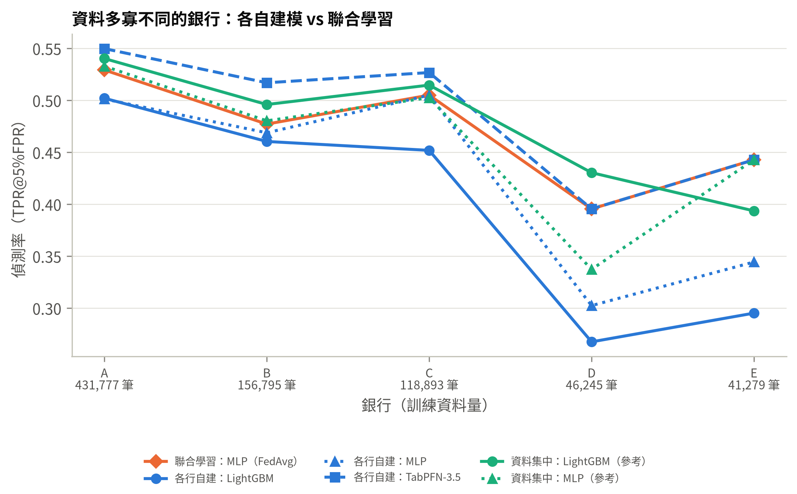{#fig-small-bank width=95%}

資料最少的銀行 D 與 E，若僅以自有資料訓練 LightGBM，偵測率只有 0.267 與 0.295，遠低於大型銀行；改用表格基礎模型 TabPFN-3.5 或加入聯合學習，偵測率皆提升至 0.395 與 0.443，增加約 13 至 15 個百分點，接近資料集中訓練 LightGBM 的水準（0.430、0.393）。由於兩家銀行的測試期詐騙僅 86 與 61 件，偵測率的 95% 信賴區間寬達約 ±0.12（例如銀行 E 的兩種方法皆為 0.31 至 0.56），兩者的偵測率恰好相同，差異並不顯著；兩者在兩家銀行皆高於自建 LightGBM，但受限於詐騙件數，提升幅度仍有相當的不確定性。值得注意的是，銀行 D 與 E 自建 LightGBM 的偵測率，明顯低於 [4.2.3](#sec-data-size) 節以 5 萬筆訓練的 LightGBM（0.420），主因在於詐騙樣本更少：兩家銀行的訓練期詐騙僅 287 與 211 件（詐騙率 0.62% 與 0.51%），不到學習曲線中 5 萬筆分層抽樣（約 510 件詐騙）的六成，且客群集中於住房狀態 BB（@tbl-banks），與整體資料的分布不同。對資料充足的銀行 A 至 C，自建 TabPFN-3.5 也是最佳的選擇（0.517 至 0.550），甚至略高於資料集中的 LightGBM。需要說明的是，各銀行自建的 LightGBM 使用預設參數，未針對小樣本調參，因此基礎模型的領先幅度可能被高估。此外，就 MLP 而言，聯合學習的偵測率在 A 至 C 三家銀行與資料集中訓練相當（相差不到 0.005），且不低於各行自建的 MLP；在資料最少的 D、E 兩家則比自建 MLP 高約 10 個百分點，與資料集中訓練相當或更高。換言之，聯合學習在不交換原始資料的前提下，大致達到了集中資料的效果。初版實驗未使用提前停止時，資料集中訓練的 MLP 明顯過度擬合，反而在五家銀行皆輸給聯合學習；加入提前停止後，此一反常現象即消失。

就管理意涵而言，基礎模型與聯合學習對小銀行的效益相當，但導入條件不同：聯合學習需要多家銀行協調資料格式、訓練流程與治理機制；基礎模型則可由單一銀行自行導入，門檻較低，但需注意預測的運算成本與模型權重的授權條件。需要說明的是，上述結果來自以單一特徵、單一隨機切分所模擬的情境，屬探索性分析；聯合學習雖不交換原始資料，模型更新仍可能洩漏部分資訊，實務上需搭配安全聚合或差分隱私等機制。

## 研究假說檢驗與小結 {#sec-hypotheses}

四項研究假說的檢驗結果彙整如 @tbl-hypothesis-results 所示。

| 假說 | 內容 | 結果 | 主要證據 |
|:-----|:----------------------------|:--------:|:------------------------------|
| H1 | 小資料量下基礎模型優於梯度提升樹，差距隨資料量增加而縮小 | 支持 | 1 萬筆時基礎模型 0.494–0.501，梯度提升樹 0.327–0.408；其他模型以全量資料訓練時，才與只用 5 萬筆的基礎模型相當（[4.2.3](#sec-data-size) 節） |
| H2 | 未經公平性處理的模型，FPR 比低於 0.8 | 支持 | 十個模型的 FPR 比皆介於 0.27–0.35（[4.3](#sec-fairness) 節） |
| H3 | 公平性結論對年齡分組方式敏感 | 部分支持 | Base 中「不公平」的結論不變，但模型排序改變；變體中兩種定義的 FPR 比差距可達三倍（[4.1](#sec-repro)、[4.3](#sec-fairness) 節） |
| H4 | 在審核人力的限制下，三級分流的期望損失低於 BAF 二元決策 | 支持 | 符合人力上限時，較人力上限內最佳的二元政策低 44.8%、較 BAF 二元決策低 23.8%；所有敏感度情境皆分別節省 30.6%–60.3% 與 4.6%–45.2%（[4.4](#sec-decision) 節） |

: 研究假說的檢驗結果 {#tbl-hypothesis-results}

最後，本研究與原論文的研究範圍對照如 @tbl-vs-paper 所示。本研究在重現原論文主要發現的基礎上，將分析由單一模型的效能與公平性量測，延伸至三代模型的比較、公平性處理、成本導向的分級決策、知識萃取與小銀行情境，並將結果連結到台灣的開戶制度。

| 項目 | BAF 原論文 [@jesus2022turning] | 本研究 |
|:---|:-------|:-----------|
| 模型 | 僅 LightGBM | 三類十個模型 |
| 公平性 | 僅量測 | 量測、兩種處理方法、分組敏感度 |
| 決策 | 無 | 三級分流決策模型 |
| 資料量情境 | 全量 | 學習曲線、小銀行聯合學習 |
| 解釋 | 無 | SHAP、風控規則 |
| 在地化 | 無 | 台灣數位帳戶制度與法規 |

: 原論文與本研究的比較 {#tbl-vs-paper}

# 管理意涵與建議 {#sec-implications}

本章將第四章的實驗結果轉化為銀行可採行的管理建議：[5.1](#sec-tier-process) 節提出開戶審查的分級作業流程；[5.2](#sec-adoption) 節說明不同情境下的模型導入策略與損益兩平分析；[5.3](#sec-audit) 節提出公平性稽核的做法，並對照國內的 AI 相關法規；[5.4](#sec-rules) 節整理可供風控人員使用的規則，並對照台灣銀行可取得的資料；[5.5](#sec-monitoring) 節說明上線後的監控與門檻校準；[5.6](#sec-dss) 節介紹本研究開發的開戶風控決策支援系統，協助銀行依自身的條件檢視上述建議。需要強調的是，本研究的資料並非台灣銀行的實際資料，成本參數亦為情境假設，以下建議旨在提供決策的方向與架構，實際導入時仍應以各銀行的資料重新驗證。

## 開戶審查的分級作業流程 {#sec-tier-process}

第四章的結果顯示，將開戶審查由「通過或轉人工」的二元決策改為三級分流，可在人工審核量更少的情況下降低期望損失（[4.4](#sec-decision) 節）。據此，本研究建議銀行採用如 @fig-tier-process 所示的分級作業流程：申請經模型評分後，低風險者正常開戶；中風險者須先完成視訊或電信認證等加強驗證，通過者以限額帳戶開戶，並設定一段觀察期，期滿無異常後再解除限額，未通過者則婉拒開戶；高風險者直接轉人工審核。此設計的關鍵在於以「加強驗證搭配限額開戶」取代「直接拒絕」或「全面轉人工」：中風險申請中的正常客戶完成驗證後即可開戶使用，而通過驗證的詐騙者在觀察期內也只能在限額內使用，與台灣第三類數位存款帳戶「完成視訊驗證後可提高限額」的制度精神一致[（中央通訊社，2021）]{.cite}。需要說明的是，台灣數位存款帳戶的類別是依開戶時的身分驗證方式區分，銀行不宜因風險分數而改變帳戶類別；較可行的做法是在既有的帳戶類別下，於約定條款允許的範圍內，為第二級的申請者設定較低的初始轉帳限額（例如比照第三類帳戶的每月 5 萬元），待觀察期滿後再調回該類別的標準限額。

{#fig-tier-process width=90%}

各級的作業重點整理如 @tbl-tier-sop 所示。在本研究的情境模擬中，第二級僅占申請量的 10%，卻涵蓋了近五成的詐騙申請；第三級僅需審核 1% 的申請，卻涵蓋近兩成的詐騙申請。換言之，銀行可將有限的人力集中於少數高風險案件，而將大部分的風險控制交由「限額」與「加強驗證」完成。

| 等級 | 申請占比 | 詐騙占比 | 處置 | 管理重點 |
|:---------------|:--------:|:---------:|:-----------------------|:-----------------------|
| 一級：正常開戶 | 約 89% | 約 33%–35% | 依帳戶類別提供完整功能 | 漏放的詐騙需由開戶後的交易監控補強 |
| 二級：加強驗證 | 約 10% | 約 48% | 先加強驗證；通過者限額開戶，觀察期滿後解除限額，未通過者婉拒開戶 | 驗證人力是三級分流效益的關鍵 |
| 三級：人工審核 | 約 1% | 約 18%–19% | 由審核人員判斷核准或拒絕 | 保留人類監督，並記錄判斷理由 |

: 三級分流的作業重點 {#tbl-tier-sop}

::: {custom-style="TableNote"}
註：比例取自兩種三級分流政策（未加與加入公平限制，皆為分位數門檻）的測試月結果。
:::

在資源配置上，敏感度分析顯示三級分流的效益主要取決於加強驗證的人力上限：上限由 10% 降至 5% 時，相較 BAF 二元決策的節省由 23.8% 降至 4.6%；放寬至 20% 時則提高至 45.2%（如 @tbl-sensitivity 所示）。因此，本研究建議銀行優先投資「加強驗證」的處理能量，例如擴充視訊驗證的人力或導入自動化的電信認證，其效益可能高於單純提升模型的偵測率。相對地，人工審核上限在 1% 至 5% 之間變動時，節省幅度僅在 20.6% 至 26.8% 之間變動，影響小於加強驗證的人力。此外，固定門檻上線後的審核量會隨分數分布漂移（[4.4](#sec-decision) 節），設定門檻時應以近期的分數分布換算，而非沿用固定的分數門檻。

## 模型導入策略 {#sec-adoption}

第四章的比較顯示，「哪一個模型最好」取決於銀行的資料量、運算資源與維運能力。本研究依情境整理的建議如 @tbl-adoption 所示。

| 情境 | 建議做法 | 依據 |
|:------------------|:--------------------------|:--------------------------|
| 資料充足（數十萬筆以上）的大型銀行 | 以梯度提升樹（如 XGBoost、LightGBM）為主，投入少量調參 | 調參後偵測率最高（0.552–0.553），預設參數下訓練與預測僅需數秒，30 次調參僅需 4 至 7 分鐘（[4.2](#sec-benchmark) 節） |
| 追求最高偵測率、可不調參 | 可評估表格深度學習（如 TabM） | 預設參數下偵測率最高（0.546），但運算時間約為 LightGBM 的百倍以上（[4.2](#sec-benchmark) 節） |
| 資料較少的銀行、新產品或新通路 | 優先評估表格基礎模型（如 TabPFN-3.5） | 1 萬筆資料即達 0.50，梯度提升樹僅 0.33–0.41（[4.2.3](#sec-data-size) 節）；小銀行可提升約 13–15 個百分點（[4.6](#sec-small-bank) 節） |
| 多家中小型銀行願意合作 | 可評估跨行聯合學習 | 最小兩家銀行偵測率提升約 13–15 個百分點，接近集中資料的效果，且不需交換原始資料（[4.6](#sec-small-bank) 節） |

: 依情境的模型導入建議 {#tbl-adoption}

導入模型除了上述的變動成本，還有系統開發、人員、模型維護與稽核等固定成本，而 @eq-cost 的期望損失並未納入這些固定成本。為評估導入是否划算，本研究以損益兩平分析估計所需的申請量，如 @eq-breakeven 所示：

$$
N^{*} = \frac{F}{\Delta C}, \qquad \Delta C = c_{0} - c_{\text{model}}
$$ {#eq-breakeven}

其中，$F$ 代表一段期間內導入與維運 AI 的固定成本；$c_{0}$ 與 $c_{\text{model}}$ 分別為不使用模型與使用模型時，每件申請的期望成本（依 @eq-cost 計算後除以申請數）；$\Delta C$ 為每件申請所節省的成本；$N^{*}$ 則為損益兩平所需的申請件數，申請量高於 $N^{*}$ 時，導入 AI 即可回收固定成本。由於 $c_{\text{model}}$ 已包含加強驗證、人工審核與正常客戶的成本，$\Delta C$ 是扣除這些新增成本後的淨節省。

以 [4.4](#sec-decision) 節的結果為例，符合人力上限且加入公平限制的三級分流，使每件申請的期望成本由 2,808 元降至 1,225 元，$\Delta C$ 約為 1,583 元，其中詐騙損失的減少遠大於新增的驗證、審核與客戶成本；在測試期的 20.5 萬件申請中，合計約可減少 3.2 億元的期望損失。若假設導入與維運 AI 的年度固定成本為 1,000 萬元，則依 @eq-breakeven，每年約 6,300 件申請即可達到損益兩平。模型本身的運算成本相對很小：LightGBM 以約 80 萬筆資料訓練、再對 20.5 萬件申請預測，合計僅需約 2.4 秒（[4.2](#sec-benchmark) 節）。需要強調的是，$\Delta C$ 主要來自避免的詐騙損失，而 @eq-cost 的詐騙損失以帳戶的轉帳上限估計，代表詐騙帳戶可能造成的財損，主要由被害民眾承擔，並非銀行損益表上的現金支出；因此上述分析屬「社會總成本」的觀點。銀行自身承擔的，是警示帳戶處理、客訴、聲譽與監理裁罰等成本，僅為其中一部分，且高度依賴詐騙損失與攔截率的假設，銀行應以自身的資料重新估計。即使 $\Delta C$ 只有上述估計的十分之一（例如銀行僅將約一成的詐騙損失視為自身的成本），損益兩平的申請量也僅約每年 6.3 萬件。對線上開戶量達此規模的銀行而言，固定成本並非導入 AI 的主要障礙，真正需要權衡的是審核人力、客戶體驗與公平性。

導入表格基礎模型時，有三點需要特別注意。第一，其運算成本集中在預測階段，對 20 萬筆申請的預測時間約 13 分鐘（[4.2](#sec-benchmark) 節），若需即時審查大量申請，應評估批次處理或硬體需求。第二，部分基礎模型的權重限於非商業用途，商業導入前應確認授權條件。第三，基礎模型並未比較公平（FPR 比 0.27–0.30，[4.3](#sec-fairness) 節），導入時仍需搭配公平性處理。此外，在資料充足時，不同世代模型的偵測率差距僅 1 至 2 個百分點，遠小於決策流程設計（三級分流）帶來的效益；因此，對多數銀行而言，「如何使用模型分數」的重要性，可能高於「選擇哪一個模型」。

## 公平性稽核與法規遵循 {#sec-audit}

第四章的結果顯示，未經處理的模型皆對年長的正常申請者較不公平（FPR 比 0.27–0.35），且新一代模型並未改善此問題（[4.3](#sec-fairness) 節）。本研究據此建議銀行將公平性稽核納入模型的上線與定期檢視程序，重點如 @tbl-fairness-audit 所示。

| 稽核項目 | 建議做法 | 本研究依據 |
|:------------------|:------------------------------|:------------------------|
| 明確定義受保護群體 | 書面定義分組方式（如「50 歲以上」或「大於 50 歲」），並固定使用 | 兩種定義可使 FPR 比相差 2 至 3 倍（[4.1](#sec-repro) 節） |
| 分組敏感度檢查 | 以多個年齡切點計算 FPR 比，確認結論不因切點而改變 | 不同切點下最公平的模型不同（[4.3](#sec-fairness) 節） |
| 以誤判率衡量公平 | 定期計算各組正常申請者被誤判或被升級審查的比例 | 年長者的誤判率約為年輕者的 3 倍（[4.3](#sec-fairness) 節） |
| 選擇公平性處理方法 | 評估分組門檻與訓練中處理的取捨，並記錄選擇理由 | 分組門檻 FPR 比 0.90、FairGBM 0.62–0.77（[4.3](#sec-fairness) 節） |
| 評估公平的代價 | 以期望損失量化公平性限制的成本 | 三級分流加入公平限制僅增加 3.6% 成本（[4.4](#sec-decision) 節） |

: 公平性稽核的建議項目 {#tbl-fairness-audit}

在處理方法的選擇上，兩種方法各有取捨。分組門檻的效果最好，且公平性的代價很小（偵測率僅降低約 1.6 個百分點），但有三項風險需要權衡：第一，決策時需要依申請者的年齡組別使用不同門檻，可能被視為對不同年齡的「差別對待」；第二，由於 50 歲以上申請者的詐騙率較高（2.34% 對 0.83%），提高其門檻以降低誤判，也會降低年長組詐騙申請的攔截率，以 LightGBM 為例，年長組的偵測率由 0.692 降至 0.536，年輕組則由 0.477 升至 0.535，整體只降低 1.6 個百分點是因為年輕組的人數較多（[4.3](#sec-fairness) 節）；第三，若詐騙集團察覺年長申請者較容易通過審查，可能轉而收購中高齡民眾的帳戶。相對地，FairGBM 只在訓練時使用年齡組別，決策時對所有人一視同仁，但改善幅度較小且結果較不穩定。本研究建議銀行由法遵、風控與資料科學單位共同決定採用的方法，並將決策理由記錄於模型的說明文件中；若採用分組門檻，應同時監控各年齡組的詐騙漏判率，以及警示帳戶的年齡結構變化。

金管會的《金融業運用人工智慧（AI）指引》以治理與問責、公平性與以人為本、隱私保護、系統穩健與安全、透明與可解釋、永續發展等核心原則為基礎，要求金融機構於 AI 系統的生命週期中落實[（金融監督管理委員會，2024）]{.cite}；《人工智慧基本法》亦明定人類自主、透明與可解釋、公平與不歧視等原則[（人工智慧基本法，2026）]{.cite}。本研究的建議與上述原則的對照如 @tbl-regulation 所示。

| 法規原則 | 本研究的對應做法 | 相關章節 |
|:--------------------|:------------------------------------|:--------:|
| 公平與不歧視；重視公平性 | 年齡公平性量測、分組敏感度檢查、公平性處理與公平代價的量化 | [4.3](#sec-fairness)、[5.3](#sec-audit) |
| 透明與可解釋 | 以 SHAP 解釋模型，並萃取可直接檢視的風控規則 | [4.5](#sec-knowledge)、[5.4](#sec-rules) |
| 人類自主（保留人類監督） | 高風險申請由審核人員判斷並作成最終決定，模型不單獨拒絕申請 | [5.1](#sec-tier-process) |
| 治理與問責 | 以模型說明文件記錄模型的用途、限制與公平性處理的決策理由 | [5.3](#sec-audit)、[5.5](#sec-monitoring) |
| 系統穩健與安全 | 逐月監控特徵漂移與模型表現，並定期校準門檻與重新訓練 | [5.5](#sec-monitoring) |
| 隱私保護 | 規劃資料蒐集時確認蒐集目的、告知與同意程序；跨行合作可採聯合學習 | [4.6](#sec-small-bank)、[5.4](#sec-rules) |

: 法規原則與本研究建議的對照 {#tbl-regulation}

## 風控規則與資料對照 {#sec-rules}

[4.5](#sec-knowledge) 節的分析顯示，模型最重視的特徵多與「身分資訊是否穩定、可驗證」有關，且可萃取出簡單的規則：例如「住房狀態為 BA、沒有其他卡片、使用 Windows 裝置」的申請，詐騙率約為整體的 7 倍，並涵蓋約三分之一的詐騙申請。此類規則可作為後續風控規則研究與人工審查的候選訊號，或供審核人員判讀模型結果時參考；但由於 BAF 的欄位經過匿名化（例如住房狀態 BA 的實際意義未公開），仍需在銀行自身的資料與後續期間驗證其穩定性與誤傷情形，不宜直接作為拒絕開戶的單一條件。

由於 BAF 的欄位經過匿名化，且非台灣的資料，銀行若要應用上述發現，需要找到台灣實務上可取得的對應資料。主要特徵可能的對應來源整理如 @tbl-feature-mapping 所示，供銀行規劃資料蒐集時參考。

| BAF 特徵 | 意義 | 台灣銀行可能的對應資料 |
|:---------------------------------------|:-----------------|:-----------------------------|
| `device_os`、 `keep_alive_session` | 申請裝置與登入行為 | 線上開戶時的裝置資訊與連線紀錄 |
| `prev_address_months_count`、 `current_address_months_count` | 居住地址的穩定度 | 開戶申請書填寫的地址與居住期間 |
| `housing_status` | 住房狀態 | 開戶申請書的居住狀況欄位 |
| `phone_home_valid`、 `phone_mobile_valid` | 電話是否有效 | 電話驗證或電信認證的結果 |
| `has_other_cards` | 是否持有其他卡片 | 本行既有往來資料，或經客戶同意查詢的信用資料 |
| `name_email_similarity`、 `email_is_free` | 聯絡資訊的一致性 | 申請資料中的姓名與電子郵件 |
| `velocity_6h`、 `velocity_24h`、 `velocity_4w` | 短期內的申請頻率 | 同一裝置、地址或聯絡資訊的近期申請次數 |

: BAF 主要特徵與台灣銀行可能的對應資料 {#tbl-feature-mapping}

::: {custom-style="TableNote"}
註：此為概念對照，實際可用性需依各銀行的資料與法規確認。
:::

需要注意的是，部分特徵（例如裝置資訊與信用資料）涉及個人資料的蒐集與利用，銀行應確認其蒐集目的、告知與同意程序符合個人資料保護的相關規定。

## 上線監控與門檻校準 {#sec-monitoring}

模型上線後，申請者的特徵與行為會隨時間改變。本研究以驗證月（第 5 個月）決定 5% 誤判率的門檻後固定不變，逐月追蹤模型的表現，結果如 @fig-monitoring 與 @tbl-monitoring 所示。結果顯示，上線第一個月（第 6 個月）的誤判率由 5.0% 升至 6.2%，警示率由 5.6% 升至 6.9%；偵測率則由 0.528 略升至 0.541 與 0.561，FPR 比維持在 0.33 至 0.35。換言之，即使模型的偵測能力沒有下降，固定的門檻也會因資料分布改變而讓審核量增加約兩成，這與 [4.4](#sec-decision) 節三級分流的第二級比例超出上限的現象一致。

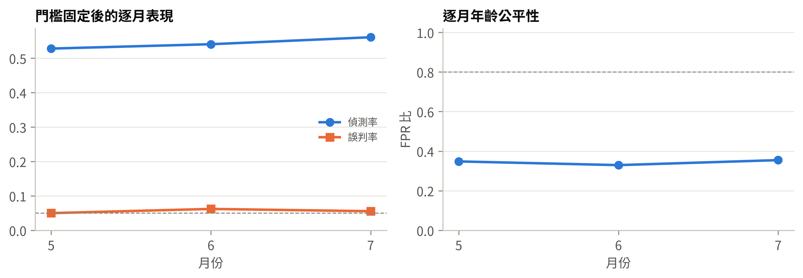{#fig-monitoring width=95%}

| 月份 | 角色 | 申請量 | 詐騙率 | 警示率 | 誤判率 | 偵測率 | FPR 比 |
|:----:|:----------|-------:|:------:|:------:|:------:|:------:|:------:|
| 5 | 驗證（設定門檻） | 119,323 | 1.18% | 5.56% | 5.00% | 0.528 | 0.35 |
| 6 | 上線後 | 108,168 | 1.34% | 6.86% | 6.21% | 0.541 | 0.33 |
| 7 | 上線後 | 96,843 | 1.47% | 6.30% | 5.55% | 0.561 | 0.35 |

: 門檻固定後的逐月追蹤（LightGBM） {#tbl-monitoring}

::: {custom-style="TableNote"}
註：門檻於第 5 個月依誤判率 5% 設定後固定不變。警示率為被判定為疑似詐騙的申請比例；誤判率為正常申請者被判定為疑似詐騙的比例。
:::

在特徵層面，本研究以母體穩定指標（PSI）比較訓練期與測試月的分布。依常用的經驗法則，PSI 低於 0.1 視為穩定、0.1 至 0.25 為中度變化、高於 0.25 為顯著變化 [@siddiqi2006credit]。結果顯示，30 個特徵中有 5 個出現顯著變化，以申請頻率相關的特徵最為明顯（如 @tbl-psi 所示），其中 `velocity_4w` 在第 7 個月的 PSI 達 3.70；這類特徵計算的是一段期間內的申請次數，可能直接反映申請量的逐月下降（[3.2](#sec-data) 節）。值得注意的是，這些特徵的大幅變化並未造成偵測率下降。對照 [4.5](#sec-knowledge) 節的 SHAP 分析，`velocity_4w` 的重要性僅排名第 12，對模型判定的影響遠小於前幾名的身分穩定性特徵，因此其漂移並未破壞模型的排序能力。這顯示 PSI 適合作為「需要檢查」的預警，而不宜單獨作為重新訓練的依據。

| 特徵 | PSI｜第 6 個月 | PSI｜第 7 個月 | 判斷 |
|:---------------------------------------|:------------:|:------------:|:----------:|
| `velocity_4w` | 2.70 | 3.70 | 顯著變化 |
| `velocity_24h` | 1.28 | 2.32 | 顯著變化 |
| `velocity_6h` | 0.74 | 1.22 | 顯著變化 |
| `zip_count_4w` | 0.23 | 0.79 | 顯著變化 |
| `date_of_birth_distinct_emails_4w` | 0.28 | 0.43 | 顯著變化 |
| `credit_risk_score` | 0.20 | 0.24 | 中度變化 |

: PSI 達中度以上變化的特徵 {#tbl-psi}

::: {custom-style="TableNote"}
註：其餘 24 個特徵的 PSI 皆低於 0.1。
:::

據此，本研究建議銀行建立以下的監控機制：

1. 每月計算特徵的 PSI，以及模型的警示率、誤判率與各年齡組的 FPR 比，並與上線時的基準比較；
2. 每月依最新資料重新校準門檻，使警示率與各級的審核量維持在人力上限內；由於 [4.4](#sec-decision) 節的結果顯示，僅預留 10% 的緩衝（以 9% 而非 10% 作為第二級的目標）仍不足以吸收分數分布的漂移，較可靠的做法是以最近一段期間（如前一週）的分數分布滾動更新分位數門檻；
3. 當偵測率較基準下降超過一定幅度（例如 5 個百分點），或 FPR 比低於 0.8 時，啟動模型的重新訓練與重新驗證；
4. 以模型說明文件（model card）記錄模型的用途、資料、效能、公平性與限制，並於每次重新訓練後更新。

## 開戶風控決策支援系統 {#sec-dss}

上述建議中的門檻與成本參數，都需要依各銀行的情況調整。為了讓不具模型背景的風控主管也能檢視不同設定的影響，本研究將三級分流決策模型實作為一套互動式的決策支援系統（decision support system），稱為「開戶風控決策支援系統」，其操作畫面如 @fig-simulator 所示。使用者可在左側調整兩項門檻，即升級至第二、三級的申請比例，以及其中轉人工審核的比例，並可修改詐騙損失、驗證與審核成本、正常客戶的不便與流失成本，以及加強驗證與人工審核的人力上限等假設；右側則即時顯示預期攔下的詐騙比例、正常客戶被升級的比例、年齡組間的 FPR 比與每件申請的期望成本，並與不使用模型的情況比較。此外，系統以曲線呈現升級比例與期望成本的關係，並依使用者設定的人力上限，以灰色區域標出加強驗證人力不足的範圍，避免主管只看成本曲線而忽略作業負荷。

{#fig-simulator width=100%}

以 @fig-simulator 的設定為例，將 5% 的申請升級至第二、三級，可涵蓋 48.6% 的詐騙申請；依加強驗證與人工審核的攔截率（0.5 與 0.9），預期約可攔下 904 件，即 31.4% 的詐騙申請，其餘則以限額帳戶或經審核後開戶。每件申請的期望成本由不使用模型時的 2,808 元降至 1,623 元，約節省 42%；然而，50 歲以上正常申請者被升級的比例（10.0%）約為未滿 50 歲者（3.2%）的 3 倍，FPR 比僅 0.32，畫面會同時提示未達 0.8 的標準。

若風控主管將升級比例由 5% 提高至 10%（如 @fig-simulator-10 所示），升級涵蓋的詐騙申請由 48.6% 提高至 64.4%（預期攔下的比例由 31.4% 提高至 39.3%），每件申請的期望成本進一步降至 1,243 元（較不使用模型節省 56%）；但正常客戶被升級的比例也由 4.28% 增加至 9.12%，加強驗證的工作量增加一倍以上（第二級由 4.0% 增加至 9.0%，已接近 10% 的驗證人力上限，即圖中灰色區域的邊界），50 歲以上正常申請者被升級的比例更達 19.4%。換言之，在本研究的成本假設下，擴大加強驗證的範圍雖能降低期望損失，但需要相應的驗證人力，也會讓更多正常客戶受到打擾。系統的價值在於讓這類取捨在決策前即可被看見與量化，而非上線後才發現人力不足或客訴增加。

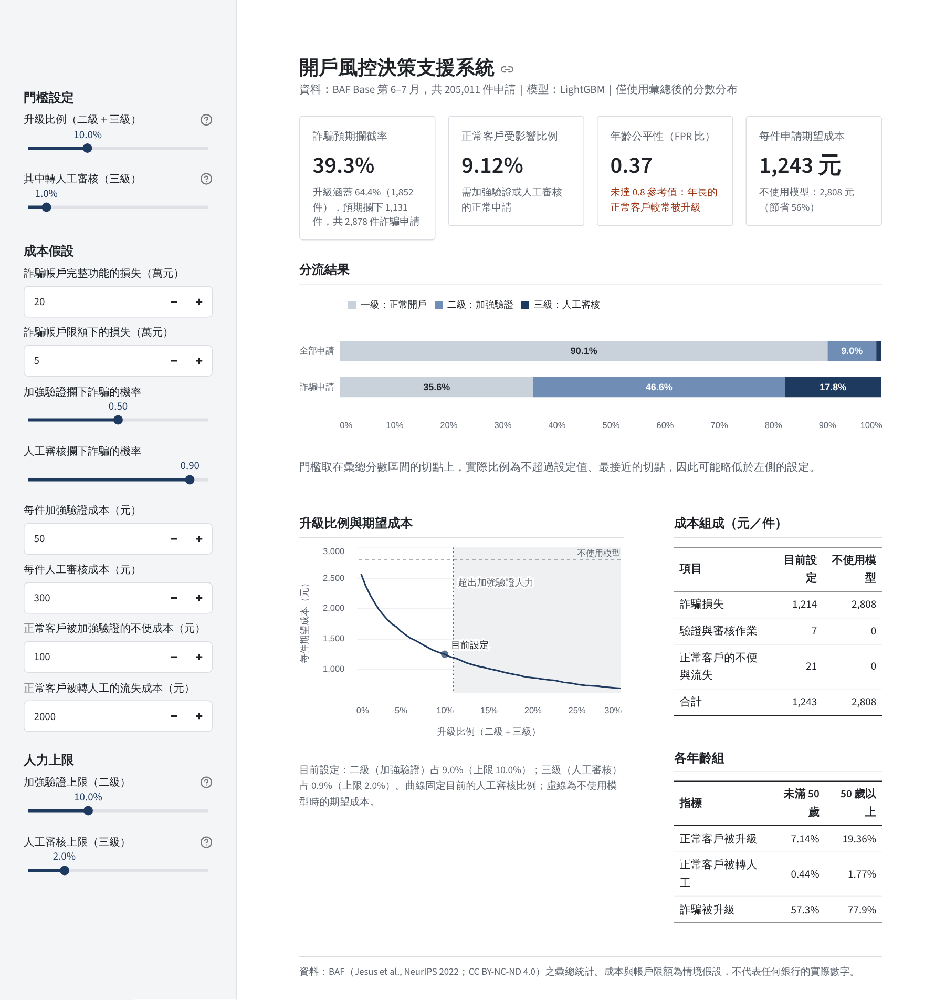{#fig-simulator-10 width=100%}

此系統有三項管理用途。第一，作為門檻決策的溝通介面：風控、業務與法遵單位可在同一畫面上檢視「多攔一些詐騙」與「多打擾一些正常客戶」之間的取捨，使門檻的決定有共同的依據。第二，彌補本研究成本參數為假設值的限制：銀行可代入自身的損失與作業成本，立即檢視三級分流在該情境下的效益。第三，作為 [5.5](#sec-monitoring) 節每月校準門檻時的輔助工具。在資料保護上，此系統僅使用模型分數的彙總分布（各分數區間的件數），不含任何個別申請者的資料，也未散布 BAF 的原始資料。

## 小結 {#sec-ch5-summary}

綜合本章，本研究對銀行的開戶詐騙防制提出四項主要建議。第一，以三級分流取代二元決策，並優先擴充加強驗證的處理能量，因為驗證人力是決定效益的關鍵；門檻則應依近期的分數分布定期換算，使各級的審核量維持在人力上限內。第二，模型的選擇應依資料量與運算資源而定：資料充足時，經調參的梯度提升樹即具成本效益；資料較少時，表格基礎模型或跨行聯合學習在本研究的模擬情境中可提升偵測能力，但仍需在真實的跨行資料上驗證。第三，將公平性稽核制度化，明確定義受保護群體並量化公平的代價；在本研究的情境中，以分組門檻滿足本研究設定的年齡公平限制，期望成本僅增加約 3.6%。第四，上線後應逐月監控並校準門檻，避免資料漂移使審核量超出人力負荷。這些建議同時呼應了金管會 AI 指引與《人工智慧基本法》對公平、可解釋與人類監督的要求；本研究開發的開戶風控決策支援系統（[5.6](#sec-dss) 節）則可協助銀行代入自身的成本參數，檢視上述建議的效益。

# 結論 {#sec-conclusion}

本章總結本研究的發現：[6.1](#sec-findings) 節依研究問題歸納研究結論；[6.2](#sec-contributions) 節說明本研究的貢獻；[6.3](#sec-limitations) 節說明研究限制；[6.4](#sec-future) 節提出未來研究方向。

## 研究結論 {#sec-findings}

本研究以銀行開戶詐騙偵測為情境，從管理者的角度回答「如何在攔截詐騙、不誤傷正常客戶、控制審核成本與公平對待各客群之間做出決策」。研究以 NeurIPS 2022 的 BAF 資料集為基礎，先重現原論文的發現，再比較三代表格模型的效能、公平與成本，並提出對應台灣數位存款帳戶分類的三級分流決策模型。依研究問題彙整的主要結論如 @tbl-conclusions 所示。

| 研究問題 | 主要結論 | 管理意涵 |
|:------------------|:------------------------------------|:------------------------|
| RQ1 重現 | 偵測率重現成功：六個資料集的偵測率皆與原論文一致，Base 的 FPR 比為 0.331（原論文約 0.3）；變體的 FPR 比僅在正文的分組定義下與原論文相符，以資料中實際被注入偏差的分組計算則低 2 至 3 倍，成因仍待驗證 | 公平性稽核須明確定義受保護群體 |
| RQ2 三代模型 | 資料充足時三代模型差距僅 1–2 個百分點，調參後的梯度提升樹最佳且成本最低；資料少時表格基礎模型明顯領先 | 依資料量與運算資源選擇模型 |
| RQ3 年齡公平性 | 所有模型對年長者皆不公平（FPR 比 0.27–0.35），新一代模型並未改善；分組門檻可將 FPR 比提升至 0.90，偵測率僅降低約 1.6 個百分點 | 公平性處理的代價小，應制度化 |
| RQ4 三級分流決策 | 在本研究的成本假設與人力上限下，期望損失較最佳的二元政策低 44.8%、較 BAF 二元決策低 23.8%；加入公平限制僅增加 3.6% 成本；效益主要取決於限額的效果與加強驗證的人力 | 以加強驗證搭配限額開戶取代直接拒絕，優先投資驗證人力 |
| RQ5 知識發現 | 身分資訊的穩定性與可驗證性最能預警詐騙；簡單規則即可涵蓋約三分之一的詐騙申請 | 規則可作為風控研究與人工審查的候選訊號 |
| RQ6 小銀行困境 | 在本研究的模擬情境下，資料少的銀行改用表格基礎模型或聯合學習，偵測率可提升約 13–15 個百分點，兩者差異不顯著 | 基礎模型的導入門檻較低 |

: 研究結論總表 {#tbl-conclusions}

綜合上述，本研究有三項主要結論。第一，在開戶詐騙偵測中，「如何使用模型分數」比「選擇哪一個模型」更重要。在資料充足的情況下，新一代的表格深度學習與基礎模型只比梯度提升樹多出約 1 至 2 個百分點的偵測率，運算成本卻高出兩至三個數量級；相對地，在本研究的情境成本與理想化的門檻校準下，將二元決策改為三級分流，在相同的人力上限下，可較最佳的二元政策降低四成以上的期望損失；即使與需將 6.59% 申請轉人工審核的原論文二元決策相比，也只需轉人工 1%，期望損失仍低約四分之一。其效益主要來自以限額帳戶降低詐騙帳戶的損失，並依賴足夠的加強驗證人力。第二，模型的不公平並未隨模型世代而改善，但改善公平的代價很小：以分組門檻改善本研究採用的年齡公平指標（FPR 比與升級 FPR 比），無論是偵測率（約 1.6 個百分點）或期望損失（約 3.6%），所需付出的代價都相當有限，銀行沒有理由忽略公平性。第三，模型上線後的管理與模型本身同樣重要：資料分布會隨時間改變，即使偵測率維持穩定，固定的門檻仍會使審核量增加約兩成；改以近期的分數分布換算門檻，則可使各級的審核量維持在人力上限內（本研究以測試期整體的分數分布模擬，屬理想化情境），因此需要定期監控並重新校準。

## 研究貢獻 {#sec-contributions}

本研究的貢獻可分為學術與實務兩方面。在學術上，第一，本研究在極度不平衡且資料隨時間變化的詐騙情境中，同時比較三代表格模型的效能、公平與成本，補充了現有大型評比以整體預測指標為主的不足；第二，本研究將三支決策應用於開戶審查，並納入審核人力與公平性的限制，提出可求解且可檢驗的三級分流決策模型；第三，本研究在重現過程中發現原論文的年齡分組定義不一致，並以切點敏感度分析證明分組定義會影響公平性結論，提醒後續研究應明確報告受保護群體的定義。

在實務上，本研究提供銀行一套從模型選擇、分級審核、公平性稽核到上線監控的完整決策架構（第五章），並將其對照台灣數位存款帳戶的制度與國內的 AI 相關規範。此外，本研究將三級分流決策模型實作為互動式的開戶風控決策支援系統（[5.6](#sec-dss) 節），且程式碼與實驗流程皆可完整重現，銀行或後續研究者可以依自身的資料與成本參數重新執行分析。

## 研究限制 {#sec-limitations}

本研究有以下限制。第一，BAF 是以真實、匿名化的銀行開戶資料經生成模型合成的資料，且並非台灣的資料；因此本研究與台灣數位存款帳戶制度的對應屬於情境模擬，研究發現不宜直接套用於特定銀行。第二，三級分流決策模型中的詐騙損失、驗證攔截率與各項成本皆為假設值；雖然敏感度分析顯示三級分流在所有情境下皆優於二元決策，但節省的幅度會隨假設改變；尤其本研究支持的是「限額能有效降低短期風險暴露」前提下的成本優勢，並未驗證限額帳戶在實際交易中的損失。此外，分位數門檻以整個測試期的分數分布換算，屬理想化的校準；BAF 僅提供申請月份，無法模擬逐週或逐日、只使用當時已有資料的門檻校準。此外，期望損失未納入導入 AI 的固定成本，本研究僅以損益兩平分析估計其影響（[5.2](#sec-adoption) 節）。第三，受限於 GPU 記憶體，表格基礎模型在全量實驗中僅以 5 萬筆訓練資料作為情境資料，其在全量資料下的表現可能被低估。第四，本研究的模型比較以單一隨機種子進行，雖以拔靴法估計測試資料的抽樣變異，但未涵蓋模型訓練本身的隨機變異；此外，TabM 與 MLP 在小資料量下的失效原因尚未釐清。第五，公平性分析僅涵蓋年齡，未分析收入、就業狀態等其他屬性，也未分析多重屬性交織下的公平性，且公平性處理與三級分流的 FPR 比未報告信賴區間；此外，詐騙標籤可能受既有審查流程影響（選擇性標籤），模型學到的風險關係與公平性結果不一定能推廣至所有申請者。第六，小銀行的情境是以單一特徵切分資料所模擬，各銀行自建的 LightGBM 未經調參，聯合學習亦僅以 MLP 實作，與實際的跨行合作環境仍有差距。第七，BAF 僅涵蓋 8 個月的開戶申請，且研究範圍限於開戶階段，無法涵蓋既有帳戶轉為人頭帳戶的情形。第八，重現實驗係依原論文的方法重新實作，並非執行其官方程式；變體資料的公平性與原論文不一致的成因，係依公開程式與資料分布所做的推論；由於公開的生成程式未必是實際產生資料的版本，且無法取得生成時的原始年齡，此推論尚待原作者的完整程式驗證。

## 未來研究方向 {#sec-future}

針對上述限制，本研究提出以下未來研究方向。第一，與國內銀行合作，以實際的開戶資料與成本數據驗證三級分流決策模型，並評估其在實際作業流程中的可行性；同時以只使用過去資料的滾動校準（例如以前一段期間的分數分布設定下一段期間的門檻），檢驗分位數門檻在實務上能否守住人力上限，以及限額帳戶的實際損失。第二，以多個隨機種子重複實驗以估計模型的訓練變異，並探討表格基礎模型在更大規模情境資料或微調下的表現，以及 TabM 與 MLP 在小資料量下的失效原因。第三，將公平性分析延伸至收入、就業狀態等其他屬性，以及多重屬性的交織公平性。第四，結合 FiFAR 資料集所提供的模擬審核人員判斷 [@alves2023fifar]，以實際的人員能力取代本研究對人工審核攔截率的假設，進一步探討模型與審核人員的分工。第五，比較以梯度提升樹為基礎的聯合學習，以及在更接近實務的跨行資料差異下的表現。第六，將研究範圍延伸至開戶後的交易監控，例如結合交易網路分析，以偵測既有帳戶轉為人頭帳戶的情形；並參考 @zhang2026mule 以大型語言模型產生審核說明的做法，提升模型結果對審核人員的可用性。第七，以原論文的官方程式與相同版本的套件，在相同資料上重新執行重現實驗，直接驗證本研究對年齡分組不一致的推論。

# 參考文獻 {.unnumbered}

```{=typst}
#set par(first-line-indent: 0em, hanging-indent: 2em)
```

## 中文文獻 {.unnumbered}

::: {custom-style="Bibliography"}
ETtoday財經雲（2025年10月7日）。自然人憑證開戶大復活！金管會：16家銀行已受理。**ETtoday新聞雲**。<https://finance.ettoday.net/news/3046520>

人工智慧基本法（2026年1月14日）。總統華總一義字第11500001671號令制定公布。

中央通訊社（2021年11月16日）。第三類數位存款帳戶轉帳上限 提高至每日10萬。**中央社**。<https://www.cna.com.tw/news/afe/202111160397.aspx>

中央通訊社（2026年8月6日）。8銀行強化AI防詐戰線 提升警示帳戶辨識精確率。**中央社**。<https://www.cna.com.tw/news/afe/202608060315.aspx>

今周刊（2026年1月6日）。「16.2萬個悲慘故事」詐團去年騙走893億…投資詐騙變少、網路購物卻變多…他上小紅書百萬被詐光。**今周刊**。<https://www.businesstoday.com.tw/article/category/183017/post/202601060042/>

金融監督管理委員會（2024年6月20日）。**金融業運用人工智慧（AI）指引**。

臺灣中小企業銀行（無日期）。**數位存款帳戶約定條款**（數位11105版）。<https://www.tbb.com.tw/zh-tw/-/media/tbb/files/zh-tw/about/information/download/adhesion-contract/deposit/digital-deposit-account-agreement-v11105.pdf>

優分析（2025年10月）。〈財委會質詢〉AI打詐頻傳鎖帳災情 金管會：9月警示帳戶控管見效 促提高精準度。**優分析 UAnalyze**。<https://uanalyze.com.tw/articles/9514134924>
:::

## 英文文獻 {.unnumbered}

::: {#refs}
:::

```{=typst}
#set par(first-line-indent: (amount: 2em, all: true), hanging-indent: 0em)
```

# 附錄 {.unnumbered}

## 附錄 A　程式碼與專案架構 {.unnumbered}

本研究的程式碼、設定檔與報告原始檔皆公開於 GitHub（網址見封面），包含逾 5,000 行 Python 程式碼與 88 個單元測試，並以 GitHub Actions 於每次更新時自動執行程式碼檢查與測試。BAF 原始資料依其授權條款（CC BY-NC-ND 4.0）不重新散布，使用者可透過專案提供的腳本自 Kaggle 下載。專案的主要架構如下：

```
fair-fraud-detection/
├── src/frauddetect/          核心程式（可匯入、可測試）
│   ├── data/                 資料下載、欄位驗證、時間切分
│   ├── models/               十個模型的統一介面、前處理、超參數搜尋
│   ├── evaluation/           效能指標、公平性指標、拔靴法檢定
│   ├── decision/             三級分流決策模型
│   ├── explain/              SHAP 與代理模型規則萃取
│   ├── monitoring/           PSI 資料漂移監控
│   ├── federated/            小銀行模擬與聯合學習（FedAvg）
│   ├── experiments/          實驗 E0–E11 的執行程式
│   ├── viz/                  統一的圖表風格
│   └── cli.py                命令列介面
├── configs/                  實驗設定（模型參數、成本假設、資料切分）
├── tests/                    單元測試
├── reports/paper/            本報告的原始檔、圖表與參考文獻
├── app/                      互動式開戶風控決策支援系統（Streamlit）
├── docs/                     研究計畫書、實驗手冊、環境建置說明
├── Makefile                  一鍵執行的指令
└── .github/workflows/        自動化測試（CI）
```

所有實驗皆可透過 `make` 指令重新執行，各實驗與報告章節的對應如 @tbl-reproduce 所示（實驗程式皆位於 `src/frauddetect/experiments/`）。實驗的完整設定記錄於 `configs/` 目錄，每次執行時亦會自動記錄硬體、套件版本與程式版本。

| 實驗 | 指令 | 主要程式 | 章節 |
|:-------------------------|:-------------------------------|:-----------------------------|:------:|
| E0 探索式資料分析 | `make eda` | `eda.py` | [3.2](#sec-data) |
| E1 重現原論文 | `make reproduce` | `reproduce.py` | [4.1](#sec-repro) |
| E2–E3 三代模型比較 | `make benchmark`、 `make tuned` | `benchmark.py` | [4.2](#sec-benchmark) |
| E4 學習曲線 | `make learning-curve` | `benchmark.py` | [4.2.3](#sec-data-size) |
| E5–E6 年齡公平性 | `make fairness` | `fairness_exp.py` | [4.3](#sec-fairness) |
| E7 三級分流決策 | `make decision` | `decision_exp.py` | [4.4](#sec-decision) |
| E8 知識發現 | `make explain` | `explain_exp.py` | [4.5](#sec-knowledge) |
| E9 上線監控 | `make monitor` | `monitoring_exp.py` | [5.5](#sec-monitoring) |
| E10 小銀行困境 | `make small-bank` | `small_bank.py` | [4.6](#sec-small-bank) |
| E11 開戶風控決策支援系統 | `make app-data`、 `make app` | `app_data.py` | [5.6](#sec-dss) |
| 報告 | `make report` | `reports/paper/index.qmd` | 全文 |

: 實驗、指令與程式的對應 {#tbl-reproduce}

## 附錄 B　調參組的超參數 {.unnumbered}

調參組（E3）以 Optuna 的 TPE 演算法，為每個模型各進行 30 次試驗，以驗證月的 TPR@5%FPR 為目標選擇超參數。各模型調整的超參數、搜尋範圍與最後選定的數值如 @tbl-hpo 所示；除少數固定設定（例如邏輯迴歸的最大迭代次數為 2,000、XGBoost 使用 hist 演算法、MLP 使用提前停止）外，未列出的超參數皆使用套件的預設值。深度學習模型在 10 萬筆分層抽樣的子樣本上調參，再以選定的超參數於第 0 至 5 個月的完整資料重新訓練。

| 模型 | 超參數 | 意義 | 搜尋範圍 | 選定值 |
|:------------|:----------------------------|:----------------------|:-------------------|:--------|
| 邏輯迴歸 | `C` | 正則化強度的倒數 | 0.001–100* | 56.7 |
| 隨機森林 | `n_estimators` | 樹的數量 | 100–600* | 395 |
|  | `max_depth` | 樹的最大深度 | 4–40 | 34 |
|  | `min_samples_leaf` | 葉節點最少樣本數 | 1–200* | 19 |
|  | `max_features` | 每次分裂抽取的特徵比例 | √p、0.3、0.5 | √p |
| XGBoost | `n_estimators` | 樹的數量 | 100–2,000* | 1,352 |
|  | `learning_rate` | 學習率 | 0.01–0.3* | 0.0115 |
|  | `max_depth` | 樹的最大深度 | 3–10 | 7 |
|  | `min_child_weight` | 子節點的最小權重 | 1–100* | 23.4 |
|  | `subsample` | 每棵樹抽取的樣本比例 | 0.5–1.0 | 0.763 |
|  | `colsample_bytree` | 每棵樹抽取的特徵比例 | 0.5–1.0 | 0.691 |
|  | `reg_lambda` | L2 正則化 | 0.001–10* | 2.73 |
| LightGBM | `n_estimators` | 樹的數量 | 100–2,000* | 298 |
|  | `learning_rate` | 學習率 | 0.01–0.3* | 0.0154 |
|  | `num_leaves` | 每棵樹的葉節點數 | 8–256* | 60 |
|  | `min_child_samples` | 葉節點最少樣本數 | 5–300* | 7 |
|  | `subsample` | 每棵樹抽取的樣本比例 | 0.5–1.0 | 0.757 |
|  | `colsample_bytree` | 每棵樹抽取的特徵比例 | 0.5–1.0 | 0.672 |
|  | `reg_lambda` | L2 正則化 | 0.001–10* | 0.337 |
| CatBoost | `iterations` | 樹的數量 | 200–2,000* | 1,517 |
|  | `learning_rate` | 學習率 | 0.01–0.3* | 0.0129 |
|  | `depth` | 樹的深度 | 4–10 | 7 |
|  | `l2_leaf_reg` | L2 正則化 | 1–10* | 2.14 |
| MLP | `hidden_layer_sizes` | 隱藏層的神經元數 | 64；128-64；256-128 | 64 |
|  | `alpha` | L2 正則化 | 10⁻⁶–0.01* | 0.00055 |
|  | `learning_rate_init` | 初始學習率 | 10⁻⁴–0.01* | 0.00076 |
| TabM | `lr` | 學習率 | 10⁻⁴–0.003* | 0.00185 |
|  | `weight_decay` | 權重衰減 | 10⁻⁵–0.01* | 0.00019 |
|  | `n_blocks` | 網路區塊數 | 1–4 | 2 |
|  | `d_block` | 每個區塊的寬度 | 64–1,024* | 1,011 |
|  | `dropout` | dropout 比例 | 0–0.5 | 0.495 |
| RealMLP | `lr` | 學習率 | 0.01–0.2* | 0.0226 |
|  | `n_hidden_layers` | 隱藏層數 | 1–4 | 4 |
|  | `hidden_width` | 隱藏層寬度 | 64–512* | 68 |
|  | `p_drop` | dropout 比例 | 0–0.3 | 0.245 |
|  | `wd` | 權重衰減 | 10⁻⁵–0.01* | 0.00018 |

: 調參組的超參數搜尋範圍與選定值 {#tbl-hpo}

::: {custom-style="TableNote"}
註：\* 表示在對數尺度上均勻抽樣；p 為特徵數。
:::

## 附錄 C　生成式 AI 使用說明 {.unnumbered}

本研究使用生成式 AI 工具（Claude）輔助以下工作：程式的撰寫與單元測試、文獻的檢索、圖表統整、以及報告文字的初稿撰寫。研究題目與方向的決定、實驗的執行、結果的判讀，以及報告內容的審閱(含文獻驗證)與定稿，由作者負責。
